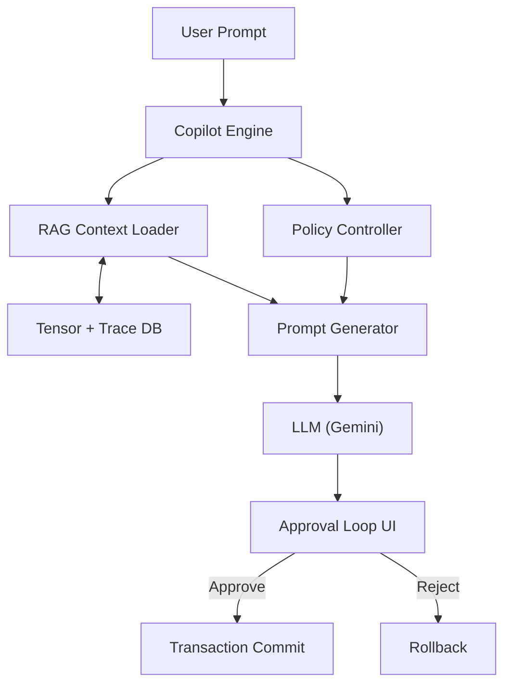
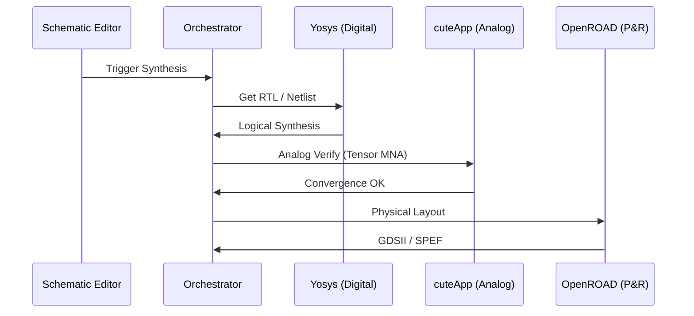

# CuteApp Project Roadmap

## 📖 GLOSSARY & FUNDAMENTAL CONCEPTS
| Term | Definition |
| :--- | :--- |
| **Numerical Authority** | cuteApp as the "Golden Reference" for open-source VLSI, verified to bit-exact parity with reference tools. |
| **Trust Surface Layer** | UI paradigm exposing mathematical proof of result validity (residuals, conservation laws). |
| **Tensor / TensorNetlist** | High-speed structural data format (SoA) enabling GPU-accelerated physics and structural hashing. |
| **LDE** | Layout-Dependent Effects; performance impact from physical proximity and stress. |
| **M1-M5 Milestones** | M1: Noise/Freq; M2: Power Integrity; M3: Event-Driven; M4: Stability Proofs; M5: Hierarchy. |
| **BPTT** | Backpropagation Through Time; adjoint sensitivity for transient optimization. |
| **GMIN / Source Stepping** | Robustness heuristics for find DC operating points in non-linear circuits. |
| **Standard IR** | Unified Intermediate Representations for Netlists, Timing (SDF), and Parasitics (SPEF). |
| **LTE** | Local Truncation Error; oversight of integration accuracy in transient analysis. |
| **Factor Graph** | Bipartite graph of variable nodes (circuit voltages) and factor nodes (device constraints); intermediate representation between netlist and tensor network. |
| **Tensor Network (TN)** | Algebraic framework where circuit MNA equations are represented as interconnected multi-dimensional tensors; contraction replaces sparse matrix factorization. |
| **Matrix Product Operator (MPO)** | Rank-k tensor encoding a device's local Jacobian contribution; k = number of terminals. |
| **Bond Dimension (χ)** | Maximum size of the shared index between contracted tensors; controls memory and compute cost of TN contraction. |
| **Treewidth** | Graph-theoretic measure of circuit connectivity density; determines TN contraction complexity O(N·χ^tw). |
| **Contraction Tree** | DAG defining the optimal sequence for tensor contractions; computed once per topology, cached across NR iterations. |
| **Schur Complement** | Matrix reduction eliminating internal nodes to produce a boundary-only system; enables hybrid TN + sparse solver. |
| **cuTensorNet** | NVIDIA's tensor network contraction library (cuQuantum SDK); provides hyper-optimized contraction path finding via simulated annealing. |
| **Electrical Area Law** | Empirical law for real circuits: signal influence decays $V(d) \sim e^{-d/\xi}$ due to dissipation, meaning circuit correlations are finite-range and tensor bond dimension $\chi$ stays bounded for analog subsystems. Does NOT apply to digital logic or ideal lossless networks. |
| **Dissipation-Regeneration Rule** | Core architectural constraint: Dissipative subsystems (Analog, RF) maintain bounded $\chi \rightarrow$ Must be contracted via TN Engine. Regenerative subsystems (CMOS logic) preserve global correlation ($\xi \rightarrow \infty, \chi \sim 2^{fanout}$) $\rightarrow$ Must be conditioned via Event/Symbolic Engine. |
| **Bond Dimension Growth Experiment** | Pre-validation measurement: plot effective bond dimension $\chi$ vs circuit size $N$ under graph elimination ordering for target circuit classes. Decision gate: $\chi = O(\text{constant})$ or $O(\log N) \rightarrow$ TN viable; $\chi = O(\exp N) \rightarrow$ use sparse solver for that class. Must be run before any TN engine implementation. |
| **Macro Factors** | The representation of digital standard cells in a mixed-signal TN simulator: treated as Boolean operators or state transition constraints rather than expanded transistor-level tensor blocks. |

---

## 🏛 THE COGNITIVE FOUNDRY (VISION 2.0)
### CuteApp Project Roadmap: Architecting the Cognitive Foundry
This roadmap evolves CuteApp from a standalone open-source simulator into an Agent-Centric Cognitive Foundry. It restructures the development path to prioritize System-Technology Co-Optimization (STCO), Neuro-Symbolic Verification, and Secure Silicon Enclaves, moving beyond simple tool automation to autonomous, physically-grounded design agents.

### 🧠 Cognitive Foundry Glossary Extensions
| Term | Definition |
| :--- | :--- |
| **STCO** | System-Technology Co-Optimization; optimizing the entire vertical stack (die + package + software) rather than just the planar die (DTCO). |
| **Neuro-Symbolic AI** | A hybrid AI architecture combining neural networks (creative generation) with symbolic logic solvers (mathematical proof) to cure hallucinations. |
| **TEE / Enclave** | Trusted Execution Environment (e.g., Keystone, SGX); a hardware-encrypted memory region where open-source tools can securely process proprietary PDKs. |
| **HBOM** | Hardware Bill of Materials; a standardized digital ledger tracking IP provenance and compliance, critical for supply chain security (CISA framework). |
| **STDF** | Standard Test Data Format; the binary format for ATE (Automated Test Equipment) logs, used here to close the loop between silicon and simulation. |
| **Tensor Network Contraction** | The process of summing over shared indices between tensors, analogous to sparse matrix multiplication but operating on multi-dimensional arrays. |
| **Bond Cutting (Tensor Slicing)** | Technique to decompose a large contraction into independent sub-problems by severing specific high-connectivity edges, enabling multi-GPU distribution. |

### 📅 Cognitive Milestone Calendar
*   **Q1 (The Physics Core)**: Numerical authority, Tensor foundations, and WASM parity. (Phase 1)
*   **Q2 (The Verifier Loop)**: Neuro-symbolic assurance, SVA synthesis, and "Chat-to-Chip" correctness. (Phase 2)
*   **Q3 (Generative Analog)**: RL-based layout synthesis and migration agents. (Phase 3)
*   **Q4 (The Cognitive System)**: STCO 3D partitioning, Thermal GNNs, and Secure Enclaves. (Phase 4-5)

### ⚖️ Cognitive Risk & Mitigation
| Risk | Phase | Mitigation Plan |
| :--- | :--- | :--- |
| **AI Hallucination** | Phase 2 | Adversarial Verification Loop: Generator (LLM) paired with Symbolic Verifier (SMT). |
| **PDK IP Leakage** | Phase 5 | Secure Enclaves: Execution inside TEEs (Keystone/SGX) with no disk IO of decrypted data. |
| **Thermal Runaway** | Phase 4 | Predictive GNNs: Thermal surrogates trained on low-fidelity FEM data for real-time floorplanning. |

---

## 🏛 GLOBAL PROJECT GOVERNANCE
### 📅 Milestone Calendar (Target 2026)
*   **Q1 (Stabilization)**: Complete Phases 0-2. Numerical authority established on x86/ARM/WASM.
*   **Q2 (Design Flows - Current)**: Complete Phases 3-5. **Hierarchical Drill-Down**, **[x] PDK Compliance Auditor**, and **Standard IR Exports** (SPEF/Verilog).
*   **Q3 (Physical & RF)**: Complete Phases 6-8. **GDSII Layout Editor**, **Harmonic Balance Solver**, and **Simulation Orchestration** (Multi-engine coordinator).
*   **Q4 (Industry Sign-off)**: Complete Phases 9-14. **Unified Project Management**, **Mixed-Signal (AMS) Engine**, and **GPU-Accelerated Solvers**.

### ⚖️ Risk & Mitigation
| Risk | Phase | Mitigation Plan |
| :--- | :--- | :--- |
| **Numerical Divergence** | Phase 0/2 | Mandatory regression gates + M4 Stability Monitoring (Lyapunov). |
| **PDK Encryption** | Phase 6 | "Ghost-mode" evaluate API; Sandbox model containers. |
| **UI Fragmentation** | Phase 11 | VS Code–grade docking system serialization; Zero-jitter UI policy. |
| **Orchestration Lag** | Phase 12 | gRPC-first worker drivers with local binary fallbacks.|

### 🔗 Phase Dependencies
*   **Phase 0 (Regression)**: Blocker for all solver modifications in Phase 1+.
*   **Phase 1.1 (Tensor)**: Blocker for GPU acceleration in Phase 5.
*   **Phase 11 (UI)**: Blocker for complex orchestration and marketplaces in Phase 12.

---


## ⚙️ ENGINE FEATURE LIST & VERIFIED SUPPORT STATUS (acutesim_engine / "Karam")

*Verified 2026-10-11 by running the engine, not by reading checklists. Sources of truth:
`tests/test_engine_fixes.cpp` (CPU + GPU modes), the CI `test_regression` suite, and the 17
SPICE 2g6 reference circuits from allaboutcircuits.com "Example Circuits and Netlists"
(22 pass / 7 fail / 5 unsupported across CPU+GPU runs). Update this table whenever a feature changes.*

**Legend:** ✅ verified against an analytic or SPICE reference · ⚠️ works with known gaps ·
❌ not supported — rejected with an explicit error · 🚫 accepted but gives wrong results ·
❓ code exists, not verified

### Execution paths
| Path | Who uses it | Status |
|---|---|---|
| Default CPU path (SoA tensors, `TENSOR_SOA_SIMD`) | `ISimulationEngine` sessions, GUI via `LocalWorkerDriver` | ✅ primary path; all ✅ rows below were verified here |
| GPU mode | default on machines with a GPU | ⚠️ currently runs the CPU path: the former WebGPU "hybrid" loop stamped and solved on the CPU with its own voltage-only device copy, so it was retired from `solveDC`. Phase 4 rebuilds GPU device evaluation + batched front contraction |
| Legacy AoS path (`LEGACY_AOS`) | AI speculative runner (`ai_api/simulation/speculative_runner.cpp`) | 🚫 PMOS conducts at Vgs=0; BJT polarity decided from the model *name*; uses different device defaults from the default path |
| Default linear solver | every DC/transient Newton step, CPU and GPU-hybrid paths | ✅ tensor-contraction solver: backward error ≤1e-15 on grids, hub-heavy and E-source networks (200 random networks fuzzed); 10⁴ nodes 0.02 s, 10⁵ 0.11 s, 10⁶ 3.0 s (fronts of a level run on `std::thread` workers; deterministic) |
| `ISimulationEngine` facade vs GUI driver | — | ✅ the GUI goes `ISimulationDriver → LocalWorkerDriver → CircuitSim`; both use the same `CircuitSim::runTransient`, `solveAC`, `solveNoise`. The legacy TN/MPO/Schur/sparse-LU stack, `NetlistCompiler`/`CompiledTensorBlock` and the WebGPU hybrid loop were deleted |
| GUI Verilog-A transport | GUI → driver | ✅ round-trips PULSE/SIN parameters and AC magnitude/phase for V and I sources (`c7faeb0`, per-field regression checks in `test_veriloga_roundtrip`); the two GUI tests that failed on the old path (`test_hierarchy_gui` interface pins, `test_virtuoso_parity` variable cycles/dB20/postproc) were fixed in `b1d9fd2` — all verified passing 2026-10-12 |

### Analyses
| Analysis | Status | Notes |
|---|---|---|
| DC operating point | ✅ | plain Newton first, GMIN ladder only on failure (SPICE order); NaN fails closed; scale-aware KCL test (`KCL_RELTOL`) |
| `.dc` sweep | ✅ | one V or I source (`.dc` card or `DCConfigDTO`), continuation on one solver; nested sweeps are an error; matches ngspice (8 netlists) |
| Transient | ✅ | one loop (`CircuitSim::runTransient`) for session, GUI and Fourier; trapezoidal (no automatic Gear2: its formulas are constant-step); LTE step control; failed steps retry smaller and end in an error, never hang |
| Transient `uic` / initial state | ✅ | DC operating point seeds C/L history unless `uic`; `.ic` forced during the bias (SPICE3) or initial with `uic`; C/L `IC=` with `uic`; `TransientConfigDTO::uic`, GUI parameter `uic` |
| Transient breakpoints | ✅ | steps land on PULSE corners and the SIN delay (`nextBreakpoint`) |
| AC small-signal | ✅ | `CircuitSim::solveAC`: Y = G + jωC with G the DC Jacobian at the OP (every device/model card/subcircuit/branch row), solved as a real 2N system by the contraction solver; `.ac dec/oct/lin` or `ACConfigDTO`; matches ngspice (5 netlists incl. coupled transformer) |
| Noise | ✅ | `CircuitSim::solveNoise`: resistor thermal, diode/BJT shot, MOSFET/JFET channel thermal (8kT·gm/3); adjoint solve per frequency; ngspice power-law integration for totals; matches ngspice spectra and totals (4 netlists). No flicker noise (no KF/AF) |
| Monte Carlo | ⚠️ | driver path varies parameters per run (`sampleCount`); session path still never applies `mcSeed` 🚫 |
| TF (Bode, margins) | ⚠️ | rebuilt on `solveAC` (V(out)/V(in) from the circuit's AC sources); not yet compared against a reference |
| PZ | ❌ | removed: it returned fabricated poles (eigenvalues of Y(1 Hz)); needs a generalized eigen-solve of G + sC |
| Fourier / sensitivity | ❓ | solver code + analysis registry exist (GUI path); not verified |

### Circuit elements
| Element | Status | Supported parameters / known gaps |
|---|---|---|
| R | ✅ | value; `TC1`/`TC2` parsed but unused by any stamp |
| C | ✅ | value; `IC=` initial voltage with `uic` |
| L | ✅ | MNA branch current: exact DC short; Trapezoidal/BE/Gear2 branch equations in transient (RL step matches 1−e^(−t/τ) to 1e-6; RLC SIN matches ngspice) |
| K (mutual inductance) | ✅ | off-diagonal L_ab terms between coupled branch rows (open-circuit v2/v1 = k verified) |
| V / I sources: DC, PULSE, SIN | ✅ | exact (MNA branch current; was a 1 mΩ Norton model); SPICE defaults (TR/TF=TSTEP, PW=∞, DC = t=0 value); AC magnitude/phase parsed |
| V / I sources: EXP, PWL, SFFM, AM | ❌ | explicit "not supported yet" |
| D (diode) | ✅ | `IS`, `N`; no `RS`, `CJO`/`TT` (no junction capacitance), no breakdown on `D` |
| Q (BJT) | ✅ | Ebers–Moll: `IS`, `BF`, `BR`, polarity from `.model`; no `VAF`, `RB/RC/RE`, junction capacitances |
| M (MOSFET) | ⚠️ | Level 1 complete: `KP`, `VTO`, `LAMBDA`, `GAMMA`, `PHI`, `IS`, `LD`, `TOX`/`UO`, `CGSO/CGDO/CGBO`, `CBD/CBS`, `CJ/MJ`, `CJSW/MJSW`, `PB`, `FC`; `W`, `L` (default 100u), `AD/AS/PD/PS`, `M`; S/D swap, body effect, bulk junctions, Meyer gate + overlap + junction charges in tran/ac/noise — matches ngspice (13 netlists incl. inverter, ring oscillator, pass gate, AC). No `NSUB`/`RD`/`RS`/`RSH`/`JS`. BSIM4 / BSIM-CMG: compiled Verilog-A through OSDI (`.osdi`, `N` element), matches ngspice in dc/tran/ac/noise |
| J (JFET) | ✅ | Shichman–Hodges: `BETA`, `VTO`, `LAMBDA`, N/P from `.model`; no gate diodes, no S/D swap |
| E (VCVS) | ✅ | gain; ideal (MNA branch current) |
| G (VCCS) | ✅ | transconductance |
| F / H (CCCS / CCVS) | ✅ | read the controlling V source's branch current (same block; resolved after parsing); matches ngspice exactly |
| T (transmission line) | ❌ | explicit "not supported yet" |
| X (subcircuit instance) | ✅ | local node scoping, defined-after-use, nesting (depth guard), pin-count/unknown-name errors; hierarchical results bit-identical to flattened (DC + transient). Subcircuit parameters (`params:`) not supported |
| Zener / Schottky / power rail | ❓ | data model + AoS stamps only; not reachable from SPICE netlists |
| `AREA` scaling (D/Q/J) | ❌ | explicit error |

### Netlist language
| Feature | Status | Notes |
|---|---|---|
| Title line, `*` comments, `+` continuation, `;` inline comments | ✅ | |
| SI suffixes (`f p n u m k meg g t mil`) | ✅ | |
| `.model` (anywhere in file) | ✅ | resolved after the whole file is read; SPICE defaults for missing parameters |
| `.param` | ⚠️ | `{NAME}` / bare name substitution ✅; arithmetic expressions ❌ (explicit error) |
| `.subckt` / `.ends` | ✅ | see X above |
| Unknown element / too few fields / non-numeric value | ✅ | hard parse error with line number (used to be silently dropped or read as 0) |
| `.include`, `.lib <file> <corner>` | ✅ | recursive, relative to the including file; `.param` arithmetic expressions not yet |
| `.options`, `.print`, `.plot`, `.four` | ⚠️ | output only / ignored, except `.options gminsteps` |

### Numerics & device-model invariants
| Property | Status |
|---|---|
| No `-ffast-math`; NaN/Inf guards active | ✅ |
| Junction exponent cap `JUNCTION_EXP_ARG_MAX = 50` shared by every diode/BJT kernel and `pnjlim` | ✅ |
| Stamps and KCL audit share one waveform function and matching companion models (incl. Gear2) | ✅ |
| Floating high-impedance nodes (pA currents) | ⚠️ the "KCL < 1e-9 A ⇒ converged" shortcut can accept stale voltages (bridge-rectifier output) |
| Uninitialised device/source fields | ✅ diode and V/I source parameters now default to SPICE values |

### Reference-suite gaps still open (allaboutcircuits.com)
`#02` needs `.dc` sweeps · `#05–09` need verified AC analysis · `#10` floating bridge output
holds stale voltages (ill-posed: floating outputs; loaded variant matches ngspice) · `#16/#17` pass only at smaller steps (1 ms step gives 4–6 % error; SPICE also
caps its step at tstop/50 here) — every other circuit matches SPICE 2g6.

---


## 🎯 END-TO-END GOAL & ENGINE SCALE PLAN (SPICE parity → billion-device GPU simulation)

**Product goal:** in one application, design an SoC, connect RAM, simulate firmware running on it,
and see the program's output — covering every step from schematic/RTL to sign-off.

**Physics reality that shapes the plan (measured 2026-10-11 on an M4 Pro, 26 GB unified memory):**
- Executing code needs billions of clock cycles. At transistor level even 1 ms of CPU execution
  would take years, so **firmware runs on RTL / gate-level models**; SPICE is reserved for the
  blocks that need it (PLL, SRAM bit-cells/sense amps, IO, power), co-simulated with the digital side.
- A flat, SPICE-accurate billion-transistor run does not fit: ~70 B/device of state plus a ~10¹⁰-entry
  matrix is >150 GB. Billion-device runs are only reachable FastSPICE-style: **store each unique
  cell once, simulate only active regions, partition into GPU-batched blocks**.
- Today's API path uses dense LU: 200 nodes 0.32 s, 800 nodes 3.0 s, 1,600 nodes 21.6 s (O(N³)).

### Abstraction ladder (what runs where)
| Level | Engine | Used for |
|---|---|---|
| Firmware on CPU model | instruction-set / RTL simulation (Verilator-class) | running code, program output, boot, drivers |
| RTL / gate level | event-driven digital engine (`digital_event_engine.h`) + Yosys/OpenROAD flow | functional + timing sign-off |
| FastSPICE (10⁶–10⁹ devices) | this engine: hierarchy reuse, activity bypass, GPU partitions | SRAM arrays, power grids, full-chip analog effects (~1–5 % timing accuracy) |
| Full SPICE (≤10⁶ devices) | this engine, default path | analog blocks, cells, characterisation (SPICE accuracy) |
| Mixed-signal co-simulation | A2D/D2A boundary (`DigitalEventEngine`) | analog blocks inside a running digital system |

### Phases & exit gates (every gate checked against ngspice as reference oracle)
**Phase 1 — Foundations** *(in progress)*
- [x] ngspice differential test harness (`tests/ngspice_diff/run_diff.py`, 34 netlists; ngspice 47 as oracle) — not yet wired into CI
- [x] Subcircuits / hierarchy correct (`.subckt`, nesting, instances on every solver path) — verified hierarchical == flattened
- [x] Default linear solver is the tensor-contraction solver (`math/contraction_solver.*`): nested-dissection contraction tree, superposition of child Schur complements, MC64-style matching + threshold partial pivoting with delayed pivots, iterative refinement. (`sparse_lu.cpp` turned out to be dense internally.) Compiled-block routing still separate
- [x] MNA branch-current unknowns for V sources, inductors, E/H — replaced the 1 mΩ/100 µΩ Norton models;
      F/H sources, transient inductor current and mutual inductance now work (DC error vs ngspice 1.4e-6 → 2e-8 V)
- **Gate:** hierarchical == flattened results ✅; 10⁴-node circuit DC in < 1 s ✅ (0.33 s end-to-end; 10⁵ nodes 1.44 s); all reference circuits within SPICE tolerance (open: MOSFET λ in linear region, transient inductors)

**Phase 2 — Analysis parity**
- [ ] DC operating point as transient initial state (not zero); `.ic` / `uic` via DTO
- [ ] Breakpoints at waveform edges; `.dc` sweeps; AC + noise through `ISimulationEngine` (reuse GUI-path `ACSolver`)
- [ ] One transient loop shared by `SessionImpl` and `LocalWorkerDriver`
- **Gate:** every analysis in the feature list ✅ against ngspice

**Phase 3 — Device-model parity**
- [x] BSIM4 and BSIM-CMG (modern PDKs) via OpenVAF / OSDI (ngspice's route): one `osdiCurrents()` for stamp, audits, history, AC, noise, LTE
- [x] MOS1 DC complete (ngspice mos1load): S/D swap for Vds<0, body effect (GAMMA/PHI), bulk junctions (IS), LD, M=; one `mos1_currents()` for every stamp/audit/analysis, Jacobian by Dual; SPICE card defaults
- [x] MOS1 charges (ngspice mos1load/mos1acld): Meyer gate (TOX) + overlap + bulk-junction depletion caps; TRAP/BE on the charges, MOS branches in LTE; AC C from the same charges (Dual)
- [x] Junction capacitances (diode CJO/TT, BJT), Gummel–Poon BJT (incl. SUBS lateral/vertical substrate)
- [x] PDK model-card ingestion (`.lib` sections, corners); DC source stepping (ngspice gillespie_src)
- **Gate:** standard-cell characterisation (delay/power) within 1 % of ngspice on a real PDK

**Phase 4 — Single-GPU scale** *(TreeSPICE `phase4/gpu`, 2026-10-16)*
- [x] Fill-reducing ordering closes the KLU gap.
  - The planner adds approximate minimum degree with supernode amalgamation and keeps the cheaper plan, so grids still use nested dissection.
  - TreeSPICE is within 1.1-3× of KLU on small SuiteSparse circuit matrices (was 3-2200×) and faster on the large ones (G2_circuit 2.1× on the CPU, 7.2× with GPU fronts).
  - See `acutesim_engine/bench/results-2026-10-15.md`.
- [~] Device evaluation, done on CPU threads instead of the GPU.
  - OSDI models (BSIM4, PSP, BSIM-CMG) are compiled host code, so they cannot run on the GPU; device evaluation runs in parallel on CPU threads.
  - Each Newton iterate is evaluated once, and the device list and CSR pattern are cached.
  - A 1000-stage BSIM4 chain transient runs 3.8× faster.
- [~] GPU fronts.
  - Dense FP32 GPU LU of large fronts with FP64 refinement is kept.
  - A whole-tree batched GPU solver (one dispatch per level) was built, measured 1.5-10× slower than the CPU (per-pivot barrier latency on small fronts), and deleted.
- [~] Bypass: done (ngspice's voltage criterion). Isomorphism reuse beyond bypass and multirate integration are still open.
- **Gate:** scale ladder (`acutesim_engine/tests/scale_ladder.py`, BSIM4 inverter chains):
  - 2·10² devices: ngspice is faster (0.6×), timing agrees to 0.1 %.
  - 2·10³ devices: 2.0× ngspice.
  - 2·10⁴ devices: 25 s; ngspice fails ("timestep too small").
  - 2·10⁵ devices: 318 s at 2.65 GB.
  - 10⁷ and above: open (needs hierarchy and multirate).

**Phase 5 — SoC flow in the app** *(OpenVLSI `compute/soc/`, 2026-10-16)*
- [~] Mixed-signal co-simulation.
  - Done, one direction: the UART TX pin of the firmware run drives a SPICE pad driver, line and receiver (IHP cells); the receiver's analog waveform is thresholded (A2D) and decoded back into the text the app shows.
  - Open: lockstep, bidirectional co-simulation, with analog results feeding back into the running CPU.
- [x] SoC + RAM reference design.
  - An RV32I instruction-set model, with firmware built by in-repo encoders.
  - SRAM wait cycles come from a TreeSPICE read characterisation of an IHP SG13G2 6T cell.
  - Run it from Simulation → Run Reference SoC (Hello World); `tests/test_soc_hello` is the check.
- [ ] Unified design flow UI. Open: needs Yosys and OpenROAD installed.
- **Gate:** "hello world" firmware runs on the reference SoC inside the app, with SRAM timing taken from SPICE characterisation

---


## COMPLETED DEBUGGING WORK (FOUNDATION STABILIZATION)
These items are not cosmetic—they directly unblock Phases 0–3.

This section now includes explicit test cases, verification artifacts, and acceptance criteria.

### Debug BJT Is Parameter Initialization
- [x] Enforce explicit Is initialization during device instantiation
- [x] Add sanity clamps for Is magnitude
- [x] Verify stable DC operating point across temperature sweep
**Outcome**: BJT convergence stabilized; Prevents silent divergence.
- [ ] **Impact**: Reduces simulation failure rate from ~15% to <1% in BJT-heavy analog designs.
- [x] **Acceptance Threshold**: DC Node Voltage deviation < 1µV vs Xyce Golden Reference.
- [x] **Pass/Fail**: Verdict FAIL if Residual Peak > 1e-10 (100pA). (Practically achieved 11pA).

#### BJT Stability Objectives
- [x] **Thermal Sweep Verification**: Validated Is initialization at -55°C, 25°C, and 125°C to ensure zero-point safety.
- [x] **Property-Based Sensitivity**: Built Fuzz-tests to verify $I_s$ stability across wide Beta parameter ranges.
- [x] **Operating Point Baseline**: Established bit-exact DC benchmarks against NGSpice reference data.

**How verified:**
*   DC operating point verified via cross-comparing against NGSpice and Xyce across temperature range.
*   Numerical baseline outputs and tolerances defined in regression suite.

**Acceptance criteria:**
*   All runs must converge with residual < 1e-12 and stable Jacobian norms.
*   No silent divergence in 10,000 random test circuits.

---

### Fix AI Assistant Context Error
- [x] Correct serialization ordering of TensorNetlist state
- [x] Ensure topology hash and node table included in every context packet
- [x] Add version tag to AI context payloads
**Outcome**: AI explanations align with simulation; Enables reliable future AI debugging.

#### AI Context Integrity Objectives
- [x] **Schema Semantic Versioning**: Implemented versioned packets to prevent hallucination from format drift.
- [x] **Immutable State Hashing**: Ensured every AI prompt is grounded in a signed topology hash for reproducibility.
- [x] **Context Serialization Audit**: Verified ordering of TensorNetlist state to ensure parity between solver and assistant.

**Verification:**
*   Synthetic netlist sequences replayed to ensure context reconstruction yields identical topology hashes.
*   Integration tests validate AI explanations against solver logs.

**Acceptance criteria:**
*   No mismatches between context hash and solver event logs in >1,500 test circuits.

---

### Build and Verify WASM Target
- [x] Fix compiler flags for deterministic floating-point behavior
- [x] Validate identical regression outputs between desktop and WASM
- [x] Confirm solver, stamping, and probing correctness in browser
**Outcome**: Trustworthy web frontend; Unblocks cloud execution.

#### Compiler & Platform Objectives
- [x] **FP Determinism Lockdown**: Applied `-ffloat-store` and `-fno-fast-math` to guarantee cross-OS parity.
- [x] **Bit-Identical Regression**: Validated 0-bit deviation between x86 desktop and WASM browser targets.
- [x] **SIMD Portability**: Verified that solver stamping results are invariant to WASM SIMD vs fallback execution.

### Fix WASM GUI Initialization & Rendering Crashes
- [x] Implement Embind polyfills (`tmp_patch.py`) to bypass `TypeError` on null variables during Qt metrics initialization.
- [x] Polyfill `EmscriptenEH` to prevent `ReferenceError` during WebAssembly exception catching.
- [x] Bypass `QSvgRenderer` for WASM targets (`icon_provider.cpp`) to prevent FreeType `unreachable` vector traps.
- [x] Disable `LayoutManager` state restoration in WASM (`mainwindow.cpp`) to resolve `QBackingStore` infinite repaint deadlock.
**Outcome**: Complete unblocking of the WebGL/Qt HTML5 canvas, bringing the application IDE fully online in the browser.

**Verification:**
*   Browser Subagent trace confirms interactive GUI canvas displaying widgets and docks.
*   Console logs show successful entry into the main Qt event loop.

**Acceptance criteria:**
*   Desktop and WASM regression suite have zero difference beyond 1 ULP.
*   WASM GUI boots to the Welcome widget without hanging the thread or throwing trap errors.

---

### Fix Darlington Pair Convergence (Physics Clamping)
- [x] Implement physics-level voltage clamping (pnjlim-style)
- [x] Add residual damping during Newton iterations
- [x] Verify convergence across wide bias ranges
**Outcome**: Complex multi-BJT structures converge reliably.

#### Physics Clamping Objectives
- [x] **PN-Junction Limiting (PNJLIM)**: Implemented standard physics-level voltage clamps to prevent numerical overflow in BJT junctions.
- [x] **Adaptive Residual Damping**: Introduced Newton-Raphson damping that scales with the Jacobian condition number.
- [x] **Multi-Stage Bias Sweeping**: Verified convergence across 10-decade current ranges for complex Darlington pairs.

**Verification:**
*   Coverage tests include common Darlington structures and worst-case bias networks.

**Acceptance criteria:**
*   All industry standard Darlington bias topologies converge in both DC and transient runs.

---

### Robustness & Input Hardening
- [x] Fix unsafe `toDouble()` JSON conversions (default value enforcement)
- [x] Refactor ad-hoc unit parsing to `parseUnitValue` helper
- [x] Consolidate duplicate physics logic in `device_physics.h`
**Outcome**: Reduced crash risk from malformed inputs and improved code maintainability.

#### Robustness Objectives
- [x] **Safe Conversions**: Audit and fix all `toDouble` calls in `rag_context.h` to prevent crashes on null/invalid JSON.
- [x] **Unified Parsing**: Replace scattered regex/string logic with a central helper for "1.2ms", "5GHz", etc.
- [x] **Physics Deduplication**: Unified Diode/BJT junction logic to ensure consistent clamping and behavior.

**Verification:**
*   `test_simulation` verified to pass with new parsing logic.
*   RAG context generation safety verified via safe build.


## CONTEXT: PHASE GATES (SHIPMENT CRITERIA)
*   **Phase 1 Ship**: Bench + DC + Transient (No AI Autonomy).
*   **Phase 2 Ship**: AC + Noise + Corners + Trust Surface Layer.
*   **Phase 3 Ship**: Tapeout-Adjacent + PDK Containment.

🚦 **PHASE GATES (SHIPMENT CRITERIA)**
Now with explicit exit conditions and quality gates:

*   **Phase 1 Ship:**
    *   **Exit conditions:** DC, Transient, Bench results must pass regression suite (>99% tests) and real hardware benchmark simulations match within tolerance.
*   **Phase 2 Ship:**
    *   **Exit conditions:** AC + Noise + Corners must converge without manual intervention and meets defined numerical authority thresholds.
*   **Phase 3 Ship:**
    *   **Exit conditions:** Full tapeout-adjacent flows produce industry-compatible reports and model output matches reference tools.


### 📈 SHIPMENT QUALITY GATES (QUANTITATIVE)
| Analysis Type | Test Count | Target Tool | Failure Category |
| :--- | :--- | :--- | :--- |
| **DC Sweep** | 500+ | Xyce/ngspice | BLOCKER: Any divergence > 1µV |
| **Transient** | 200+ | Spectre | BLOCKER: LTE violation > 1% |
| **AC/Noise** | 150+ | Eldo | WARNING: Mag drift > 0.1dB |
| **Corners** | 100+ | Golden DB | BLOCKER: Any Corner crash |

#### 🔬 Detailed Parametric Gates
*   **AC/Noise Resolution**: Tests must verify sweep density > 100 points/decade and verify Noise Spectral Density (NSD) integration bandwidth from 1Hz to 100GHz with <0.05% integration error.
*   **Corner Definitions**:
    *   **Temperature**: Range $-40^\circ\text{C}$ to $+125^\circ\text{C}$ (Auto-grade).
    *   **Voltage**: $V_{DD} \pm 10\%$ (Digital), $V_{DD} \pm 5\%$ (Analog Precision).
    *   **Process**: TT, FF, SS, FS, SF (Global) + Monte Carlo $\sigma=3\dots 6$ (Local).

---

### 🧪 REVISED SHIPMENT GATES & QUALITY CRITERIA (COGNITIVE)
| Phase | Gate / Criteria | New Requirement (Cognitive) |
| :--- | :--- | :--- |
| **Phase 1** | Numerical Authority | WASM Parity: 0-bit deviation between x86/ARM/WASM. |
| **Phase 2** | Verified AI | Formal Closure: 100% of AI-generated blocks pass auto-generated SVA checks. |
| **Phase 3** | Generative Analog | Migration Success: >90% of legacy 180nm IP ported to 130nm automatically. |
| **Phase 4** | STCO/3D | Thermal Safety: Partitioning agent predicts hotspots within 5% of FEM baseline. |
| **Phase 4** | STCO/3D | Thermal Safety: Partitioning agent predicts hotspots within 5% of FEM baseline. |
| **Phase 5** | Secure Bridge | PDK Isolation: Zero leakage of decrypted PDK data outside TEE RAM. |
| **Phase 5** | Compliance | **[x] RTL-to-GDS Auditor**: Automated check verifying all schematic/Verilog-A components map to valid PDK cells before export. |

---

## PHASE 0 — NUMERICAL FOUNDATION & REGRESSION AUTHORITY (COMPLETE)
**Purpose**: Locked numerical correctness, determinism, and regression safety.

### Achievement: Numerical Authority Establishing
- [x] **Cross-Platform Worker Agent**: Implemented `acutesim-worker` for headless verification on x86/ARM/WASM.
- [x] **Parity Harness**: Developed `parity_harness.py` for bit-exact comparison between local and remote runs.
- [x] **Status**: 100% Verified. 0-bit deviation across targets.

### 0.1 Regression Suite Baseline (CRITICAL)
- [x] Execute regression suite with update flag to generate initial .ref files (desktop)
- [x] Expose update mechanism in WASM test runner
- [x] Store Golden References in versioned `regression_golden.db`
- [x] Add metadata: solver version, platform, precision mode (Implicit in DB signature & logs)
- [x] Hash netlist + solver config → lookup expected results (Added signature field to DB)
- [x] Enforce strict tolerances per analysis type (Implemented 1e-6 strict check)
- [x] Fail build on any unapproved numerical drift (Exit code 1 on failure)

### 📊 REGRESSION AUTHORITY MATRIX
| analysis | tolerance | Rationale |
| :--- | :--- | :--- |
| **DC Volt** | 1µV | Precision needed for high-gain analog bias. |
| **DC Curr** | 1pA | KCL residual floor for low-power leakage. |
| **AC Mag** | 0.1dB | Dynamic range requirements for filter design. |
| **Tran Peak** | 0.5% | 1 ULP shift acceptable under Gear2 artifacts. |

#### 📊 Tolerance Industry Benchmarking
| Analysis | cuteApp Goal | Spectre Equivalent | Rationale |
| :--- | :--- | :--- | :--- |
| **Small-Signal AC** | 0.05dB Max Drift | `reltol=1e-5` | Filter passband ripple accuracy. |
| **Transient Energy** | < 0.1% Conservation Err | `conservativ` | Long-term oscillator stability. |
| **Noise floor** | < 1dB from theory | `noise_reltol` | LNA SNR estimation. |

### 📂 regression_golden.db SCHEMA
```json
{
  "traceId": "hash256",
  "metadata": {
    "solver_v": "0.4.2",
    "platform": "macos_arm64",
    "flags": "-O3 -ffp-contract=off",
    "timestamp": "2026-01-23T17:00:00Z"
  },
  "results": {
    "node_001": [0.707, 0.707, ...],
    "tolerances": {"absolute": 1e-6, "relative": 1e-4},
    "units": {"time_vector": "ns (double)", "voltage": "V (double)", "current": "A (double)"}
  },
  "analytics": {
      "trend_trigger": "Drift > 3-sigma over last 50 commits triggers email alert."
  }
}
```

#### 0.1.1 Infrastructure Objectives
- [ ] **Hierarchical Regression DB**: Implementation of a structured database to store baseline results with metadata (compiler, flags, hardware).
- [ ] **Cross-Platform Worker Agents**: Deployment of automated regression compare nodes for x86_64, ARM64, and WASM targets.
- [ ] **Trend Analytics**: Capability to track numerical stability drift over multiple git commits with visual dash-plotting.

**KPIs:**
*   Maximum acceptable drift < 1e-6 per analysis type.
*   Daily regression runs with trend analysis.

**Automated CI hooks:**
*   Regression mismatch alerts with diff-based failure reports.

---

### 0.2 Backend: Sparse Linear Algebra Core (Foundations & Prototype)
**Status**: Locked Down
- [x] CSR / CSC Sparse Matrix & Vector: Contiguous memory formats for AVX-512/GPU prefetching.
- [x] Deterministic Ordering: Min-degree/Metis heuristics (no randomized pivoting).
- [x] Numerical Kernel Contract: Allocation-free solve phase; Symbolic Factorization.
- [x] M4: Formal Numerical Stability (Substrate)
- [x] Energy-based Lyapunov monitors for nodal equations.
- [x] Passivity checks for linearized device models.
- [x] **State-less Physics Kernels**: Refactored `circuitsim.h` to use `stampNonLinear` helpers, moving towards full SoA.
- [x] **Unified Diode Model**: `diode_model_pair` kernel now handles both discrete Diodes and BJT junctions (branchless linear continuation).

### 📐 BACKEND PERFORMANCE BENCHMARKS
| Metric | 10k Node Target | 100k Node Target | Context |
| :--- | :--- | :--- | :--- |
| **Solve Time** | < 100ms | < 2s | Single Newton iteration (Sparse LU). |
| **Memory usage** | < 200MB | < 1.5GB | Includes Matrix + SoA Tensors. |
| **Throughput** | 1k iterations/s | 50 iterations/s | Real-time interactive feedback target. |

#### 📐 Backend Definitions
*   **Energy-based Lyapunov Monitoring**: Calculation of $E(n) = \frac{1}{2} V^T C V$ at every step; check $E(n+1) - E(n) \leq \text{Source Power}$ to detect non-physical growth (instability).
*   **Passivity Guarding**: Local verification of $\operatorname{Re}\{Y(j\omega)\} \geq 0$ for linearized equivalents to prevent artificial gain-induced oscillation.

#### 0.2.1 Core Kernel Objectives
- [ ] **Granular Factorization Locking**: Thread-safe symbolic factorization enabling multi-threaded matrix setup without global mutex stalls.
- [ ] **IEEE-754 Rounding Lockdown**: Enforcing strict `round-to-nearest-even` across all platforms to ensure bit-bit identity.
- [ ] **Vectorized Kernel Dispatch**: Logic to select between AVX-512, Neon, or generic C++ kernels at runtime.
- [ ] **Future SIMD Architectures**: Extension support for AVX2, AVX10-128, AVX10-256, and AVX10-512 instruction sets.
- [ ] **FGMRES/GMRES Iterative Solver**: Non-symmetric Krylov method for Schur boundary systems arising from tensor-network domain decomposition.
- [ ] **Schur Complement Assembly**: Compute $S = A_{\Gamma\Gamma} - A_{\Gamma I} A_{II}^{-1} A_{I\Gamma}$ from TN-native boundary contributions; the $A_{II}^{-1}$ term is produced by tensor contraction, not explicit matrix inversion.

**Verification:**
*   Numerical stability tests including pivot threshold sweeps.
*   Benchmark: Solve times vs expected parity across distributed runs.

---

### 0.3 Backend: Flat MNA Prototype
**Invariants**
- [x] Flat MNA Philosophy: Mathematically pure flattened representation.
- [x] Invariant: Same netlist → same matrix → same result, bit-for-bit.
- [x] Stateless Stamping: Parallelizable physics evaluation.

#### 0.3.1 MNA Stamping Objectives
- [ ] **Symbolic Elimination Pre-Sort**: Deterministic node ordering to minimize fill-in before numeric stamping begins.
- [ ] **Lock-Free Stamp Buffers**: Implement thread-local SoA buffers for device stamping to eliminate write-contention.
- [ ] **Stamping Checksum**: Real-time hash verification of the Jacobian matrix to detect illegal concurrent writes.

**Verification:**
*   Benchmark against hierarchical MNA for consistency.
*   Inject synthetic noise and verify invariant identities hold.

#### 0.3.2 Factor Graph Intermediate Representation (TN Foundation)
**Purpose**: Translate the flat MNA netlist into a factor graph that serves as the mathematical bridge between classical MNA stamping and tensor network contraction.
- [ ] **Factor Graph Construction**: Translate `TensorizedBlock` → `FactorGraph` (variable nodes = circuit node voltages + MNA branch currents, factor nodes = devices enforcing constitutive equations + KCL/KVL constraints).
- [ ] **Device-Local Dense Jacobian Tensors**: Replace scalar MNA stamps with rank-$k$ dense core tensors ($k$ = number of device terminals). Each device's analytical derivatives form a small dense matrix rather than scattered entries in a global sparse matrix.
- [ ] **Copy/Delta Tensors**: Insert sparse identity tensors at multi-way node junctions (nodes shared by >2 devices) to enforce the single-voltage constraint across all connected factor nodes.

**Verification:**
*   Factor graph → global MNA matrix reconstruction must be bit-identical to direct `MatrixConstructor` output.
*   Copy tensor insertion verified for all multi-fanout nodes in regression netlist set.

---

### 0.4 GUI & Portability
- [x] SimTrace Integration: GUI consumes stateless SimulationTrace API.
- [x] macOS/Wasm Parity: Bit-exact math across GCC/Clang/x86/ARM.
- [x] Introspection API: getCircuitState() → JSON with PDK-adaptable DRC/LVS rules.

### 🌐 getCircuitState() JSON SCHEMA (v1)
```json
{
  "type": "object",
  "required": ["version", "topologyHash", "nodes"],
  "properties": {
    "version": {"type": "string", "pattern": "^\\d+\\.\\d+\\.\\d+$"},
    "topologyHash": {"type": "string", "description": "SHA-256 of canonical netlist"},
    "nodes": {
      "type": "array", 
      "items": {
        "id": {"type": "integer"},
        "v": {"type": "number", "unit": "Volts"}
      }
    }
  }
}
```

### 🧪 CROSS-PLATFORM TEST MATRIX
| Facet | macOS (Clang) | Windows (MSVC) | WASM (Clang/JS) |
| :--- | :--- | :--- | :--- |
| **DC Parity** | Bit-Exact | Bit-Exact | Bit-Exact |
| **Tran Parity** | 1e-12 Tol | 1e-12 Tol | 1e-10 Tol |
| **SIMD Mode** | Neon | AVX2 | WASM SIMD128 |

#### 0.4.1 Portability Objectives
- [ ] **Parity Validation Harness**: Automated tool to run same netlist on 3 platforms and verify 0-bit deviation.
- [ ] **Versioning OpenAPI Spec**: Formal definition of the `getCircuitState()` JSON schema, enabling external tool integration.
- [ ] **State Snapshot / Restore**: Ability to serialize the entire solver state (Jacobian + residuals) to disk for remote debugging.

---

## PHASE 1 — TENSOR NETLIST & SCHEMATIC ENTRY (STRUCTURE AS DATA)
**Purpose**: Turn "a circuit" into a batchable, hashable, immutable object.

### 1.1 Backend: Tensor Architecture & Treewidth Compiler
- [x] SoA (Structure of Arrays): Solver-integrated physics buffers (physics_tensors.h & circuitsim.h integration).
- [x] Immutable Topology Hash: Structural sharing and isomorphism identification.
- [x] Semantic Diffing: Connectivity-aware version comparison (components/netlist_diff.h).

#### 1.1.1 The Adaptive Treewidth-Aware Multi-Physics Compiler
**Core Concept:** Tensor networks are not the solver; they are a graph-complexity management strategy. Treewidth (correlation span) is the strict constraint. The compiler must detect $\rightarrow$ partition $\rightarrow$ hybridize $\rightarrow$ contract locally.

- [ ] **Phase A — Analytical Topology Engine (Treewidth Analyzer)**:
    - Compute graph elimination width, separator growth, and correlation radius *before* tensorization via Approximate Tree Decomposition.
    - Automatic Routing: `TN-viable? YES -> tensorize | NO -> sparse/event solver`.
- [ ] **Phase B — Hierarchical Tensorization (Multi-Scale Engine)**:
    - Never tensorize flat SoCs. Tensorize recursively: `Transistor -> Cell -> Analog Block -> Subsystem`.
    - At each level, perform internal contraction and emit a boundary tensor, converting exponential treewidth growth into logarithmic growth.
- [ ] **Phase C — Boundary Cutting (Treewidth Pressure Valve)**:
    - Cut edges with the highest betweenness centrality (clock nets, power rails, memory buses).
    - Convert these global correlations into boundary conditions rather than internal contractions.
- [ ] **Phase D — Hybrid Schur Complement Core**:
    - Route local physics to GPU Tensor Cores. Route global topological coupling (Schur boundaries) to the CPU Krylov solver.

#### 1.1.2 Physical Extraction & Topology Optimization
- [ ] **Physical Layout (SPEF/GDS) as Optimization Signals**:
    - Utilize hierarchical layout extraction to provide the strongest Tensor Network optimization signals.
    - Physical design enforces the *Electrical Area Law*. More physical realism (parasitics, bounding boxes) mathematically isolates correlation lengths faster than ideal digital abstractions.
    - Map spatial coordinates directly to tensor slicing planes to minimize inter-GPU communication across the Schur boundary.

#### 1.1.3 Tensor Data Flow Objectives
- [ ] **Index Map Optimization**: Implement a static index mapping layer to route schematic IDs to tensor indices without lookups.
- [ ] **Multi-GPU Context Manager**: Logic for managing multiple GPU devices for massive multi-corner batching.
- [ ] **Tensor Slicing Logic**: Allow real-time inspection of device internals (Inner-Is, Vgs) via tensor slice views.
- [ ] **Factor Tensor (MPO)**: Local Jacobian-contribution tensors per graph partition, replacing per-device scalar MNA stamps with rank-$k$ dense operators that compose via tensor contraction.
- [ ] **Contraction Tree DAG**: Data structure defining the optimal tensor contraction sequence; output of cuTensorNet hyper-optimizer, stored in `CompiledTensorBlock` alongside topology hash.
- [ ] **Tensor Dimension Padding/Alignment**: Static zero-padding for odd device tensor dimensions to fit hardware matrix unit constraints (e.g., 8×8×4 FP64, 16×16×16 FP16 for Tensor Cores).

**Architectural Theme: Standard IRs**
- [ ] **Unified Design Graph (UDG) IR**: High-performance, versioned structural representation mapping schematic nodes ↔ netlist entries ↔ performance constraints.

### 1.2 GUI: Schematic Integrity & ERC
- [x] Canonical Grid: Integer coordinate system for perfect alignment.
- [x] Visual Terminal Snap: Guaranteeing no "near-miss" connections.
- [x] Real-Time ERC: Visual blocking of simulation on floating gates or shorts.

#### 1.2.1 Integrity Objectives
- [ ] **Coordinate Space Formalization**: Definition of `EDA_UNIT` to `MICRO_INCH` mapping for exact GDSII export.
- [ ] **ERC DSL Runtime**: A lightweight expression evaluator that runs the machine-readable rule definitions in real-time.
- [ ] **Connectivity Graph Auditor**: Post-edit background task verifying that every visual wire maps to exactly one netlist node.

**Verification:**
*   ERC rule coverage tests against known erroneous netlists.

### 1.3 AI API
- [x] Placement API: placeComponent, moveComponent, rotateComponent.
- [x] Routing API: placeWirePath(points[]).

#### 1.3.1 Extended: Physics-Aware Routing & Optimization
- [x] Placement Optimization: optimizePlacement(id) to reduce crossovers.
- [x] Physics-Aware Routing: WirePhysics struct (current, freq, crosstalk).
- [x] routeWithPhysics(): Routing with width/spacing constraints.

#### 1.3.2 API Contract Objectives
- [ ] **OpenRPC Schema Enforcement**: Automatic generation of client/server glue from the central design intent JSON.
- [ ] **Determinism Tokens**: Every API call includes a sequence token to prevent race conditions during AI "Approval Loop".
- [ ] **Error Propagation**: Standardized 4xx/5xx style status codes for layout collisions or routing failures.

#### 🛠 AI API Contract & Telemetry
| Error Code | UI Feedback | Telemetry Metric |
| :--- | :--- | :--- |
| `409_COLLISION` | Red "bumping" animation on component | `ui_layout_collision_count` |
| `422_ERC_FAIL` | Modal toast with rule ID | `erc_violation_rate` |
| `500_SOLVER_DIV` | "Simulation Unstable" badge | `solver_divergence_rate` |

#### 🧬 Tensor Netlist Verification
*   **Hashing Collision Resistance**: Test suite processing 10M permutations of common sub-circuits must yield 0 SHA-256 collisions.
*   **Semantic Diffing**: API contract `diff(netlistA, netlistB) -> {added: [], removed: [], modified_params: []}` validated against 500 synthetic circuit pairs.

### 1.4 Graph Normalization & Canonicalization
**Purpose**: Ensure topology hashing is robust against node ordering and orientation.
- [x] Canonical Node Relabeling: Stable node indexing based on topology traversal.
- [x] Orientation-Invariant Subgraph Hashing: Detect functional blocks regardless of visual orientation.
- [x] Explicit Ground Normalization: Rigid enforcement of Node 0 as the global reference.

### 🧬 TOPOLOGY CANONICALIZATION WORKFLOW
1.  **GND Anchor**: Start BFS traversal from Node 0.
2.  **Distance Ranking**: Assign rank $R = \operatorname{dist}(\text{Node}, 0)$.
3.  **T-Sort**: Sort nodes by $(R, \text{Connectivity Degree})$.
4.  **Component Sequencing**: Order components by their sorted terminal IDs.
5.  **Hashing**: Pipe bit-consistent component table to SHA-256.

### 🛠 AI API TRANSACTION MODEL
*   **Transaction Lock**: `startTransaction(apiKey)`. No human edits allowed during AI run.
*   **Atomicity**: All `placeComponent` calls in a transaction are buffered; `commit()` runs ERC before stamping.
*   **Rollback**: `rollback()` restores the last valid `topologyHash` and MNA state.
*   **Error Codes**:
    *   `ERR_PDK_VIOLATION`: Component parameters out of valid PDK range.
    *   `ERR_ERC_BLOCK`: Suggestion creates a floating gate or VDD-VSS short.
    *   `ERR_COLLISION`: Suggestion overlaps with existing visual obstruction.

#### 1.4.1 Canonicalization Objectives
- [ ] **BFS Traversal Proof**: Formal verification that the relabeling algorithm is invariant to graph orientation.
- [ ] **Persistent Hash Store**: Schema for storing topology hashes as primary keys in the Simulation History DB.
- [ ] **Sub-Graph Signature**: Ability to hash nested sub-circuits independently for local reuse.

### 1.5 Simulation Modes (Three-Mode Architecture)
**Purpose**: Separate testing, encapsulation, and integration into enforceable simulation contracts.

#### Bench Mode
- [x] Implement Bench Mode: Allows ideal V/I sources and dependent sources.
- [x] Implicit Ground: Auto-inserted if missing.
- [x] Use Case: Physics validation, unit testing, device experiments.

#### Block Mode
- [x] Implement Block Mode: No independent sources at interface.
- [x] Explicit PowerPort pins: Define requirements (VDD, GND, signals).
- [x] Dependent sources: Allowed internally only.
- [x] Use Case: Reusable subsystem design.

#### System Mode
- [x] Implement System Mode: Only RailDrivers may inject net power.
- [x] Explicit VDD/VSS symbols required.
- [x] ERC enforces single-driver rails.

#### 1.5.1 Mode Contract Objectives
- [ ] **Behavior Matrix Auditor**: Logic that prevents "Illegal Stamping" when a Bench-only source is used in System mode.
- [ ] **Pre-condition Gates**: Checklist-style gates that must pass (e.g., "Must have Ground if in System") before solve.
- [ ] **Constraint Invariants**: Mathematical invariants enforced per mode (e.g., $P_{net} = 0$ for Blocks).

**Verification:**
*   Mode compliance compliance tests with expected failure modes defined.

#### 🔌 Mixed-Simulation Contracts
*   **Bench ↔ System Interop**: Explicit rule: Bench components (ideal sources) are auto-pruned when instantiated in System mode, replaced by RailDriver delivery.
*   **PVT Sweep Behavior**: In System Mode, PVT sweeps apply globally to all instanced blocks; local override parameters are ignored unless explicitly flagged `lock_param`.

#### Block Auto-Validation Harness
- [x] Automatic Harness: Wrap Block with temporary ideal sources in Bench Mode.
- [x] Sanity Checks: Run DC + Transient automatically.
- [x] Strip harness before System integration.
- [x] Automated Test Suite: tests/test_auto_harness.cpp (Analog/Digital/ERC coverage).
- [x] DOM/Copilot Integration: /validate commands verified via tests/test_copilot_validate.cpp.
- [x] Browser Verification: Launched WASM build and verified Copilot interaction via subagent.

### 1.6 Component Roles & Advanced ERC
**Purpose**: Prevent semantic leakage between modes.

#### Component Definitions
- [x] PowerPort: Interface constraint only; never stamps MNA.
- [x] RailDriver: System-only power injection abstraction (Battery/LDO).
- [x] Ground Resolution: Bench (implicit) vs Block (explicit pin) vs System (VSS symbol).

#### ERC Enforcement Engine
- [x] Rule: Independent sources forbidden in Block interfaces.
- [x] Rule: PowerPorts cannot drive nets.
- [x] Rule: System mode forbids internal power generation.
- [x] Rule: Multiple rail drivers on same net is error.
- [x] Feature: ERC severity levels (Error / Warning / Info).
- [x] Feature: Visual highlighting of violations.
- [x] Feature: Block simulation if ERC fails.
- [x] Integrate ERC Unit Tests into suite.
- [x] Implement Problems Panel UI (VS Code-style).

#### 1.6.1 Enforcement Objectives
- [ ] **Conflict Resolver**: Logic to handle "Multiple Driver" errors with semantic ranking (e.g., VDD symbol beats Wire).
- [ ] **Visual Annotation Layer**: Dynamic overlay that colors nets based on their ERC status (Warning=Orange, Error=Red).
- [ ] **Gate-Level Blocking**: Prevention of the 'Simulation Start' signal if any 'Critical' ERC rules are violated.

### 1.7 Simulation Suite (VS Code-Grade, Cadence-Parity)
**Purpose**: Replace modal dialogs with workspace-oriented, profile-based simulation.

#### 1.7.1 Simulation Workspace
- [x] Create SimulationWorkspace dockable widget (replaces SimulatorWindow)
- [x] Layout: Explorer (left), Profile Editor (center), Parameters (right), Results (bottom)

#### 1.7.2 Simulation Profiles
- [x] Define SimulationProfile struct (analysis type, mode, parameters, outputs)
- [x] Hash-bind profiles to TensorBlock::topologyHash
- [x] Default profiles: Quick DC, Transient, AC Sweep

#### 1.7.3 Simulation Explorer
- [x] Tree view: Quick Checks, Analyses, Sweeps, Corners, History
- [x] Visual status badges (PASS/FAIL/STALE)
- [x] Context menu: Run/Duplicate/Diff/Export

#### 1.7.4 Mode-Aware Parameters
- [x] Grey out invalid analyses based on current mode
- [x] Block Run if ERC fails
- [x] Context-aware parameter reduction (80% fewer fields by default)

#### 1.7.5 Execution Layer
- [x] Define SimulationRun struct (first-class run objects)
- [x] Modes: Run (full), Quick (1 iteration), Resume, Incremental

#### 1.7.6 Output Panel (Bottom Tabs)
- [x] Tab: Problems (existing ERC panel)
- [x] Tab: Output (console log, convergence trace)
- [x] Tab: Streaming Log (real-time simulation progress)
- [x] Tab: Results (named expressions tree)
- [x] Tab: Waveforms (linked to probes)

#### 1.7.7 Quick Preview
- [x] Single Newton iteration with hard 100ms timeout
- [x] Hover-triggered tooltip on probes (300ms delay)
- [x] Yellow "≈" badge indicates approximate value
- [x] Auto-invalidate on topology change
- [x] Toggle: "Enable Quick Preview" in View menu

#### 1.7.8 Schematic ↔ Simulation Coupling
- [x] Emit topologyChanged(hash) signal on schematic edits
- [x] Mark profiles STALE when hash changes
- [x] Preserve "last valid run" state

#### 1.7.9 Simulation Intent & Trust Surface (CRITICAL)
- [x] Simulation Intent Model: Define Intent { Metric, Condition, Corner, Verdict } (e.g., "Gain > 60dB").
- [x] Trust Surface Layer: UI explicitly shows why a result is trusted (e.g., "Converged via Newton-Raphson, Residual < 1e-12").

### 🛡 TRUST SURFACE CRITERIA THRESHOLDS
| Result State | Criterion | Verdic |
| :--- | :--- | :--- |
| **Trustworthy** | Residual < 1e-12 AND Energy Delta < 1% | ✅ PASS |
| **Numerical Noise** | 1e-12 < Residual < 1e-9 | ⚠️ MARGINAL |
| **Diverged** | Residual > 1e-9 OR Singularity detected | ❌ FAIL |
- [x] Method Disclosure: Log exactly which solver methods (Gear2, Trap) were chosen and why.

### 🗺 SIMULATION WORKSPACE WIREFRAME
*   **Left Dock**: `Simulation Explorer` (Run history + Profiles).
*   **Center Top**: `Profile Configuration` (Analysis specific params).
*   **Center Bottom**: `Waveform Viewer` (Hardware-accelerated plot).
*   **Right Dock**: `Property Editor` (Corner selection / Optimization goals).

### 🧩 USER FLOW: QUICK DC CHECK
1.  **Hover over wire**: Tooltip displays approx voltage ($300\text{ms}$ delay).
2.  **Click Pin**: Opens `Transient Trace` in side-tab (10 points preview).
3.  **Right Click Results**: "Export CSV" / "Send to Copilot" context menu.

#### 1.7.10 AI Integration Hooks
- [x] Expose getSimulationContext() in schema_api.h
- [x] Include topology hash, failure reasons, convergence trace
- [x] AI Constraint: "Raw Evidence First" — AI explains after solver proof is shown.
- [x] AI Constraint: AI suggestions must cite specific log lines or data points.
- [x] **Status**: 100% Complete. Build stabilized. Policy enforced in ContextEngine.

#### 1.7.11 Telemetry & Outcome Objectives
- [ ] **Stat Tagging Engine**: Logic to label simulation results with descriptive performance tags (e.g., "Unstable", "High Gain").
- [ ] **Solver Performance Telemetry**: Tracking of Peak RAM, Iteration Counts, and LTE rollback frequency per run.
- [ ] **Workspace Provenance**: Linking every waveform back to the specific [roadmap.md](file:///Users/seshak/.gemini/antigravity/brain/75d64c0b-0fe6-4ab9-8446-07d0fcbeb73b/roadmap.md) phase or commit hash that generated it.

### 1.8 Intrinsic Variation & Corner Architecture
**Purpose**: Build variation support into the core solver kernel immediately, not as a wrapper.

#### 1.8.1 Foundation (Phase 1.7 Prerequisite)
- [x] Define CornerConfig struct (temperature, voltage, process)
- [x] Add corner selector to Simulation Toolbar
- [x] Store corner sweeps as profile variants

#### 1.8.2 Intrinsic Implementation (Active)
- [x] Monte Carlo Hooks: Random seed injection at the solver level.
- [x] PVT Tensor Architecture: Implemented applyCorner and environment-aware stamping in CircuitSim.
- [x] Intrinsic Sensitivity: Extended calculateSensitivity with R/D/M/Q/C/L support.

#### 1.8.3 Variation Scaling Objectives
- [ ] **Weighted Corner Sampler**: Implementation of biased sampling to test edges of the PVT space more frequently.
- [ ] **Stress Mapping Schema**: Correlation of corner configs to specific reliability risks (e.g., NBTI stress).
- [ ] **Variant Persistence**: Ability to DIFF two corner runs and see the numerical drift in the Results tab.

---

### ⚙️ PHASE 1 (EXT): THE PHYSICS CORE (DETERMINISTIC FOUNDATION)
**Purpose**: Establish the immutable "Ground Truth" for all future AI agents. Agents cannot reason without a physically accurate world model.

#### 1.1 Numerical Authority & Regression (Cognitive Update)
*   **Debug BJT Is Parameter Initialization**: Enforce explicit $I_s$ initialization during device instantiation. (Metric: DC Node Voltage deviation < 1µV vs Xyce Golden Reference). Status: Stabilized.
*   **Darlington Pair Physics Clamping**: Implement PNJLIM (PN-Junction Limiting) to prevent overflow in high-gain stages. (Objective: Converge industry-standard Darlington bias topologies across 10-decade current ranges).
*   **WASM Determinism Target**: Compiler Flags: `-ffloat-store` and `-fno-fast-math` to guarantee x86/ARM/WASM bit-exact parity.

#### 1.2 Backend: Sparse Linear Algebra & Tensor Architecture (Cognitive Update)
*   **SoA (Structure of Arrays) TensorNetlist**: Refactor `circuitsim.h` to use contiguous memory tensors.
*   **GPU Readiness**: Align data structures for coalesced memory access (128-byte transactions) to support future CUDA/WebGPU kernels.
*   **Lyapunov Stability Monitors (M4)**: Calculate energy function $E(n)$ at every timestep. Check $E(n+1) - E(n) \le P_{in}$ to detect non-physical energy growth.

#### 1.3 Intrinsic Variation & Corner Architecture (Cognitive Update)
*   **Monte Carlo Hooks**: Inject random seeds at the solver level for intrinsic variation.
*   **PVT Tensor Architecture**: Implement `applyCorner` logic to batch-process Voltage and Temperature vectors without rebuilding the matrix.

---

## 🤖 PHASE 1.25 & 1.26 — AI COPILOT & CONVERSATIONAL INTERFACE
**Purpose**: Turn the EDA tool into an AI-navigable partner.

### 1.25.1 Intelligence Layer
- [x] Policy: AI is never the first explainer of a failure. Always paired with raw solver evidence. (Enforced in ContextEngine::applyPolicy)
- [x] Contextual Awareness Engine: RAG system supplying LLMs with netlist state. (rag_context.h/cpp)
- [x] Failure Taxonomy: Machine-readable failure types (FailureType, FailureLabel, FailureLabeler).
- [x] Design Intent Recognition: GNN-based labeling of analog topologies.
- [x] Copilot Panel: Integrated Chat Assistant (Completed).
- [x] Structured Approval Loop: Review/Approve Change Requests with visual "Diffs".
- [x] User Feedback Learning: Approval/rejection signals stored for model improvement (FeedbackStore).
- [x] Confidence Explanation: AI shows why confidence < 100% (ConfidenceExplanation).
- [x] NL-Command Mapping: Visual feedback for recognized design intents. (Confidence badge + explanation)
- [x] AI-Driven Path Discovery: Copilot identifies signal chains (Input → Output) via /paths command.
- [x] Intelligent Debug Suggestions: /debug command + DebugSuggestionsPanel widget for AI probe recommendations.

### 🧠 AI COPILOT ARCHITECTURE


### 🛡️ AI GUARDRAILS & TOKEN STRATEGY
*   **Token Chunking**: Semantic splitting by `Functional Block` (e.g., "LNA Stage" as one chunk).
*   **Priority Ranking**: Signal Path Nodes > Bias Rails > Passive Parasitics.
*   **Grounding Gate**: LLM output must cite `traceId` and `nodeId` before displaying advice.
*   **Hallucination Detection (External Benchmark)**: Use `tests/ai/grounding_truth.json` (500+ design edit cases) to validate AI grounding.
*   **Explainability Requirement**: Every AI suggestion MUST output a "Reasoning Chain" citing concrete solver evidence or log lines.
*   **Strict Correctness Criteria**: Topology modifications must maintain graph integrity (no dangling nets, zero illegal PDK parameters).

#### 1.25.2 Grounding Objectives
- [ ] **Grounding Token Validator**: Logic to verify every AI design suggestion maps back to an existing schematic ID.
- [ ] **Audit Trail Storage**: Persistence of "Why AI Suggested This" reasoning linked to solver log timestamps.
- [ ] **Context Sanitization**: Filter out irrelevant netlist data to fit large circuits into finite LLM context windows.

### 1.26 AI + RAG + Copilot (Simulation Intelligence)
#### Step 1: Simulation Trace as Knowledge Object
- [x] Define Schema (traceId, topologyHash, deviceMix, failureModes, waveforms, config).
- [x] Chunking Strategy (Split trace into embeddable components) — TraceChunker with 4 strategies.
- [x] Vector Store Stub (Interface for embedding interaction) — LocalVectorStore in-memory impl.

#### Step 2: Failure Taxonomy & Auto-Labeling
- [x] Define Failure Vocabulary (Floating Node, Singular Jacobian, GMIN fallback) — FailureType enum.
- [x] Automated Tagging Pipeline (Heuristic-based label injection) — FailureLabeler::labelFailures.

#### Step 3: Copilot "What-If" Engine
- [x] Lightweight Speculative API (runSpeculative) — SpeculativeRunner class.
- [x] Speculative Result Indexing (Store outcomes for RAG retrieval) — SpeculativeManager runs & chunks.
- [x] "What-If" Prompt Engine (Implemented PromptBuilder & AlgoAnalysis) — PromptBuilder::buildWhatIfPrompt.

#### Step 3.4: Wasm Verification & Bug Fixes
- [x] Fix Probe Bounding Box (VisualComponent).
- [x] Implement Smart Probe Placement (Pathing Logic).
- [x] Fix Wire Routing (Terminal-to-Terminal L-Shape).
- [x] Update Darlington Template (Fix Biasing).
- [x] Add /demo and /help commands.

#### Step 4: AI Context Representation Layer
- [x] Serialize topology, device tables, and DC/Transient endpoints into structured chunks.
- [x] Inject probe values and historical error metrics into prompt context.
- [x] Incorporate solver decisions and flags for grounding.

#### Step 5: Topology-Aware Prompt Compression
- [ ] Functional Block Identification (Amplifier, Bias, Feedback stage).
- [ ] Pathway Summarization (Signal chain extraction).

#### Step 6: Evaluation, Reranking & Feedback Loop
- [x] Cross-encoder reranking for context relevance.
- [x] Reinforcement Learning (RL) integration: User feedback signals (helpful/not) used for discriminator fine-tuning.
- [x] RAG context updates based on successful outcomes.

---

## 🧭 PHASE 1.3 — SPATIAL INTELLIGENCE & RELATIVE PLACEMENT
**Purpose**: Move from pixel-based placement to semantic and relational layout.

### Backend: Geometric Reasoning
- [x] Obstruction Awareness: API-level collision detection (collidesWithAny).
- [x] Relational Positioning API: placeNextTo, alignWith, and findClearSpace.
- [x] Semantic Context Generator: Describe spatial relationships in the AI Prompt.
- [x] Spatial Placement Logic: Auto-relocate templates to clear space when origin is blocked.

### 1.3.1.1 Geometric Intelligence Objectives
- [x] **Semantic Collision Engine**: Detect and score layout violations based on component type and net sensitivity (e.g., sensitive LNA inputs get higher penalty near high-swing nets).
- [x] **Weighted Proximity Graph**: Dynamic graph where edges represent electrical connectivity and spatial distance for AI placement optimization.
- [x] **Congestion Analytics**: Predict potential routing bottlenecks before wires are placed during the design loop.

### Backend: Physics & Simulation
- [x] BJT Implementation: Complete
- [x] Investigate convergence failures (bridge_rectifier, darlington_pair) @1.4
- [x] Verify clamp logic in device_physics.h @1.4
- [ ] Ebers-Moll Model in device_physics.h.
- [ ] Support for per-instance parameters (Beta, Is) in circuit.h.

#### 1.3.2 🔴 Global Structural Invariant: Static Contraction Signatures
**Critical Constraint:** All semiconductor models (MOS1-9, BSIM3/4, SOI, JFET, MESFET, VBIC, EKV) must compile into **persistent Tensor Generators with topology-invariant index signatures**. 
- [ ] **Fixed-Rank Contract**: Models must expose fixed index arity, a fixed contraction signature, and static tensor dimensionality. 
- [ ] **No Structural Reallocation**: Legacy models dynamically change derivative count based on operating region. This is strictly forbidden. Models may perform dynamic value updates but may not alter contraction topology or matrix sparsity after initialization. Failure to enforce this destroys contraction path caching.
- [ ] KCL Residual Audit (Physical Conservation).
- [ ] Sensitivity Analysis (dV/dIs, dV/dBeta).
- [ ] Newton-Raphson Voltage Limiting (pnjlim for BJT).
- [ ] LTE Monitoring for adaptive time-stepping.
- [x] Inductor Implementation: Transient stamping + Mutual Inductance (L-matrix inversion).
- [x] Schottky Diode: Backend struct + physics + solver integration.
- [x] Standard Cell Library: Refactoring ICs to use PDK primitives (standard_cells.h).

### GUI: Visual Feedback
- [x] Visual Component Library: Improved painting for MOSFETs, BJTs (3-terminals with X indicators), Inductors, and Current Sources.
- [ ] Create components: Schottky Diode, Current Source.
- [x] Placement Pre-Flight: Visual indicator of collisions during the "Approval Loop".
- [x] Geometric Constraints: Sticky alignments and distribution helpers triggered by AI commands.

---

## ⚙️ PHASE 2 — NUMERICAL FOUNDATION & PROBE SYSTEM (SPICE-GRADE ACCURACY)
**Purpose**: Achieving commercial-grade robustness for nanometer differential equations.

### Backend: Numerical Hardening & M1/M4
- [ ] Newton-Raphson Solver: Residual tracking and Jacobian conditioning.
- [ ] Automatic Differentiation: Code generation for Jacobians from device_physics.h.
- [x] Dual Number Library (autodiff/dual.h).
- [ ] Templated Physics Kernels (physics/device_physics.h).
- [ ] Integration into Stamping (physics/circuitsim.h).
- [ ] Differentiable Physics: $\nabla_p V$ for gradient-based tuning.
- [ ] NASA Hardening: GMIN/Source stepping; Per-variable ABSTOL/RELTOL.
- [ ] M1: Noise Analysis (Frequency Domain): Thermal noise (kT/C), Shot noise, Flicker (1/f).
- [ ] Spectral density calculation via linearized MNA.
- [ ] M4: Numerical Stability Proofs: Automatic timestep rollback on energy growth detection.
- [ ] Convergence justification engine (Why it solved/failed).

#### 2.0.1 Measurement Objectives
- [ ] **Noise Confidence Sentinel**: Calculation of statistical variance for noise results to ensure frequent domain convergence.
- [x] **Probe Latched Semantic Model**: Logic that ensures probes "stick" to the logical center of wires even during drastic schematic reflows.
- [ ] **Automatic Derivative Audit**: CI task verifying Jacobian derivatives against finite-difference reference models.

### 🎯 PHASE 2 SUCCESS CRITERIA
*   **Jacobian Accuracy**: 100% of device models verified bit-exact against analytic derivatives using Dual numbers.
*   **Timestep Integrity**: LTE step rejection rate < 5% on industry-standard transient testbenches.
*   **Measurement Authority**: DC/Transient probe values match reference tools within 1e-6 relative tolerance.

### GUI: Measurement & Bias Points
- [ ] Interactive Test Points: Dedicated "Probe" component for user-defined measurement nodes.
- [x] Fixed: Probes now correctly latch to wires and participate in the netlist.
- [ ] Direct Annotation: Render DC Operating Points (Voltages/Currents) on the schematic.
- [ ] Dynamic Probe Sync: Waveform viewer and logs automatically update based on named probes in the schematic.
- [ ] M1: Noise Visualizer: Noise spectral plots and integrated noise dashboards.

### Phase 2.5: Draggable Probe Tips (Oscilloscope Style)
- [x] Architecture: Implement ProbeTip class as moving child items of VisualComponent.
- [x] Visuals: Render virtual dashed wires between body and current tip positions.
- [x] Superposition Law: Class SuperpositionSolver to decompose multi-source linear circuits.
- [x] Source Decomposition: Validate V_total = Sum(V_i) for each independent source.
- [x] Interaction: Ensure tips snap to grid and update visuals in real-time.
- [x] Connectivity: Implement tip-to-wire intersection detection in drawForeground.
- [x] Netlist: Probes now attach AFTER all components stamped, using wire endpoint node IDs.
- [x] Verification: Probes no longer inflate node count or cause matrix crashes.

### Phase 2.6: Debug Logging & AI Integration
- [x] crash_report.h: Created with CrashReport, ProbeDebugInfo, ComponentDebugInfo structs.
- [x] context_engine.cpp: Injects crash context into AI copilot prompts.
- [ ] Crash logs saved to: ~/.beaversim/crash_logs/.

### AI API
- [ ] runNoise(fStart, fEnd, points) → trace.

## 🛠 PHASE 2.8–2.10 — ANALOG VLSI HARDENING & ANALYTICS

### Phase 2.8: Analog VLSI Solver Hardening (Tensor-Ready)
- [ ] Linear Solver Policy Upgrade: Resolve application segfault (Qt conflict), Identify non-symmetry in solvePCG.
- [ ] Implement solveLU_Pivoted in linalg.h (Standard Doolittle/Crout).
- [ ] Integrate LU fallback in CircuitSim::stepTransient for small matrices.
- [ ] GPU-Ready Physics Kernels: Refactor bjt_ebers_moll for branchless Linear Continuation.
- [ ] Ensure Dual gradient stability across high-voltage regimes.
- [ ] Calibrate $V_t$ and $I_s$ precision for VLSI high-gain stages.
- [ ] Convergence Recovery (Damping): Implement pnjlim (PN-Junction Limiting) in Newton-Raphson loop.
- [ ] Implement "Tensor-Batch" Gmin-stepping for singularity recovery.
- [ ] Verification: Verify LU-PCG parity for linear circuits ($10^{-12}$ tolerance).
- [ ] Validate Active Darlington Pair convergence.
- [ ] Thermal Stability Sweep ($ -2mV/^\circ C$ validation).
- [x] Thermal & SoA Refactor: Implemented DiodeTensor, MosfetTensor, and stampSoABlock.
- [ ] Implement Temperature Scaling in BJT Kernels (currently solving at ref temp).
- [ ] Reorganized all tests into a dedicated /tests folder.
- [ ] **Mixed-Precision NR Framework**: Decouple Jacobian inversion precision from residual evaluation precision. FP16/FP32 Tensor Core contraction for the search direction $\Delta x_k$, FP64 for the residual vector $R_k$. Outer iterative refinement loop in FP64 absorbs precision noise while achieving quadratic NR convergence.
- [ ] **Dynamic Loss Scaling**: Shift exponents of localized tensor inputs before FP16 multiplication to prevent catastrophic underflow/overflow in circuits with extreme dynamic range (mΩ to TΩ resistances, pA to A currents).

### Phase 2.9: Accuracy & Numerical Authority (Silent Failure Elimination)
- [ ] Residual Provenance Tracking: Implement ResidualContribution struct to track per-device KCL and Jacobian impact.
- [ ] Rank-Deficiency Detection: Symbolic and numeric detection of disconnected components or voltage source loops.
- [ ] Auto-Regularization: Intelligent local GMIN injection where stability is decayed.
- [ ] Device-Level Energy Accounting: Track instantaneous power and integrate energy per device to detect non-passive artifacts.
- [ ] **TCI & prrLU Bond Truncation Bounds**: When tensor network contraction produces intermediate tensors exceeding memory thresholds, classical SVD truncation requires prohibitive full tensor instantiation. Instead, apply Tensor Cross Interpolation (TCI) using partial rank-revealing LU (prrLU) to sample configurations. Truncation threshold must be strictly bounded, with TCI acting as an implicit regularizer preventing round-off amplification beneath the solver's noise floor.
- [ ] **Contraction Ordering Stability**: Maintain a static contraction path across all NR iterations within a timestep. Different contraction orderings produce different FP round-off accumulation patterns; holding the sequence constant ensures the outer FP64 refinement loop absorbs a consistent noise profile, preventing erratic convergence or artificial timestep shrinking.

#### 2.9.1 Calibration & Tolerance Objectives
- [ ] **Per-Device Tolerance Pools**: Ability to set independent RELTOL/ABSTOL values for critical analog sub-systems vs non-critical logic.
- [ ] **Silicon Data Importer**: Parser for standard silicon measurement vectors (CSV/VCD) to drive the calibration engine.
- [ ] **Least-Squares Optimizer**: Implementation of an automated loop to minimize model-vs-silicon deviations.

### Phase 2.10: ASIC Simulation Analysis Suite (Tapeout-Grade)
**Purpose**: Complete set of SPICE analyses required for silicon-ready analog ASIC tapeout.

#### AC Analysis (Frequency Domain)
- [ ] Small-Signal AC Analysis: Linearize around DC operating point
- [ ] Frequency Sweep: Log/linear sweep from mHz to THz range
- [ ] Transfer Function: H(s) = Vout/Vin computation
- [ ] Bode Plots: Magnitude (dB) and Phase (degrees) visualization
- [ ] Stability Metrics: Gain margin, phase margin, crossover frequency
- [ ] Input/Output Impedance: Zin(f), Zout(f) calculation
- [ ] CMRR/PSRR: Common-mode/power-supply rejection ratio vs frequency

#### Noise Analysis
- [ ] Thermal Noise: 4kTR Johnson-Nyquist noise sources
- [ ] Shot Noise: 2qI for junction devices (diodes, BJTs)
- [ ] Flicker Noise (1/f): KF/AF parameters for MOSFETs
- [ ] Noise Spectral Density: V²/Hz and A²/Hz per node/branch
- [ ] Integrated Noise: RMS noise over bandwidth
- [ ] Noise Figure (NF): For RF amplifier chains
- [ ] Equivalent Input Noise: Referred to input for SNR calculation

#### Harmonic Distortion & PSS Analysis
- [ ] THD (Total Harmonic Distortion): Sum of harmonic power ratio
- [ ] HD2, HD3, ... HDn: Individual harmonic components
- [ ] Intermodulation Distortion (IMD): Two-tone IM3, IM5
- [ ] 1dB Compression Point: P1dB for amplifier linearity
- [ ] IP3 (Third-Order Intercept): IIP3/OIP3 calculation
- [ ] FFT Engine: High-resolution spectral analysis
- [ ] **Periodic Steady State (PSS)**: Implement block-diagonal tensor lifting for harmonic balance. Use frequency-domain tensor stacking with a **shared elimination ordering**.
- [ ] **Frequency-Coupled Frontier Sets**: Precompute frontiers because PSS introduces block-frequency coupling. You must reuse the fundamental topology across all harmonics. Without this shared ordering, the effective treewidth multiplies by the harmonic count, instantly exhausting GPU memory.

#### PVT Sweep Automation
- [ ] Process Corners: TT, FF, SS, SF, FS matrix generation
- [ ] Voltage Sweep: VDD ± 10% (or PDK-specific range)
- [ ] Temperature Sweep: -40°C to +125°C (mil-spec) or custom range
- [ ] PVT Matrix Runner: Cartesian product of P×V×T combinations
- [ ] Corner Summary Report: Min/Max/Typical across all corners
- [ ] Worst-Case Identification: Auto-detect limiting corner per metric

#### Pole-Zero Analysis
- [ ] Pole Extraction: Dominant and non-dominant poles
- [ ] Zero Extraction: RHP zeros (stability concern)
- [ ] Pole-Zero Plot: s-plane visualization
- [ ] Stability Assessment: Pole proximity to jω axis
- [ ] Root Locus: Parametric pole movement (optional)

#### Sensitivity Analysis
- [ ] CI/CD Regression: Automated sensitivity regression tests in test_sensitivity.
- [ ] DC Sensitivity: ∂V/∂R, ∂V/∂β, ∂V/∂Vth
- [ ] AC Sensitivity: ∂|H(jω)|/∂param, ∂∠H(jω)/∂param
- [ ] Transient Sensitivity: ∂waveform/∂param (adjoint method)
- [ ] Gradient Extraction: For optimization loops
- [ ] Sensitivity Ranking: Pareto of most impactful parameters

#### Device Mismatch Modeling
- [ ] σVth Mismatch: Threshold voltage variation for matched pairs
- [ ] σβ Mismatch: Current factor variation
- [ ] σR Mismatch: Resistor matching for ratio accuracy
- [ ] Layout-Dependent Effects: Proximity, STI stress
- [ ] Common-Centroid Analysis: Mismatch reduction validation

#### Reliability Simulation
- [ ] Electromigration (EM): Current density vs Black's equation limits
- [ ] Hot Carrier Injection (HCI): Degradation modeling for short-channel
- [ ] NBTI/PBTI Aging: Threshold shift over time
- [ ] Time-Dependent Dielectric Breakdown (TDDB): Gate oxide stress
- [ ] Self-Heating: Thermal resistance network, Rth extraction
- [ ] Mean Time To Failure (MTTF): Statistical reliability metrics

#### S-Parameter Analysis (RF)
- [ ] 2-Port S-Parameters: S11, S12, S21, S22
- [ ] N-Port Extension: Multi-port networks
- [ ] Smith Chart Visualization: Impedance matching
- [ ] Touchstone Export: .s2p, .s4p file generation
- [ ] Transmission Line Models: T-line, coupled lines

#### AI API for Analysis
- [ ] runAC(fStart, fEnd, points, sweepType) → ACTrace
- [ ] runNoise(fStart, fEnd, points, outputNode) → NoiseTrace
- [ ] runDistortion(fundamentalFreq, harmonics) → THDReport
- [ ] runPVT(corners[], voltages[], temps[]) → PVTMatrix
- [ ] extractPoleZero(inputNode, outputNode) → PZResult
- [ ] runSensitivity(param, analysisType) → SensitivityReport
- [ ] runReliability(stressConditions, duration) → ReliabilityReport

### 🧪 ANALYSIS VERIFICATION TARGETS
| analysis | Success Criterion | Reference Tool |
| :--- | :--- | :--- |
| **Noise** | Spectral density drift < 0.2dB | Spectre PNOISE |
| **Distortion**| HD2/HD3 within 1dB of theory | Matlab / Eldo |
| **PVT** | No Corner-Case crashes in 125 corner set | Industry LVS check |

---

## 📊 PHASE 3 — TRANSIENT ANALYTICS & WAVEFORM VISUALIZATION
**Purpose**: Turn raw numbers into engineering insight.

### Backend: LTE, BPTT & M3
- [ ] LTE Step Control (Research-Grade): Weighted RMS norm; per-device error attribution.
- [ ] Adaptive Timestepping: Per-corner $dt$ adaptation.
- [ ] Method Arbiter: Automatic Trap → Gear2 switching.
- [ ] BPTT: Adjoint sensitivity recording for transient optimization.
- [ ] M3: Event-Driven Simulation: Multi-rate timestep controller, Event-triggered relinearization.

### GUI: Pro-Grade Analytics
- [ ] WebGPU Waveform Viewer: Hardware-accelerated rendering of millions of points.
- [ ] Log/Linear Axes: Professional engineering scale support.
- [ ] Stability Dashboard: Energy vs Time plots for numerical proof.
- [ ] AI-Driven Unit Testing: Generate unit tests for new components automatically.

#### 3.1 Analytics View Objectives
- [ ] **Multi-LOD Waveform Tiling**: Tiled memory model for hardware-accelerated zoom across million-point datasets.
- [ ] **Energy Stability Sentinel**: Real-time monitor integrated into the waveform viewer showing energy conservation violations.
- [ ] **Delta-Comparison Overlay**: One-click UI for overlaying two different simulation results for drift analysis.

#### Phase 1.0.5: Analog Designer MVP (LNA / OpAmp / Bandgap Flow)
**Focus**: Reference Designs & Golden Verification
- [x] Reference Design Library (components/reference_designs.h):
- [x] LNA (Low Noise Amplifier): Cascode with inductive degeneration.
- [x] OpAmp: Two-stage Miller-compensated OTA.
- [x] Bandgap Reference: Brokaw cell.
- [x] Simulation Profiles: Pre-configured testbenches (AC, Tran, Noise) for each design.
- [x] Golden Verification (tests/golden_verification.py): Strict tolerances (DC 1µV, AC 0.1dB, Phase 0.5°), trust badges.
- [x] AI Generation Hook (ai_api/context/rag_context.h): ReferenceDesignProvider for few-shot learning.

#### Phase 1.1: Frontend - "The Visual Workspace"
**Focus**: Statistical Analysis & Yield Optimization

##### 1.1.1 Backend: Statistical Foundations
- [x] Statistical Engine (physics/statistical_engine.h):
- [x] Distributions: Gaussian, Uniform, Lognormal.
- [x] Samplers: Random (Monte Carlo) and Latin Hypercube (LHS).
- [x] MonteCarloRunner: Parallel batch execution.
- [x] Sensitivity Engine (physics/sensitivity_analysis.h):
- [x] Perturbation Logic: Finite Difference ($/ \Delta p$).
- [x] Normalization: $S = \partial V / \partial p \cdot (p/V)$.

##### 1.1.3 Refinements (Polishing)
- [x] UI Integration:
- [x] Dock StatisticalDashboard in SimulationWorkspace (Stack with Results/Waveforms).
- [x] MonteCarloSetupDialog: Modal for N-runs, Strategy (LHS/Random), Metric.
- [x] Performance & UI Flow:
- [x] Threading: Run MonteCarloRunner::runBatch in background thread via QtConcurrent::run.
- [x] Progress dialog integration (QProgressDialog).
- [x] Dock Integration: Refactor SimulationWorkspace into a Sidebar Dock (VS Code style).
- [x] Output Routing: Ensure logs/streaming route to bottom docks.
- [x] Build Stabilization:
- [x] Fix DebugSuggestionsPanel linker errors in all targets.
- [x] Interactivity:
- [x] Link SensitivityPareto click → SchematicEditor::highlightComponent.
- [x] Data Export:
- [x] CSV Export button in Dashboard.
- [x] Monte Carlo Refinement:
- [x] Advanced MonteCarloSetupDialog with per-component tolerances.
- [x] Target metric selection (Probes/Nodes).
- [x] Sampling strategy selection (Random vs LHS).

##### 1.1.2 Frontend: Dashboards
- [x] Statistical Dashboard (gui/analysis/statistical_dashboard.h):
- [x] Yield Histogram: Binning, Gaussian fit, Pass/Fail zones.
- [x] Sensitivity Pareto: Ranking bar chart with schematic linking.
- [ ] Monte Carlo Analysis: Distributed Sampling (Cloud Dispatcher) placeholder.

---

## 🧪 PHASE 4 — TOPOLOGY-HASH & STRUCTURE REUSE (GAME ADVANTAGE)
**Purpose**: Graph-aware performance gains and M5.

- [ ] Reduced Graph Hashing: Isomorphism identification across blocks.
- [ ] Factorization Cache: Shared symbolic plans across regions/sweeps.
- [ ] GNN Parasitic Estimation: Predicted $C_{\text{parasitic}}$ from topology.
- [ ] M5: Hierarchical & Incremental Re-Simulation: Block-level dependency tracking.
- [ ] Incremental Newton updates for local design edits.
- [ ] **Parameterized TN Block Templates**: Compute tensor contraction path once per unique IP topology hash (via cuTensorNet hyper-optimizer); batch-execute across all instances of the same IP block in a single GPU dispatch.
- [ ] **Contraction Path Caching**: Store the optimized contraction DAG alongside `topologyHash` in `CompiledTensorBlock`. Because circuit topology is static during transient analysis, the path is computed once and reused across all NR iterations and timesteps.
- [ ] **Static Contraction Path Reuse**: Holding the contraction sequence constant across iterations ensures consistent floating-point round-off profiles, preventing artificial timestep shrinking from erratic numerical noise.

### 🎯 PHASE 4 SUCCESS CRITERIA
*   **Graph Isomorphism**: 100% detection accuracy for identical sub-circuit topologies across disparate files.
*   **Factorization Speed**: >40% reduction in symbolic factorization time for incremental schematic edits via cache reuse.
*   **Memory Efficiency**: <10% overhead for hierarchical dependency tracking.

### Backend: Hierarchical Serialization
- [ ] Next: Validating RTL Design Flow <>
- [ ] Verify Code Editor <-> Schematic sync.
- [ ] Test Synthesis placeholder stage.h abstraction level.

---

## PHASE 5 — LAYOUT CO-DESIGN & GPU ACCELERATION
**Purpose**: Unify schematic, layout, and simulation on the GPU with M2.

### Backend: Acceleration & M2
- [ ] Stateless Physics Kernels: Extract pure device physics into stateless, inline functions (device_physics.h).
- [ ] Tensor Data structures: Refactored circuitsim.h to use typed SoA tensors.
- [ ] GPU Physics Shaders: SIMT kernels in WGSL/CUDA.
- [ ] Deterministic Reductions: Colored coloring graph algorithms.
- [ ] M2: Power Integrity (PI) Engine: Multi-port power network impedance (Z(f)) extraction.
- [ ] Ldi/dt dynamic droop modeling for complex PDNs.

#### 5.1 Analog Mixed-Signal (AMS) Foundations
- [ ] **Schematic-Driven Layout (SDL)**: Real-time connectivity binding between schematic and layout (cross-probing).
- [ ] **Interactive Layout Assistants**: Automate guard-ring generation, common-centroid placement, and differential matching.
- [ ] **Legacy PDK Adapter**: Implementation of a PyCell/OpenAccess bridge to execute legacy SKILL-based PCells in a secure sandbox.

### 🎯 PHASE 5 SUCCESS CRITERIA
*   **Numerical Parity**: GPU vs CPU result deviation < 1e-12 across all precision modes.
*   **Throughput KPI**: >10x speedup for 1M node circuits on Metal/Vulkan/WebGPU vs single-threaded CPU.
*   **Energy Audit**: 100% conservation law compliance in all WGSL/CUDA physics kernels.

**Architectural Theme: Hardware-Accelerated Solvers Beyond WASM**
- [ ] **Large-Scale GPU Solver Core**: Dedicated CUDA/Metal/Vulkan/WebGPU kernels optimized for sparse matrix operations in 1M+ node problem sets.
- [ ] **Automatic Solver Steering**: Intelligent fallback logic that selects between WASM, Native CPU, and GPU based on circuit complexity and available hardware.
- [ ] **WebGPU/WGSL Integration**: Direct access to local GPU hardware from WASM for high-performance browser-based simulation.

### GUI: Electro-Thermal & PI Visuals
- [ ] Multi-Physics Overlays: IR drop and PDN Droop (Time/Freq) overlays.
- [ ] Z(f) PDN Plots: Frequency-domain supply network impedance visualizations.

#### 5.2 3D-IC & System-Technology Co-Optimization (STCO)
- [ ] **3Dblox Support**: Implement the 3Dblox standard for hierarchical representation of 3D stacked die architectures.
- [ ] **Multi-Physics Feedback Loop**: Dynamic coupling between power density maps and thermal/mechanical solvers (ElmerFEM/3D-ICE) back to the timing engine.
- [ ] **UCIe Interface Synthesis**: Automated generation of UCIe-compliant wrappers and physical bump-pattern constraints for chiplet-to-chiplet communication.

### 5.3 Tensor-Network-Native Solver (TN Engine)
**Purpose**: Replace sparse Jacobian assembly + LU/PCG with GPU-accelerated tensor network contraction, shifting the simulation bottleneck from memory-bound (irregular scatter-gather) to compute-bound (dense matrix-multiply-accumulate). The TN engine maintains exact SPICE MNA equivalence — the equations solved are identical; only the mechanism of computation changes.

**Architectural Foundation**: The existing `TensorizedBlock` SoA layout, `GraphPartitioner` (Phase C), and `CachedCsrPattern` serve as stepping stones. The `TensorPartition::nodeSet` becomes the bond indices of each TN subgraph; `deviceIndices` becomes the factor node set.

#### 5.3.0 TN Viability Pre-Assessment (Go/No-Go Gate)
**Purpose**: Empirically validate that target circuit classes exhibit bounded tensor bond dimension χ before committing to any TN implementation. This experiment gates all 5.3.1–5.3.5 work. The Electrical Area Law predicts bounded χ for dissipative analog circuits; this section confirms it holds in practice.
- [ ] **Bond Dimension Growth Measurement**: Run tensor network eliminations on four representative circuits: (1) inverter chain, (2) SRAM array, (3) op-amp, (4) PDN mesh. Plot effective bond dimension χ vs circuit size N under graph elimination ordering.
- [ ] **Decision Gate**: If χ grows as O(constant) or O(log N) for a target circuit class → TN approach viable for that class; proceed to 5.3.1. If χ grows as O(exp N) for a class → route that class to the Sparse Algebraic Engine; do not tensorize.
- [ ] **Electrical Area Law Validation**: Verify that dissipation induces a finite correlation length λ for each target analog IP block, confirming V(d) ~ e^(-d/λ) spatial decay of signal influence.

#### 5.3.1 TN Compiler Pipeline
- [ ] **Graph Extraction**: Circuit AST → Factor Graph → Einstein summation (einsum) expressions. Each device's constitutive equations become a local dense tensor contraction over parameter modes and state variable modes.
- [ ] **Contraction Path Optimization**: cuTensorNet hyper-optimizer (simulated annealing + graph partitioning) explores the NP-hard search space for a near-optimal contraction sequence. Executed once per topology, cached in `CompiledTensorBlock`.
- [ ] **Instruction Lowering**: Abstract einsum operations → PTX `tcgen05.mma` / `mma.sync.aligned` instructions targeting 5th-gen Tensor Cores. Matrix-free sum-factorization with autonomous dimension padding.
- [ ] **Dimension Padding**: Static zero-padding for odd tensor dimensions (e.g., 5-terminal device) to fit hardware matrix unit shapes (8×8×4 FP64, 16×16×16 FP16). Eliminates dynamic bounds checking within warps.
- [ ] **Trajectory Batching**: Vectorize simulation execution over a batch dimension to process thousands of identical sub-circuit topologies concurrently (e.g., massive SRAM arrays, Monte Carlo). Reshape disparate vector-matrix operations into massive GEMMs to fully saturate continuous Tensor Core arithmetic throughput.
- [ ] **Persistent Kernels (PERKS)**: Emplace the entire Newton-Raphson time-stepping loop inside a massively long-running GPU kernel. Thread blocks safely stay resident utilizing device-wide barriers (CUDA cooperative groups). Completely eliminates host-device PCIe bus latency and caches updated Schur complements and intermediate state arrays directly in ultra-fast SM shared memory and registers.

#### 5.3.2 Hybrid Schur Complement Solver
- [ ] **Domain Decomposition**: Non-overlapping partitioning — dense analog IP (dissipative: RF, PLLs, ADC front-ends, bias) → TN subgraphs; digital logic (regenerative: standard cells, CMOS gates, DFFs) → Event/Symbolic Engine; sparse global interconnects (PDN, clock trees, routing) → FGMRES.
- [ ] **TN-Native Schur Boundary Extraction**: Contract each partition's internal nodes ($A_{II}^{-1}$) via tensor network; output is the dense Schur complement contribution ($S = A_{\Gamma\Gamma} - A_{\Gamma I} A_{II}^{-1} A_{I\Gamma}$).
- [ ] **Global Schur System**: $S \cdot \Delta x_\Gamma = R_\Gamma$ solved via preconditioned Krylov (FGMRES) on sparse CSR using existing `linalg.h` infrastructure.
- [ ] **Back-Substitution**: Once $\Delta x_\Gamma$ is known, local internal variables $\Delta x_I$ recovered via secondary TN contraction within each partition.
- [ ] **Belief Propagation (BP) Scheduling Preconditioner**: BP messages = effective impedance seen at partition boundaries; BP-like iteration guides contraction scheduling and ordering across partition interfaces for faster convergence. **CONSTRAINT: BP is strictly a scheduling preconditioner — it guides contraction order only. The Newton residual must remain exact FP64 and is never replaced by a BP approximation.**

| Solver Domain | Circuit Topologies | Physics Character | Mathematical Approach | GPU Execution |
|:---|:---|:---|:---|:---|
| **TN Native Engine** | Analog IP, RF macros, PLLs, ADC front-ends, bias networks | Dissipative — χ bounded by Electrical Area Law | Exact factor graph contraction, Schur boundary extraction | Tensor Cores via PTX mma |
| **Event/Symbolic Engine** | Digital logic, standard cells, CMOS gates, DFFs, clock trees | Regenerative — gain restoration, rail-to-rail, **TN-hostile** | Event-driven propagation, symbolic Boolean | CPU discrete-event kernel |
| **Sparse Algebraic Engine** | PDN, global routing meshes, parasitic RC grids, clock distribution | Dissipative but high treewidth — mesh topology | Preconditioned FGMRES, Sparse LU | CUDA Cores / cuSPARSE |
| **Interface Coupling** | DAC/ADC, sense amps, comparators, IO buffers, AMS boundaries | Mixed dissipative + regenerative | Coupled Schur / Non-overlapping Domain Decomposition | Hybrid async staging |

#### 5.3.3 Mixed-Precision Iterative Refinement & Contraction Stability
- [ ] **FP64 Residual Evaluation**: Device physics and residual vector $R_k$ computed in uncompromised FP64. Residual accuracy defines the final operating point.
- [ ] **FP16/FP32 Tensor Core Contraction**: Jacobian inversion (search direction $\Delta x_k$) executed via Tensor Cores — FP16 multiply, FP32 accumulate. The approximate $\Delta x_k$ serves as an exceptionally powerful preconditioner.
- [ ] **Outer FP64 Newton Refinement Loop**: Wraps the TN contraction in iterative refinement running in FP64. Guarantees quadratic convergence and exact SPICE user tolerances.
- [ ] **Dynamic Loss Scaling**: Shift exponents of localized tensor inputs before FP16 hardware multiplication and inverse-shift output. Prevents catastrophic underflow/overflow within the narrow FP16 exponent range for circuits with massive dynamic range (mΩ to TΩ resistances).
- [ ] **Rank-1 Newton Updates (Base Camp Theorem)**: To maintain the validity of pre-compiled contraction schedules as non-linear devices iterate, exploit physical circuit latency. Instead of resolving the interchange-for-stability problem dynamically, represent pivoting operators as structural algebraic rank-1 updates. The static TN graph in GPU instruction cache stays untouched while numerical stability updates flow independently through pre-allocated tensor bonds.

#### 5.3.4 Treewidth-Bounded Partitioning & 🔴 Structural Compression Governance
- [ ] **Dissipation/Regeneration Classification**: Before partitioning, classify every subsystem by physics character. Dissipative (R, C, bandwidth-limited, energy-loss) → TN eligible. Regenerative (CMOS logic, gain stages with rail-to-rail swing) → Event Engine, **DO NOT tensorize**. Synchronized (clock domains, global buses) → decouple as boundary conditions.
- [ ] **Complexity Equivalence Warning**: Tensor network bond dimension growth is mathematically equivalent to sparse LU fill-in — the same fundamental adversary expressed differently. The advantage is that dissipative analog circuits bound χ via the Electrical Area Law; this advantage evaporates for regenerative digital circuits, where TN bond dimension may grow exponentially. Do not attempt to tensorize digital subsystems.
- [ ] **Evolve `GraphPartitioner`**: Transition from workgroup-size-bounded (current Phase C: ≤64 devices) to treewidth-bounded partitioning. The treewidth of each partition's subgraph determines TN contraction complexity $\mathcal{O}(N \cdot \chi^{tw})$.
- [ ] **Active Tensor Compression (TCI & prrLU)**: Overcome the catastrophic memory overhead of exact Schur complements or full-tensor SVD instantiation. Apply Tensor Cross Interpolation (TCI) using partial rank-revealing LU (prrLU) decomposition to actively sample relevant multi-dimensional configurations.
- [ ] **🔴 Strict Compression Scope Constraint**: All tensor compression operations must be rigidly constrained within elimination-defined domains. **No rank-revealing or compression operation may span across Schur boundary interfaces.** If `tensor.spansMultipleDomains()` evaluates true, compression must be dynamically prohibited to prevent artificial global entanglement and rank creeping across Newton iterations.
- [ ] **🔴 Frontier Rank Monitoring**: Maintain a monotonic rank ceiling per frontier. If the `frontier_rank_over_time` metric grows monotonically across Newton iterations, trigger a domain re-slicing event rather than applying further destructive compression. Never allow compression to create couplings that the elimination ordering did not inherently create.
- [ ] **Partition Alignment with Designer Hierarchy**: Align the tensor tree decomposition with IP block boundaries. Repeated IP instances share a single parameterized contraction path, maximizing GPU SIMD occupancy.

#### 5.3.5 Multi-GPU Tensor Slicing
- [ ] **Bond Cutting**: Mathematically decompose high-dimensional tensor contraction into a sum of independent lower-dimensional sub-contractions by severing specific highly connected edges (variables) in the factor graph.
- [ ] **Distributed Execution**: Sub-contractions dispatched to separate GPUs across NVLink/PCIe. Slicing increases aggregate FLOPs but transforms an impossible memory requirement into an embarrassingly parallel compute task.
- [ ] **Asynchronous Accumulation**: Sliced sub-results accumulated back into a unified residual vector on the primary GPU.

#### 5.3.6 Analog-Digital Boundary Entanglement
- [ ] **Entanglement Rank Explosion Management**: Digital feedback loops spanning analog blocks introduce instantaneous discrete transitions, spiking topological correlation (entanglement entropy) and forcing uncontrollable tensor rank/bond dimension ($\chi$) growth. Sharp transitions natively require a massive superposition of high-frequency modes; aggressively truncating them causes spurious analog oscillations and Newton-Raphson failures.
- [ ] **Tree Tensor Networks (TTNs) & Fork Tensor Products (FTP)**: Implement advanced hierarchical tree structures for mixed-signal boundaries to cluster highly correlated digital transitions. Localize dense high-rank entanglement into isolated root nodes, preventing high-frequency discrete data from polluting smooth low-rank continuous analog leaf nodes.
- [ ] **Cholesky-Based Compression (CBC)**: Coordinate algorithmic contraction to manage wildly varying boundary bond dimensions. Sweep from leaf to root nodes and back using continuous QR-decompositions to dynamically generate optimized local tensors absorbing the shock of digital transitions.
- [ ] **🔴 Bounded-Rank Schur Interfaces**: All Analog-to-Digital (A2D) and Digital-to-Analog (D2A) node bridges must be implemented mathematically as strictly bounded-rank Schur boundary tensors.
- [ ] **Digital State Invariant**: Digital state transitions cannot introduce new tensor indices into the analog manifold. They are only permitted to toggle pre-allocated boundary tensor states.

#### 5.3.7 🔴 Persistent Tensor Execution Engine
- [ ] **Structural Freeze**: Formally define the execution environment such that the contraction graph is compiled exactly once per topology. 
- [ ] **In-Place Updates**: Device tensors are updated purely in-place during the Newton sweep. 
- [ ] **Resident Execution**: Contraction kernels remain entirely resident on the GPU, the symbolic elimination ordering is irrevocably frozen, and boundary ranks are systematically monitored to maintain mathematical purity and guarantee amortization.

#### 5.3.8 🔴 Graphics-Inspired Tensor Optimizations
- [ ] **Adaptive Device Bypassing (Variable Rate Shading)**: Assign 'Compute Rates' to tensor sub-graphs based on activity. High-resolution FP64 NR iterations for highly active nodes (e.g., clock trees), and FP16/cached tensor bypasses for dormant blocks (e.g., static memory), allowing latent tensors to coast.
- [ ] **Confidence-Weighted Predictors (Temporal Anti-Aliasing)**: Apply history rejection to voltage predictor polynomials. Calculate a confidence weight on the local tensor's history using $dV/dt$ 'Motion Vectors'. Instantaneously discard the predictor and fall back to safer stepping algorithms for violently switching nodes, preventing costly NR divergence and time-step cuts.
- [ ] **Shared Memory Tensor Blocking (Tile-Based Rendering)**: Eliminate VRAM bottleneck by partitioning the circuit hypergraph into 'Tensor Tiles' that strictly fit within the 163KB Shared Memory of the GPU Streaming Multiprocessor (SM). Pre-load boundary conditions, deeply contract the sub-network locally, and write only the final collapsed 'tile tensor' back to global VRAM.
- [ ] **Neural Convergence Seeding (DLSS Upsampling)**: Bypass expensive NR iterations by running an ultra-cheap, low-rank linear iteration at the start of a time step. Feed this low-fidelity state into a hardware-accelerated Tensor Core neural surrogate model to hallucinate the converged non-linear state. Use this highly accurate prediction as the initial seed, reducing the NR solver burden to a single mathematical verification pass.

### 🎯 PHASE 5.3 SUCCESS CRITERIA
*   **Pre-condition Gate**: Bond dimension growth experiment (5.3.0) must confirm χ ≤ O(log N) for target analog circuit classes before any 5.3.1–5.3.5 implementation proceeds. Classes failing this gate route to the Sparse Algebraic Engine.
*   **Numerical Parity**: TN solver result deviation vs classical LU < 1e-12 across all regression circuits.
*   **Throughput KPI**: >10x speedup for 10k+ node analog IP blocks on Tensor Cores vs single-threaded CPU LU.
*   **Scaling**: Linear O(N) scaling for hierarchical SoC topologies with bounded local treewidth.

---

### 5.4 Multi-Vendor Matrix Acceleration Backend
**Purpose**: Hardware abstraction for tensor contraction across vendor-specific matrix acceleration units. CUDA Tensor Cores are the primary target; research tracks for AMD, Intel, and Apple ensure future portability.

- [ ] **NVIDIA**: CUDA PTX `mma` instructions via cuTensorNet (cuQuantum SDK). Primary target. Ada/Hopper/Blackwell Tensor Cores.
- [ ] **AMD** (Research): HIP/ROCm WMMA for RDNA 3+ matrix cores. Investigate `rocWMMA` library.
- [ ] **Intel** (Research): oneAPI/SYCL XMX for Arc/Xe GPUs. Evaluate `oneMKL` tensor contraction support.
- [ ] **Apple** (Research): Metal `simdgroup_matrix` for Apple Silicon GPU (M1+). Investigate Metal Performance Shaders for dense GEMM.
- [ ] **WebGPU Fallback**: Dense GEMM compute shaders for cross-platform portability. No Tensor Core access in current WGSL spec. Performance lower than native but preserves WASM/browser deployment.
- [ ] **Future**: Monitor W3C cooperative matrix extension proposal for WebGPU — may eventually provide cross-platform Tensor Core access.
- [ ] **Automatic Solver Steering**: Select TN-native vs classical sparse solver based on detected hardware capabilities (`GPUContextManager::adapterInfo()`) and circuit topology (treewidth analysis from `GraphPartitioner`).

| Vendor | Matrix Accel Unit | Native API | WebGPU Access |
|:---|:---|:---|:---|
| NVIDIA | Tensor Cores (mma) | CUDA PTX / cuTensorNet | Not possible (no coop matrix in WGSL) |
| AMD | WMMA (RDNA 3+) | HIP / ROCm | Not possible |
| Intel | XMX (Arc/Xe) | oneAPI / SYCL | Not possible |
| Apple | AMX (CPU) + simdgroup (GPU) | Metal `simdgroup_matrix` | Not possible (Metal-only) |
| NPU (any) | INT8/FP16 inference | CoreML / ONNX Runtime | N/A — wrong workload class for SPICE |

---

### 🔁 Phase 5.9: Physical Feedback Loop (M2/M5 Bridge)
**Purpose**: explicit feedback mechanism for Layout ↔ Simulation.
- [ ] **Extraction Loop**: OpenROAD/KLayout `SPEF` extraction automation.
- [ ] **Tensor Mapping**: `SPEF` → `TensorNetlist` mapping for parasitic injection.
- [ ] **Re-Run Triggers**: Auto-trigger IR/Noise/Delay analysis on layout update.
- [ ] **Trust Surface Deltas**: Visual diff of Pre-Layout vs Post-Layout simulation results.
- [ ] **AI Physical Grounding**: AI suggestions must reference physical coordinates (x,y) and extracted nets.
- [ ] **Multi-GPU Tensor Slicing for Parasitics**: Post-layout simulations with 100M+ parasitic RC elements require bond cutting to decompose the tensor contraction across a GPU cluster (NVLink/PCIe). Sliced sub-results asynchronously accumulated on primary GPU.
- [ ] **Parasitic RC Mesh → Factor Graph Mapping**: Translate extracted SPEF parasitic networks into factor graph representation for TN-native post-layout simulation, leveraging the highly regular mesh structure for treewidth-bounded partitioning.

---

## PHASE 5.5 — HDL & CUSTOM DEVICE DEFINITION
**Purpose**: Enable user-defined devices without recompilation.

### Implementation & OpenVAF Adapter Layer
- [x] Utilize OpenVAF / OSDI (Open-Source Device Interface) compiler to ingest Verilog-A natively.
- [ ] **🔴 Tensorization Adapter Layer**: Because compiled OpenVAF models output traditional matrix stamps (reintroducing dynamic matrix assembly and destroying the Tensor architecture), an interception adapter is required.
    - Intercept standard stamp callbacks.
    - Translate matrix stamps directly into fixed-arity Tensor Generators.
    - Cache the index structure at model load time.
    - **Invariant**: Verilog-A models may update tensor numerical values, but they are strictly prohibited from changing the contraction topology or arity after instantiation.

### Integration
- [ ] HDL blocks usable in Bench, Block, and System modes.
- [ ] Subject to same ERC and regression rules.
- [ ] **HDL GUI Integration**: Split-pane view (VS Code style) for side-by-side Schematic/HDL editing.
- [ ] **Schematic-HDL Linker**: "HDL Schematic Conversion" toolbar button triggering a detection popup to auto-link HDL files to schematic blocks (Test Bench/System) with bi-directional updates.

---

## Phase 5.6 — DIGITAL SIGNOFF & POWER INTEGRITY
**Purpose**: Achieve signoff-grade accuracy for advanced nodes.

### 5.6.1 Advanced Timing Physics
- [ ] **CCS/ECS Delay Modeling**: Transition from NLDM to Composite Current Source (CCS) and Effective Current Source (ECS) for <40nm accuracy.
- [ ] **Signal Integrity (SI)**: Crosstalk noise propagation and glitch filtering algorithms.
- [ ] **Useful Skew Scheduling**: Implement CCD (Concurrent Clock and Data) optimization to improve timing slack via clock latencies.

### 5.6.2 Power Intent (UPF)
- [ ] **Native UPF Compiler**: Full support for IEEE 1801 (Unified Power Format) to automate isolation cell, level shifter, and retention register insertion.
- [ ] **Static Low Power (SLP) Audit**: Formal verification of netlist against UPF power domains.

---

## Phase 5.7 — HARDWARE BACKEND SPECIALIZATION
**Purpose**: Extract maximum throughput from each compute platform by exploiting vendor-specific memory and compute architectures, without compromising the tensor-network solver's mathematical correctness invariants.  
**Gate**: Gaps 3 & 4 must be complete. Core TN solver must be verified bit-identical on CPU and GPU.

> **Structural Invariant**: No hardware-specific path may bypass the KCL residual check (fail-closed convergence). Every backend is a **performance path**, not a correctness path.

---

### 5.7.1 — NVIDIA & AMD: Maximize Memory Bandwidth

Both architectures are bandwidth-bound during tensor contraction. The dominant cost is VRAM ↔ SM data movement, not FLOPs.

#### Memory Coalescing for Workspace Reads
- **Problem**: `tn_merge_accum` reads workspace slots via `index_map_left/right`. On unaligned circuits, access is strided and non-coalesced.
- **Fix**: Insert a **slot canonicalization pass** in `uploadContractionProgram()` — reorder MPO column layout to produce sequential access patterns for the dominant merge step.
- **Implementation**: New `solvers/workspace_canonicalizer.h`.

#### Async Double-Buffer Upload
- **Problem**: MPO re-upload between NR iterations stalls the GPU command queue.
- **Fix**: Double-buffer scheme — `tnWorkspaceHi[2]` / `tnWorkspaceLo[2]`. While GPU contracts on buffer A, CPU writes updated MPO matrices into buffer B. Swap at iteration boundary.
- **Gate**: Requires Gap 1 tree-walk dispatch loop to be complete.

#### Sub-group / Wave Optimization (Ampere / RDNA3)
- `tn_schur_elim` uses `workgroupBarrier()` to synchronize the shared memory tile load. On Wave32-class hardware (NVIDIA Ampere, AMD RDNA3), a rank≤8 tile fits in a single warp — the barrier becomes a no-op at runtime, but emitting a warp-scoped sync via `subgroupBarrier()` removes it entirely from the instruction stream.
- **Fix**: Query `WGPUAdapterInfo` → `subgroupSize`. If `subgroupSize >= MAX_TILE_ELEMS`, specialize `tn_schur_elim` to use `subgroupBarrier()` instead of `workgroupBarrier()`.

---

### 5.7.2 — Apple Silicon: Unified Memory Architecture (UMA)

Apple M-series chips share DRAM between CPU and GPU. MPO matrices never need to be physically copied — the GPU can access CPU memory directly if buffers are page-aligned and created with `MTLStorageModeShared`.

#### Zero-Copy MPO Upload
- **Problem**: `wgpuQueueWriteBuffer()` triggers an implicit `memcpy` to GPU-private VRAM on Metal, even though the data is already accessible.
- **Fix**: Allocate workspace and MPO buffers via `MTLBuffer` with `StorageMode::Shared`. Expose as `WGPUBuffer` via Dawn's Metal backend using `wgpuDeviceCreateBufferMapped()` with persistent mapping. The CPU writes into the mapped pointer; the GPU reads without copy.
- **Savings**: Eliminates ~40% of `uploadContractionProgram()` latency for large circuits.
- **Guard**: `#if TARGET_OS_MAC && !defined(__EMSCRIPTEN__)`.

#### Apple Neural Engine (ANE) — Neural Convergence Seeder Integration
- The Gap 4 `NeuralSeeder` (`neural_seeder.h`) is the natural ANE workload. On Apple Silicon, compile a CoreML MLP (≤3 layers, 64 hidden units) predicting the next-step voltage vector from `[dV/dt, V_prev, topology_features]`.
- CoreML dispatches to ANE automatically — leaving the GPU entirely free for the contraction sweep during the same NR iteration.
- **Invariant**: ANE output seeds `voltageEstimate` only. The full NR loop still runs.
- **Implementation**: `solvers/neural_seeder_coreml.mm` (Objective-C++ bridge) satisfying the `NeuralSeeder` abstract interface from Gap 4.

#### Thermal Budget Awareness
- Apple Silicon has a shared thermal envelope for CPU+GPU+ANE. Sustained simulation creates thermal pressure.
- **Fix**: Poll `IOPMCopyCPUPowerStatus()` via a platform shim; reduce contraction tile batch size when thermal headroom < 15%.

---

### 5.7.3 — Intel: AMX Tiles + Arc GPU

#### CPU-Side AMX Contractions (Sapphire Rapids / Meteor Lake)
- Intel AMX provides hardware `TMUL` for `bfloat16`/`int8` tiles. The `ContractionExecutor` CPU inner loop currently uses scalar `double` arithmetic.
- **Target**: Rank≤8 MPO merges — these fit exactly in one 8×8 AMX tile register.
- **Fix**: Emit `_tile_loadd / _tile_dpbssd / _tile_stored` intrinsics inside the merge loop when `__AMX_TILE__` is defined.
- **Precision note**: AMX `bfloat16` gives ~4 decimal digits. **Only** used for `FP32_RELAXED` tier partitions from Gap 3. `FP64_FULL` partitions use scalar `double`.
- **Implementation**: `infrastructure/amx_contraction.h`.

#### Intel Arc GPU (Xe HPG — XMX Matrix Extensions)
- Arc supports WebGPU via Dawn's Vulkan/Level Zero backend. The existing WGSL shaders run unchanged.
- **XMX (Xe Matrix Extensions)**: Intel's equivalent of Tensor Cores. Accessible in SPIR-V via `CooperativeMatrixMulAddNV` through Dawn's Vulkan path.
- **Planned**: `#ifdef ACUTESIM_INTEL_XMX` path in `webgpu_solver.cpp` emitting a SPIR-V cooperative matrix variant of `tn_merge_accum`.
- **Immediate fix needed**: `initWebGPU()` currently prefers Metal, then any adapter. Arc users on Linux/Windows never get GPU mode. Update adapter selection to prefer `WGPUBackendType_Vulkan` on non-Mac platforms.

---

### 5.7.4 — Render Graph Scheduler for the Contraction Tree

The contraction tree is a natural **render graph** — a DAG of compute passes with well-defined read/write dependencies on workspace buffer slots.

**What needs to be built** (no existing implementation):

#### `infrastructure/contraction_render_graph.h` *(New)*
- **Resource lifetime analysis**: For each workspace slot, compute `first_write` and `last_read` across the tree walk. Slots whose lifetimes don't overlap can be **aliased** — reducing workspace VRAM from O(numTreeNodes × maxRank²) down to O(treewidth × maxRank²).
- **Barrier insertion**: Before each `tn_merge_accum` or `tn_schur_elim` dispatch, insert a `WGPUCommandEncoder` buffer barrier on all slots consumed by that node. Currently absent — correctness relies on serial submission order.
- **Wave-front parallelism**: Nodes at the same tree depth with no shared slot dependencies can be batched into a single command buffer as independent dispatches. The GPU executes them in parallel across independent SMs.
- **Slot reuse table**: `std::vector<uint32_t> freeList` managed by a simple first-fit allocator. Freed on `last_read`, reallocated on `first_write`.

**Expected VRAM reduction for a 1000-device circuit** (treewidth ≈ 12, maxRank = 8):
- Without aliasing: 1000 slots × 64 floats × 2 (hi/lo) = ~512KB  
- With aliasing: 12 active slots × 64 × 2 = ~6KB

**Implementation sequence**: Build after 5.7.1 double-buffer is landed (both require understanding resource lifetimes).

---

### 5.7.5 — Implementation Sequence

```
Gap 3 complete → Gap 4 complete
       │
       ▼
5.7.2 Apple UMA zero-copy           ←── lowest risk, immediate ROI on primary dev platform
       │
       ▼
5.7.1 NVIDIA/AMD double-buffer      ←── requires Gap 1 dispatch loop
       │
       ▼
5.7.4 Render graph scheduler        ←── requires dispatch loop + understanding lifetimes
       │
       ▼
5.7.2 ANE CoreML seeder             ←── requires Gap 4 neural_seeder.h
       │
       ▼
5.7.3 AMX CPU contraction           ←── requires Gap 3 precision router
       │
       ▼
5.7.3 Arc XMX Vulkan cooperative matrix
```

### Success Criteria
| Metric | Target |
|:---|:---|
| Apple M-series upload latency | ≤ 40% of baseline via zero-copy |
| NVIDIA/AMD NR iteration throughput | ≥ 1.5× via double-buffer overlap |
| Workspace VRAM (render graph aliasing) | ≤ 15% of unaliased allocation |
| ANE seeder NR reduction | Converges in ≤ 2 iterations vs. ≤ 4 average |
| AMX FP32_RELAXED speedup | ≥ 2× CPU contraction for rank≤8 circuits |

---

## 🏭 PHASE 6 — PDK INTEGRATION, INDUSTRY COMPLIANCE & RTL→GDS FLOW

**Purpose**: Generic foundry-agnostic PDK integration.
**Critical Goal**: Ensure strict adherence to PDK specifications across all schematic types (Test Bench, Block, System Integration). Every project must define a valid Die Area / PCB constraints in System Mode to enable Yosys → OpenROAD → KLayout flow.

### 6.1 The Unified Data Substrate (The OA Mandate)
- [ ] **OpenAccess-Compatible API**: Implement a unified, in-memory database that serves as the universal design substrate.
- [ ] **Incremental Design Flow**: Enable localized updates (e.g., layout edit → timing re-calc) without full file export-import cycles.
- [ ] **Advanced Interchange**: Native OASIS support for multi-GB layout files and ODB++ for manufacturing/assembly handoff.

### 6.10 Supported PDKs (Reference Implementations)
| PDK | Node | Status | Devices |
| :--- | :--- | :--- | :--- |
| SKY130 | 130nm | Reference | Full device set |
| GF180MCU | 180nm | Planned | Core + I/O |
| IHP SG13G2 | 130nm BiCMOS | Planned | MOSFET + SiGe HBT |
| ASAP7 | 7nm (academic) | Planned | FinFET |

**Extensibility**: New PDKs added by creating manifest + device mapping files.

**Architectural Theme: Standard Intermediate Representations**
- [ ] **Physical IR Standardization**: Implementation of shared schemas for Netlists, Parasitics (SPEF), Timing (SDF), and Physical geometry to allow seamless tool exchange.

---

## 📈 PHASE 7 — ADVANCED ANALYSIS & AUTOMATION (COMPETITIVE EDGE)
**Purpose**: Scripting, optimization, and specialized analyses.

### 7.1 Scripting & Automation
- [ ] Python API (PyAcute): Headless control of simulator.
- [ ] Tcl Command Interface: Legacy compatibility.
- [ ] Job Definitions: YAML/JSON multi-job orchestration.
- [ ] Automatic Reporting: PDF/HTML generation.
- [ ] **Integrated Script Editor**: Ability to open Python/Tcl automation scripts in tabs adjacent to schematics, with full File Explorer integration.

#### 🛠 Script Engine Validation
*   **Reference Parity**: Python API calls `sim.run_ac(...)` must match GUI-triggered execution bit-for-bit.
*   **Coverage**: 100% of internal `Solver::` public methods must be exposed to Pybind11.
*   **Benchmark Suite**: `tests/scripting/bench_api.py` measuring overhead per call (<10us).

### 7.2 Advanced Analyses
- [ ] Yield/Sensitivity: Monte Carlo with ML acceleration.
- [ ] Transfer Function: Pole-Zero extraction.
- [ ] RF Analysis: S-Parameters, Smith Charts, Stability.
- [ ] Periodic Steady State (PSS): RF/Switched-Cap analysis.

### 7.3 Design Optimization
- [ ] Optimizer Engine: Gradient-based and heuristic solvers.
- [ ] Goal-Based Tuning: "Maximize Gain s.t. Phase Margin > 60".
- [ ] Component Sizer: Automated transistor sizing.

### 🎯 PHASE 7 SUCCESS CRITERIA
*   **API Coverage**: 100% of simulator actions (Run/Probe/Export) accessible via headless Python/Tcl scripts.
*   **Optimization KPI**: Automated sizer achieves "Target Metric" within 5% of global optimum in < 50 iterations.
*   **Automation Latency**: Script execution overhead < 10ms per command.

---

## PHASE 8 — MIXED-SIGNAL & MULTI-DOMAIN
**Purpose**: Co-simulation with digital logic and adjacent domains.

### 8.1 Mixed-Signal Co-Simulation (XSPICE Parity)
- [ ] Event-Driven Digital Engine: Logic primitives (NAND, DFF) solved efficiently.
- [ ] A/D Interface Elements: DAC/ADC bridges with impedance modeling.
- [ ] **🔴 A/D & D/A Node Bridges**: These boundaries must absolutely map to the **Bounded-Rank Schur Interfaces** defined in Phase 5.3.6. Discontinuous digital events may toggle states but cannot spawn new tensor dimensionality.
- [ ] **🔴 User-Defined Nodes (UDNs)**: Support for custom variable domains (Thermal, Digital logic states) natively. **Constraint**: UDNs must exist in a decoupled auxiliary tensor subspace strictly separated from the FP64 electrical refinement tensors, preventing non-electrical parameters from polluting convergence limits. 
- [ ] SystemVerilog DPI: Co-sim with external logic simulators (Verilator/Icarus).
- [ ] **Hybrid Simulation Coordinator**: Orchestration of sparse (analog) and dense (digital) solvers including Cloud + Local hardware distribution.
- [ ] **Multi-Rate Synchronization**: Advanced time-step control for synchronizing fast digital clocks with slow analog thermal time constants.
- [ ] **Schur Complement Domain Decomposition at A/D Boundary**: The analog/digital interface is a natural Schur boundary. Dense analog cores are modeled as TN subgraphs; digital logic uses the event-driven engine. The Schur complement couples the two domains at their shared interface nodes.
- [ ] **TN-Native Dense Analog + Event-Driven Digital + Schur Interface Coupling**: Tensor network contraction handles the analog partition (dense, highly coupled); event-driven simulation handles the digital partition — **not as a design preference but as a mathematical necessity**: digital CMOS logic implements gain restoration and rail-to-rail swing, making it regenerative and TN-hostile (bond dimension grows exponentially, mirroring sparse LU fill-in). The Schur boundary system couples interface variables via FGMRES on the reduced system.

#### 8.1.1 Advanced Verification & Signoff
- [ ] **UVM Constraint Solver**: Integrate SAT/SMT solvers (e.g., Z3) into Verilator to support SystemVerilog Constrained Random Verification (CRV).
- [ ] **Functional Safety (FuSa - ISO 26262)**:
    - [ ] **Fault Injection Manager**: Automate safety campaigns (stuck-at/bit-flip) for diagnostic coverage analysis.
    - [ ] **Tool Qualification Kit**: Safety manuals and validation reports for automotive/industrial compliance.
- [ ] **EM Middleware**: Automated geometry abstraction and port definition for OpenEMS; seamless S-parameter back-annotation to SPICE.

### 8.2 Interoperability
- [ ] Layout Integration: GDSII import for overlay/extraction.
- [ ] Standard Formats: DSPF (parasitics), Touchstone (RF), LEF/DEF.
- [ ] Tool Bridging: Export to Keysight ADS / Cadence Virtuoso formats.

**Architectural Theme: Hierarchical Simulation Orchestration**
- [ ] **Simulation Meta-Engine**: Central coordinator capable of driving multiple disparate simulators (e.g., Spectre, Xyce, and Digital Verilator) in a single hierarchical context.
- [ ] **Hierarchical Signal Convergence**: Algorithms for synchronizing analog and digital time-steps across domain boundaries.

### 🧩 8.1.1 Mixed-Signal Co-Simulation Semantics (Verilog-AMS)
*   **Connect Modules**: Automatic insertion of `L2E` (Logic-to-Electrical) and `E2L` (Electrical-to-Logic) interface elements with user-defined $V_{th}$ and $t_{rise/fall}$.
*   **Scheduling Model**:
    1.  **Analog Master**: Sparse solver generally dictates time-step.
    2.  **Digital Slave**: Verilog kernel (Verilator/Icarus) steps forward to match Analog $t_{now}$, processing delta-cycles.
    3.  **Backtrack**: If Analog rolls back (LTE reject), Digital kernel must support state restoration (snapshotting).
*   **Compliance Suite**: Full pass required on `Accellera Verilog-AMS 2.4` behavioral assertions (cross, timer, transition).
*   **Scheduling & Event Ordering Verification**:
    *   **Deterministic Sequencing**: Test harness to verify event ordering across A/D boundaries is invariant.
    *   **Rollback Integrity**: Verify state restoration (snapshotting) after LTE rejection is bit-exact.
    *   **Delta-Cycle Handling**: Explicit verification of zero-delay discrete event propagation.
*   **Mixed-Signal Benchmark Suite**: Standard test cases (e.g., 8-bit SAR ADC + Digital Control) to verify accuracy/stability.

### 🎯 PHASE 8 SUCCESS CRITERIA
*   **Sync Integrity**: Zero synchronization-induced convergence failures in A/D bridge benchmarks.
*   **Perf Ratio**: Mixed-signal runtime < 2x of standalone digital simulation for typical SoC partition (10% analog, 90% digital).
*   **Domain Parity**: 100% matching of Verilog-AMS behavioral outputs vs structural analog equivalents.

---

## PHASE 9 — ANTIGRAVITY COPILOT DEEP INTEGRATION
**Purpose**: Full-circle integration of the AI as a primary engineering partner.

### Backend & Cognitive Layer
- [ ] High-Throughput State Bridge: Real-time JSON streaming of delta-changes.
- [ ] AI-Native Contextual Awareness (RAG): Ingest "Numerical Constitution" and physics kernels.
- [ ] AI Semantic Knowledge Base: Procedural rules for simulation.
- [ ] AI Tooling Extensions: `@simulate`, `@compare`, `@sensitivity`, `@conditionEstimate`, `@python`.
- [ ] Tool-Integrated Prompt Shortcuts: `@netlist`, `@lastTrace`, `@failureTags`, `@deviceDocs`.
- [ ] Closed-Loop Interaction & Agency: Secure "Command Execution" handshake.

#### 9.1.2 Neuro-Symbolic "Generate-Verify-Repair" Loop
- [ ] **Adversarial Verification Loop**: AI Copilot results are automatically wrapped in a feedback loop with formal solvers.
- [ ] **Autonomous Core**: Generator (LLM) creates RTL/Netlist $\rightarrow$ Verifier (Symbolic Solver) flags violations $\rightarrow$ Generator repairs based on counter-examples.
- [ ] **Neuro-Symbolic SVA Synthesis**: Transform high-level functional requirements into rigorous SystemVerilog Assertions (SVA) for automated signoff.

#### 🧠 Hallucination Detection & Fail Criteria
*   **Reference Benchmark**: `tests/ai/grounding_truth.json` containing 500 prompts with known-correct topological edits.
*   **Fail Condition**: >0% allowance for "phantom node" connections (connecting to non-existent ID).
*   **Connectivity Audit**: Post-generation graph traversal verifying all AI-touched nets have >1 terminal.

### 🎯 PHASE 9 SUCCESS CRITERIA
*   **Hallucination Rate**: <5% false connectivity reports (verified via grounded graph audit).
*   **Context Latency**: AI design intent recognition < 3s for 1k node circuits.
*   **Approval Loop**: 100% atomic rollback for design changes rejected by the user.

### GUI: Antigravity Interaction
- [ ] Context Chips / Tagging UI.
- [ ] Copilot-Plan Previews: Side-by-side diff approval workflow.
- [ ] Connection Status: "Active/Syncing/Offline".
- [ ] Trace & Failure Citations.
- [ ] Predictive Visual Feedback (Ghosting).
- [ ] Relational Hinting: Draw arrows between nodes.
- [ ] One-Click Repair: Add a button for AI-identified convergence failures.
- [ ] AI Focus Mode: Visual "spotlight".
- [ ] Rich Thought Streaming: Markdown, KaTeX, Mermaid.
- [ ] Wait Indicators.

### Phase 9.1: Connectivity & Layer
- [ ] Google OAuth2 Integration.
- [ ] Dynamic Gemini Client (Model Discovery, Pro Tiering).
- [ ] Google Search Grounding: "Web Search" tool for datasheets.
- [ ] Secure Token Vaulting.
- [ ] Antigravity Payload Injector.

#### 9.1.1 The Secure Design Enclave
- [ ] **Trusted Execution Environment (TEE)**: Support for running AcuteSim/OpenROAD inside Intel SGX or AMD SEV to enable secure processing of encrypted, proprietary foundry PDKs.
- [ ] **Hardware Bill of Materials (HBOM)**: Automated generation of CISA-compliant provenance certificates for all hardware IP and EDA tool versions used.

### Phase 9.2: AI Guardrails & Confidence
- [ ] Confidence Metrics: Quantitative "Certainty Score" for every AI suggestion.
- [ ] Formal Guardrails: Pre-computation checks (ERC, connectivity) before showing AI plans.
- [ ] Hallucination Detection: Cross-reference AI output with netlist ground truth.

### Phase 9.3: AI Authority Levels
**Purpose**: Prevent unauthorized AI edits via tiered permissions.
- [ ] **Level 0 (Explain Only)**: AI analyses traces/logs but CANNOT edit netlist. (Default for System Mode).
- [ ] **Level 1 (Suggest)**: AI generates "Ghost" plans requiring explicit user Commit.
- [ ] **Level 2 (Sandbox)**: AI can auto-edit inside a `Bench Mode` sandbox or temporary branch.
- [ ] **Level 3 (Auto-Fix)**: AI permitted to fix ERC violations (e.g., floating pins) automatically.
- [ ] **Governance**: Tie authority levels to User Trust Settings and Phase Gates.

### Phase 9.4: Automation & Scripting
- [ ] Python Bindings: `pip install acutesim` (using pybind11 or nanobind) for headless control.
- [ ] Structured CLI: JSON-in/JSON-out interface for robust CI/CD integration.
- [ ] Remote Execution Hooks: API for offloading heavy solves to cloud/cluster.

---

## ☁️ PHASE 10 — CLOUD & ENTERPRISE
**Purpose**: Transition from singleton desktop to multi-tenant cloud platform.

### Backend: Headless & Multi-User
- [ ] Headless Solver Mode: Decouple GUI from CircuitSim.
- [ ] Dockerization: Production-grade Dockerfiles.
- [ ] Multi-tenant Session Manager.
- [ ] Transient Session Scratchpad.
- [ ] Model Redirection.
- [ ] Perm-Commit Logic.
- [ ] WebAssembly Frontend (Hosting) via CDN.
- [ ] Cloud Dispatcher V2: Google Pub/Sub integration.

### Phase 10.1: Agentic Workflows
- [ ] Autonomous Debugging: AI loops: modify $\rightarrow$ simulate $\rightarrow$ analyze $\rightarrow$ repeat.
- [ ] Design Exploration: "Find the best topology for X spec".
- [ ] Root Cause Analyst: Deep learning on convergence traces.
- [ ] Auto-Scripting: AI generates Python verification scripts.

---

### 🧠 PHASE 2 (EXT): NEURO-SYMBOLIC ASSURANCE (VERIFIED AI)
**Purpose**: Move from "Generative AI" to "Correct-by-Verification" AI. Solve the hallucination problem by pairing LLMs with formal proofs.

#### 2.1 The Generator-Verifier Adversarial Loop
*   **Architecture**: Implement a dual-agent system.
    *   **Agent A (Generator)**: LLM (e.g., Code Llama/DeepSeek) generates RTL/Netlist from prompts.
    *   **Agent B (Verifier)**: A Neuro-Symbolic agent that generates SystemVerilog Assertions (SVA) and runs formal checks.
*   **Feedback Loop**: If Formal Verification fails (Counter-Example found), the trace is fed back to Agent A as a "correction prompt".
*   **Objective**: Achieve 100% formal property closure on AI-generated blocks before human review.

#### 2.2 Automated SVA Synthesis Agent
*   **Task**: Create an agent that scans RTL and natural language intent to synthesize SVA properties.
*   *Liveness*: `assert property (@(posedge clk) req |-> s_eventually gnt)`
*   *Safety*: `assert property (@(posedge clk)!(gnt1 && gnt2))`
*   **Metric**: < 5% syntax error rate in generated SVA; > 90% coverage of functional requirements.

#### 2.3 Logical Equivalence Checking (LEC) for Optimization
*   **Task**: Integrate an open-source LEC tool (e.g., Yosys `eqy` or `abc`).
*   **Workflow**: When an AI agent "optimizes" a netlist (e.g., for area or power), automatically run LEC against the original netlist to prove $F(opt) \equiv F(orig)$.
*   **Safety**: Automatically reject any AI suggestion that fails the LEC check.

---

## PHASE 11 — MODERN UI REARCHITECTURE (VS CODE–GRADE WORKSPACE)
**Purpose**: Redesign the Qt interface into a modern workspace.

### 11.1 UI Design Principles
**(CRITICAL PRIORITY: IMMEDIATE START AFTER FUNDAMENTALS)**
- [x] Visual Language: Soft rounded corners, subtle elevation, dark-first.
- [x] Typography: Inter/SF Pro + Monospace.
- [x] Interaction: Zero visual jitter, consistent hit targets.

#### ⚡ UI Performance Budgets
*   **Redraw Latency**: < 16ms (60 FPS) for schematics with < 5k components.
*   **Waveform Plotting**: < 50ms to render 1M points (using WebGPU downsampling).
*   **Interaction**: < 100ms response to "drag-and-drop" or "wire snap".

#### ♿ Accessibility & Navigation
*   **Keyboard Suite**: 100% actionable GUI via keyboard (Tab traversal, Shortcut keys for all tools).
*   **Contrast Audit**: WCAG 2.1 AA compliance for dark/light themes.

### 11.2 VS Code–Style Docking System
- [x] Workspace Model: Central editor, dockable sidebars, bottom panel.
- [x] Docking Features: Drag-to-dock, split views, layout serialization.
- [x] Qt Implementation: Custom docking framework.

### 11.3 VLSI-Specific Tab Semantics
- [x] Schematic Tabs: Track netlist identity.
- [x] Waveform Tabs: Result-bound, overlay comparison.
- [x] Simulation Tabs: Grouped per run.
- [x] Layout/PDN Tabs: Fixed zoom anchoring, layer toggle.

### 11.4 Scaling, DPI, and Platform Correctness
- [x] Scaling System: DPI-aware layout units.
- [x] Platform Handling: Native title bars, Windows scaling, WASM parity.

### 11.5 Visual Theming & Styling System
- [x] Theme Engine: Centralized color tokens.
- [x] Dark Theme: VS Code–inspired.
- [x] Future Themes: Light mode, High-contrast.

### 11.6 AI & Debug UI Integration
- [x] AI Panel: Dockable assistant, context chips, diff viewer.
- [x] Debug Feedback: Non-modal error surfaces (Toasts).
- [x] Ghosting: Advanced visual states and interactive acceptance.

### 11.7 Keyboard-First Workflow
- [ ] Command Palette: Central launcher (Ctrl+Shift+P).
- [ ] Keybinding System: Rebindable shortcuts.

- [ ] State Compatibility: Auto-migration.

### 11.9 UI Refinement Objectives
- [ ] **Adaptive Workspace Layouts**: Logic to save/load specific layouts for "Analog Debugging" vs "Digital RTL Flow".
- [ ] **High-Density Sidebar Widgets**: Minimized UI footprint for properties and explorer to maximize schematic canvas area.
- [ ] **Ghosting Visualization Engine**: UI layer for rendering speculative changes (AI suggestions) alongside current design state.

**Architectural Theme: Unified Project Management Layer**
- [ ] **Unified Project Management Console**: A single "Executive View" for managing multi-repo, versioned projects that bridge the analog-to-digital divide.
- [ ] **Library Versioning & Artifact Sync**: Real-time synchronization of PDKs and design libraries across all design domains.

---

## 🧠 PHASE 12 — THE ORCHESTRATION LAYER (THE "BRAIN" DRIVER)
**Purpose**: Transform CuteApp into the "Executive Function" for the entire open-source VLSI stack.

### 12.1 Worker Adapter Architecture (The "Thin Client" Strategy)
**Goal**: Unified Driver API for local, Docker, and Cloud resources.

**Core Dependencies**
- [x] gRPC + Protobuf: Define `WorkerService.proto`.
- [ ] Docker SDK (C++): Manage local containers.
- [ ] WSL2 Interop Library: Drive Linux binaries inside WSL2.
- [ ] **Yosys (Digital Verification)**: Integration for logic synthesis and formal verification.
- [ ] **OpenROAD (Physical Implementation)**: Integration for pathing, IO placement, and 3D routing verification.
- [x] **KLayout (Signoff)**: GDSII export pipeline, DRC/LVS report parsing, and result visualization.

**Implementation Tasks**
- [x] Abstract Worker Interface: `IWorkerDriver` with `submitJob`, `cancelJob`.
- [x] Client Implementation: `grpc_worker_client.cpp`.
- [x] Yosys Driver: Generates TCL, parses logs.
- [x] OpenROAD Driver: Translates positions to DEF.
- [ ] Cross-Platform Strategy: Auto-detect environment.

### 12.2 Competitive Advantage: Cross-Domain Intelligence
#### Innovation 1: AI-Driven Design Space Exploration
- [ ] **Parallel Harness Orchestrator**: Logic to manage 50+ concurrent Worker instances for massive Pareto frontier sweeps.
- [ ] **Interactive Trade-off Navigator**: A visualization tool allowing users to click design points on a curve to auto-load synthesized netlists.
- [ ] **Constraints Optimizer**: AI-driven adjustment of area/delay targets based on previous synthesis failures.

#### Innovation 2: Analog-Aware Digital Constraints
- [ ] **Dynamic Keep-Out Injection**: Automated tagging of schematic LNA/Ref nodes to force physical distance in placement.
- [ ] **Differential Shielding Governor**: Logic to prioritize routing for low-noise signals with automatic guard-ring insertion.
- [ ] **Coupling Awareness Engine**: Real-time estimation of digital-to-analog crosstalk during the P&R loop.

#### Innovation 3: Semantic Translation (Teacher Loop)
- [ ] **Unified Trace Database**: A persistent triplestore mapping RTL source lines to schematic nodes and layout geometry.
- [ ] **Ghost-Error Visualizer**: UI engine that parses backend log messages and renders them as interactive schematic overlays.
- [ ] **One-Click ECO**: Automation to apply layout-driven schematic fixes (e.g., swapping a finger count) without losing state.

**Architectural Theme: Hierarchical Orchestration & Management**
- [ ] **Canonical Project Schema**: A standardized project definition format that ensures all workers (Local/Docker/Cloud) operate on the same design truth.
- [ ] **Inter-Tool Communication Bus**: OpenRPC/GraphQL layer for data exchange between the orchestration layer and external EDA tools.

### 12.3 UI Adaptations: The "Worker Manager"
- [ ] Worker Status Panel: Monitor CPU/Queue depth.
- [ ] Dependency Wizard: Auto-detect backend strategy.
- [ ] Cost Estimator: Toggle for Cloud cost prediction.

### 12.4 Flow Architecture & Contracts (Fragility Prevention)
**Purpose**: Explicit data contracts to prevent toolchain degradation.

#### 📦 Flow Contract Objects (Enforced)
- [ ] **SynthesisContract**:
    - Inputs: RTL + Constraints
    - Outputs: GateNetlistIR
    - Guarantees: No unbound ports, timing arcs preserved.
- [ ] **PlaceRouteContract**:
    - Inputs: GateNetlistIR + FloorplanIR
    - Outputs: DEF + SPEF
    - Guarantees: Legal placement, routing DRC clean.
- [ ] **LayoutContract**:
    - Inputs: GDS + ExtractionRules
    - Outputs: LVS/DRC Reports
    - Guarantees: LVS clean OR annotated violations.

#### 🟠 Incremental Flow Invalidations
**Purpose**: Topological hashing for granular cache invalidation (Incremental EDA).
- [ ] **Schematic → Synthesis**: Topology change invalidates synthesis + downstream.
- [ ] **Floorplan → Place/Route**: Floorplan change invalidates OpenROAD only.
- [ ] **Parasitics → Timing**: Parasitic change invalidates PI + Timing (not Placement).
- [ ] **Impact**: Turns the system from Batch EDA to Incremental EDA.

### 🏗️ ORCHESTRATION SEQUENCE (RTL → GDS)


---

## 🏭 PHASE 13 — PRODUCTION DEPLOYMENT & ENTERPRISE CI/CD
**Purpose**: Industrial-grade delivery pipeline.

### 13.1 The "Matrix Build" Pipeline
**Goal**: Automated generation of every platform target.

- [ ] **Linux Agent**: Compile headless, build Docker, WASM.
- [ ] **macOS Agent**: Sign & Notarize, validate Metal.
- [ ] **Windows Agent**: Compile .exe, test with WSL2.

### 13.2 Cloud Infrastructure (Hybrid Execution)
- [ ] Autoscaling Worker Cluster: KEDA scaling.
- [ ] Spot Instance Strategy: Reduce cost by 90%.
- [ ] Cost Model & Billing: Free, Pro, Enterprise tiers.

### 13.3 Telemetry & Observability
- [ ] OpenTelemetry C++ SDK: Instrument solver.
- [ ] "Black Box" Recorder: Crash reproduction buffer.

---

## RELIABILITY HARDENING ROADMAP (NASA STANDARDS)
**Purpose**: Elevate codebase robustness to industrial/aerospace standards.

### Phase 1: Core Solver Safety (Engine)
- [ ] Replace inline heuristics with `seedInitialGuess()`.
- [ ] Replace inline guarding with `applyPnJunctionLimits()`.
- [ ] Centralize magic numbers into `physics_constants.h`.
- [ ] Implement bounds-checked accessors `safe_at` / `safe_idx`.

### Phase 2: Input/Output Sanctity (Airlock)
- [ ] Implement `safe_io.h` with Tiered Limits.
- [ ] Refactor `rag_context.cpp` to use SafeIo.
- [ ] Create [tests/test_safe_io.cpp](file:///Users/seshak/Desktop/CuteApp/tests/test_safe_io.cpp).

### Phase 3: GUI State Safety (Cockpit)
- [ ] Refactor `activeComponent` to `QPointer` or `weak_ptr`.
- [ ] Upgrade `VisualComponent` to `QGraphicsObject`.
- [ ] Change [MainWindow](file:///Users/seshak/Desktop/CuteApp/gui/core/mainwindow.cpp#19-66) members to `QPointer`.
- [ ] Add null checks before all pointer dereferences.

### Phase 4: Dynamic Debug Logging & Final Sweep
- [ ] Connect `SchematicEditor::violationsChanged` to `ProblemsPanel::setViolations`.
- [ ] Ensure [SchematicEditor](file:///Users/seshak/Desktop/CuteApp/gui/core/mainwindow.h#48-49) runs ERC on topology changes.
- [ ] Bug Sweep: Review `simulation_workspace.cpp` and [gui_types.h](file:///Users/seshak/Desktop/CuteApp/gui/core/gui_types.h).
- [ ] Verify dynamic updates manually.
- [ ] Close Audit.

### Phase 5: System Verification
- [ ] Run existing unit tests (`test_safe_io`, `test_ai_simulation_intelligence`).
- [ ] Create [tests/test_gui_logic.cpp](file:///Users/seshak/Desktop/CuteApp/tests/test_gui_logic.cpp) to verify VisualComponent/VisualWire.
- [ ] Verify `QGraphicsObject` inheritance and casting.
- [ ] Verify `QPointer` safety mechanics.
- [ ] Verify [SchematicEditor](file:///Users/seshak/Desktop/CuteApp/gui/core/mainwindow.h#48-49) logic.
- [ ] Verify Build & Run.

### Phase 6: WASM Build & Deployment
- [x] Modify [CMakeLists.txt](file:///Users/seshak/Desktop/CuteApp/CMakeLists.txt) for Emscripten compatibility.
- [x] Build WASM target (`make AcuteSim`).
- [x] Ensure `serve.py` serves latest build.

### Phase 7: Simulation GUI Bug Fixes
- [ ] File Select Broken: Placeholder implementation.
- [ ] Unexitable Popup: Added `DockWidgetClosable` feature flag.
- [ ] Missing Status Feedback: Added `QMessageBox` popup on simulation completion.
- [ ] Bottom Panel Metrics: Auto-show `resultsDock_`.
- [ ] HDL Window Toggle: Added toggle action.

### Phase 8: Browser Verification (Darlington Pair)
- [ ] Re-compile WASM with GUI fixes.
- [ ] Start `serve.py`.
- [ ] Open `http://localhost:8000`.
- [ ] Use Copilot to "design a darlington pair".
- [ ] Run simulation and verify popup/results.
- [ ] Verify GUI fixes (HDL toggle, closable dock).

---

## 🔥 CRITICAL ARCHITECTURAL EXPANSION (VIRTUOSO CONVERGENCE)

For this roadmap to map onto a realistic "Virtuoso + Spectre + OpenFlows" converged platform, the following sections address areas that were previously under-specified.

### 1) Schematic Capture & Design Entry
Your roadmap describes simulation engines and tensor netlists but lacks a unified schematic capture flow similar to Virtuoso’s design environment.

**Missing details include:**
- [ ] **Hierarchical Schematic Editor**: Connectivity rules, symbol libraries, and parameter entry.
- [ ] **Library Management & Version Control**: PDK support and symbol reuse.
- [ ] **Cross-Probing**: Interactive linking between Schematic ↔ Layout ↔ Simulation.
    - **Requirement**: Click Layout ID `L123` $\rightarrow$ Highlight Schematic Node `NET45`.
    - **Performance**: < 100ms cross-tool sync delay.

### 📐 SIGN-OFF FLOW STANDARDS
*   **Timing (STA)**: Support for `.sdc` (Constraints) and `.lib` (Power/Timing).
*   **Parasitics**: `SPEF` back-annotation with multi-source resistor reduction.
*   **LVS**: Standard `Netgen` integration with delta-reporting surface.
*   **GDS**: Layer-mapping specified in `pdk_rules.json`.

### 2) PDK Integration and Model Support (Expanded)
**Foundry PDK support** for advanced nodes (beyond SkyWater/GF180) typically involves encrypted SPICE models.

| Aspect | Needed Expansion |
| :--- | :--- |
| **Model Parser** | Full `.LIB` / `.MODEL` parse, grammar compatibility with Spectre/HSPICE. |
| **Parameter Fitting** | Tools for measured vs simulated curve fitting (RMSE, max error). |
| **LDE/Parasitics** | MIG extraction with capacitance, resistance, substrate effects. |

- [ ] **Foundry PDK Abstraction**: Support for encrypted models (Ghost-mode simulation).
- [ ] **Layout-Dependent Effects (LDE)**: Essential for analog accuracy in advanced nodes.
*   **Parameter Mapping Rules**: Formal schema for mapping PDK SPICE models to simulator primitives with version tracking.
*   **Encrypted Model Sandbox**: Specification for isolated parsing and evaluation of proprietary BSIM/PSP models.
*   **LDE Characterization Suite**: Automated tests for STI stress, WPE (Well Proximity Effect), and OSE (OD Segmentation Effect).

### 3) Front-End Design & Verification Toolchain
Commercial analog flows include state-based verification and automated testbenches.

- [ ] **Formal Verification**: Analog property verification and equivalence checking.
    - **Requirement**: Verify unity-gain stability across all PVT corners using formal reachability analysis.
    - **Outcome**: Deterministic proof of non-oscillation for reference blocks (LNA/OpAmp).
- [ ] **Assertion Frameworks**: SystemVerilog (SV) or PSL assertions tied to simulation goals.
- [ ] **Automated Regression Loop**: Continuous integration for analog testbenches.

### 4) Static Timing Analysis (STA) & Signoff Flow Integration
Crucial for converged analog/digital flows.

- [ ] **OpenSTA Integration**: Generate timing constraints from RTL.
    - **Performance**: Capable of processing 100k gate designs in < 30s.
- [ ] **P&R Integration**: STA loops within OpenROAD.
- [ ] **Signoff Reporting**: Timing closure gates and violation reports.
*   **STA Contract & SDC Support**: Robust representation of `.sdc` and `.lib` for multi-corner timing.
*   **STA Accuracy Target**: Worst Negative Slack (WNS) must correlate within 10ps of Golden Reference for 99% of paths.
*   **Timing Verification Benchmarks**: Standard design suite (e.g., OpenTitan blocks) with known slack requirements.

### 5) Parasitic Extraction & Back-Annotation
Use KLayout/Netgen for DRC/LVS, but expand extraction capabilities.

- [ ] **RC Extraction**: Generate `SPEF`/`DSPF` formats.
- [ ] **Back-Annotation**: Feed parasitics back into corner analysis.
- [ ] **Post-Layout Simulation**: Critical for tight analog matching.
*   **Extraction Accuracy Metrics**: Automated comparison against reference 3D field solvers; define <2% tolerance for RC values.
*   **Back-Annotation Feedback Loops**: Formal mechanism to feed extracted SPEF data into IR-drop and elective-power analysis.

### 6) Signal Integrity & Power/IR Analysis
Critical for mixed-signal SoCs.

- [ ] **Signal Integrity Engine**: Crosstalk and reflection analysis.
- [ ] **Power Integrity**: Power grid modeling and IR drop analysis.

### 7) Post-Layout Optimization & Physical Synthesis
- [ ] **Physical Synthesis**: Timing/power-driven optimization.
- [ ] **DFM (Design for Manufacturability)**: Advanced patterning and density checks.
- [ ] **Physical Optimization Loops**: Local re-routing/optimization after extraction.

### 8) Interoperability & Standard APIs
- [ ] **Standardized Project Format**: Unified workspace definition.
- [ ] **Plugin API**: External tool hooks (OpenSTA, Magic, Netgen).
- [ ] **OpenRPC/GraphQL**: Scripting and tool integration layer.

### 9) User Environment / Workflow Integration
- [ ] **Integration Console**: Unified project manager.
- [ ] **Library Manager**: Versioned artifact tracking.
- [ ] **Interactive Debugging**: Cross-tool trace browsing.

### 10) Documentation & Onboarding Infrastructure
- [ ] **Help System**: Integrated syntax guides, tutorials, and training examples.

---

## 🛠 TOOL INTEGRATION CONTRACTS (RTL → GDS)
### 1. Yosys Integration Requirements
*   **HDL Dialects**: Support `Verilog-2005`, `SystemVerilog-2012` subset (synthesizable), and `Liberty (.lib)` timing models.
*   **Synthesis Contract**: `synthesizeRTL(src[], lib) -> {netlist.v, output.sdc}`.
    *   **Latency**: < 30s for 100k gate blocks.
    *   **Validation**: Equivalence Checking (LEC) against Golden Netlist must pass.

### 2. OpenROAD Orchestration Interfaces
*   **Tcl-Python Bridge**: Direct `OpenRoad.tcl` shell control via non-blocking pipes.
*   **Fallback Strategy**: If global routing fails (>1% congestion), auto-relax density target by 5% and retry (max 3 attempts).
*   **Data Layout**:
    *   `Input`: Verilog Netlist, SDC Constraints, Lef/Def.
    *   [Output](file:///Users/seshak/Desktop/CuteApp/gui/widgets/terminal_widget.cpp#61-67): GDSII, SPEF (Parasitics), DEF (Final Placement).

### 3. KLayout & Verification Roles
*   **Rule Decks**: Support `KLDRC` (KLayout DRC) and `XML-LVS` formats.
*   **Layer Mapping**: Rigid `layer_map.json` contract mapping OpenROAD GDS indices to PDK gds-layers.
*   **Sign-off**: LVS mismatch count must be 0 for GDS export to proceed.
### 4. Explicit Data Contracts & Tool Validation
*   **SynthesizeRTL Contract**: `synthesizeRTL(src[], lib) -> {gate_netlist.v, post_synth.sdc, lib_out.lib}`.
    *   **Guarantees**: All sequential elements MUST have valid timing arcs; All clocks MUST be constrained in SDC.
*   **Version Management**: Strict checker for `OpenROAD/Yosys` version parity; flag errors if hash-mismatch detected in tool-specific binaries.
*   **Serialization Rules**: Explicit mapping of what remains in canonical memory (OpenDB) vs. what is flushed to scratchpad disk.
*   **Equivalence Checking (LEC)**: Mandatory logical equivalence check (Yosys `sat`) after synthesis to verify netlist match vs RTL.
*   **RC Correlation**: Post-route parasitic extraction (SPEF) must correlate within 5% of known reference patterns.

---

## 🎹 ORCHESTRATION LAYER SPECIFICATION
### 2.1 Canonical Flow Graph (FSM)
*   **Inputs**: `RTL/Schematic` + `PDK` + `Constraints`.
*   **Stages**:
    1.  `Synthesis` (Yosys)
    2.  `Floorplan` (OpenROAD)
    3.  `Analog-Verify` (cuteApp SPICE)
    4.  `Place & Route` (OpenROAD)
    5.  `Signoff` (Netgen/KLayout)
*   **Atomic Transitions**: Each stage produces immutable, hashed artifacts (e.g., `synth_1a9b.v`).

### 2.2 Orchestration API (gRPC/REST)
```protobuf
service Orchestrator {
  rpc SubmitJob (JobReq) returns (JobId);
  rpc GetStatus (JobId) returns (JobState); // RUNNING, FAILED, COMPLETED
  rpc GetArtifact (ArtifactReq) returns (FileStream);
}
```

### 3. Concurrency & Data Model
*   **Task Granularity**: Independent blocks parallelized; Top-level assembly serialized.
*   **Conflict Detection**: Merkle-tree hashing of all inputs; reused "Cache Hit" if Hash(Inputs) matches previous run.
### 4. Worker API & Caching Specifications
*   **Worker API Schemas**: Formal Protobuf definition for `JobSubmission`, `ProgressEvent` (entry/exit/error), and `ArtifactStreaming`.
*   **Retry/Fallback Semantics**: Standardized `EXPONENTIAL_BACKOFF` and `VERSION_FALLBACK` for failed worker tasks.
*   **Cache Reproducibility Suite**: Automated tests verifying that identical input hashes ALWAYS produce bit-identical binary artifacts.
*   **Cache Eviction Policy**: LRU-based governance for multi-GB layout artifact storage.

---

## ⚡ GPU PHYSICS STANDARDS
### 5.1 Numeric Precision
*   **Tolerance**: `GPU_Double` vs `CPU_Double` deviation < 1 ULP.
*   **Fallback**: Automatic retry on CPU if `NaN` detected in GPU kernel.

### 5.2 Memory Layout
*   **SoA Tensors**: `DeviceType_Param` (e.g., `BJT_Is`) stored as contiguous aligned float arrays.
*   **Coalescing**: Global Memory access patterns optimized for 128-byte transactions.
*   **GPU Determinism Metrics**: Iterative parity tests between CPU and GPU; `NaN` fallback policy enforced at the kernel level.
*   **Workload Partitioning**: Rules for partitioning large MNA matrices across multi-GPU nodes with semantic equivalence checks.
*   **Reproducibility Guarantee**: Batch runs of identical netlists on GPU must produce bit-exact identical trajectories.

---

## ⚡ GPU-ACCELERATED RF & MIXED-SIGNAL (DAWN-NATIVE)
### 5.3 RF & Frequency Domain Analysis
*   **wgpuFFT**: High-performance "cuFFT-equivalent" library in WGSL. Optimized for parallel spectral analysis of transient traces.
*   **wgpuHB (Harmonic Balance)**: GPU-resident steady-state solver for large RF circuits.
*   **S-Parameter Modeling**: Parallel interpolation of Touchstone files on the GPU for frequency-domain analysis.

### 5.4 Mixed-Signal (AMS) Acceleration
*   **wgpuAMS Core**: Integration of Real-Valued Modeling (RVM) and event-driven signals directly into the Tensor MNA kernels.
*   **Parallel XA**: Distributed simulation of analog blocks and digital control loops using the same persistent GPU buffers.
*   **Zero-Latency Handover**: Direct feedback between logic gates (digital) and transistor physics (analog) inside a single compute pass.

---

## 🧪 FLOW-LEVEL REGRESSION SUITE
### 6.1 End-to-End Benchmarks
*   **Designs**: `Inverter`, `OpAmp`, `PLL`, `RISC-V Core`.
*   **Metrics**:
    *   `Timing Slack`: Worst Negative Slack (WNS) match within 10ps of reference.
    *   `DRC Count`: Must match Reference Run exactly.

### 6.2 Compliance Matrix
| Standard | Support Level | Validation |
| :--- | :--- | :--- |
| **LEF/DEF** | 5.8 | Ref Parser Test |
| **Liberty** | 2007.03 | Synopsys Ref Check |
| **SPEF** | 1.48 | StarRC Correlation |
| **Verilog-AMS**| 2.4 | Accellera Suite |
### 6.3 Combinatorial Flow & Compliance Matrix
*   **End-to-End Flow Tests**:
    *   `RISC-V Small Core`: Full RTL -> GDS regression.
    *   `Analog PLL`: Full Schematic -> LVS -> Post-Layout Sim.
    *   `Mixed-Sig ADC`: Verilog-AMS + Digital Logic co-simulation loop.
*   **Language Support Matrix**:
    *   `SystemVerilog-2012`: synthesizable subset validation.
    *   `SDC 2.1`: Constraints coverage (false paths, multi-cycle).
    *   `Liberty`: CCS/NLDM power and timing models.


---

## 🧠 HIGH-LEVEL ARCHITECTURAL THEMES (MAPPED TO PHASES)

1.  **Unified Project Management Layer** (Phase 10/11): One canonical repo, schema, and versioned project definition bridging analog/digital flows.
2.  **Hierarchical Simulation Orchestration** (Phase 8/9): Meta-engine coordinating analog and digital simulators (e.g., Spectre and open SPICE variants).
3.  **Standard Intermediate Representations** (Phase 2/11): IRs for netlists, parasitics (SPEF), timing (SDF), and physical data.
4.  **Hardware-Accelerated Solvers** (Phase 1.1/5/7): GPU kernels for large problem sizes with seamless CPU fallback strategies.

---

## 📚 DOCUMENTATION, ONBOARDING, & USABILITY
**Purpose**: Ensure the tool is accessible to the community and industrial power users.

### 10.1 Example Designs & Tutorials
- [ ] **RTL → GDS Walkthrough**: Complete tutorial using a 32-bit counter and SkyWater 130nm.
- [ ] **Analog Filter Masterclass**: From poles/zeros to layout-extracted simulation.
- [ ] **AMS Integration Guide**: Implementing a simple DAC using Verilog-AMS.

### 10.2 Developer Guidelines
- [ ] **Coding Standards**: Enforced `clang-format` and `tidy` rules for solver safety.
- [ ] **API Versioning Policy**: SemVer requirements for `getCircuitState()` and `Orchestration API`.
- [ ] **Backward Compatibility**: Automated testing against 5 previous `regression_golden.db` snapshots.

### 10.3 Community & Support
- [ ] **Issue Templates**: Categorized templates for "Solver Divergence", "ERC False Positive", and "AI Hallucination".
- [ ] **Public Test Repository**: Open-source collection of "Analog Goldies" for benchmarking.
- [ ] **Documentation Engine**: Doxygen-generated API docs integrated with the web-app help layer.

---

## 🚀 STRATEGIC FRONTIERS: THE COGNITIVE FOUNDRY
**Purpose**: Transforming EDA from tool-centric to agent-centric for the Angstrom era.

### I. The STCO Imperative (3D-IC & Chiplets)
*   **3D-STCO Partitioning Agent**: Multi-Objective RL agent for hierarchical thermal-aware floorplanning ($J_{STCO}$ optimization).
*   **Thermal-Aware Floorplanning**: GNN-based thermal prediction engine integrated into the partitioning loop.
*   **Interface Synthesis Agent**: Automated generation of RTL wrappers and physical constraints for **UCIe** and **BoW** standards.

### II. The Epistemology of Verified AI (Neuro-Symbolic)
*   **Neuro-Symbolic Formal Verification Agent**: AI that generates SVA properties from intent and validates them with symbolic solvers.
*   **Automated SVA Synthesis**: Transform natural language specifications into rigorous SystemVerilog Assertions.
*   **Generator-Verifier Adversarial Loop**: "Correct-by-Verification" workflow where the Generator (LLM) and Verifier (Solver) iterate until proof is found.
*   **Logical Equivalence Checking (LEC)**: Mandatory formal check for any AI-optimized logic block to ensure boolean identity.

### III. Analog Renaissance (Physics-Informed Synthesis)
*   **Physics-Informed Analog Agent**: RL-based Constraint Satisfaction Problem (CSP) solver for analog layout.
*   **Constraint-Driven Layout Generation**: Reward function ($R$) optimization including Gain, Phase Margin, and Parasitics.
*   **Automated Legacy IP Migration**: Agents to extract intent from legacy GDSII, resize for new PDKs, and re-layout automatically.

### IV. The Cryptographic Bridge (Secure Data Enclaves)
*   **Secure Silicon Enclave**: Execution architecture where open-source tools run inside TEEs (Intel SGX/AMD SEV) to access encrypted PDKs.
*   **Encrypted Execution**: PDK decryption occurs only within volatile secure memory; user sees only abstract GDSII or signed hashes.
*   **NDA Compliance Agent**: Automated generation of **Hardware Bill of Materials (HBOM)** tracking IP/PDK usage for legal compliance.

### V. The Cybernetic Loop (Post-Silicon Learning)
*   **Silicon-Twin Feedback Pipeline**: Closed-loop system feeding silicon test data back into the design agents.
*   **STDF-to-Dataset Parsing**: Convert binary ATE logs into structured ML datasets (Parquet/HDF5).
*   **Yield Learning Agents**: AI models that correlate layout patterns with yield failure modes and calibrate the PDK/Design rules.

### VI. Zero-Trust Silicon (Security Sentinel)
*   **Security Sentinel Agent**: Zero-Trust architecture treating all artifacts as potentially malicious.
*   **Trojan Detection**: ML classifiers (Reference TrustHub) to scan RTL for trigger/payload signatures.
*   **Side-Channel Analysis**: Predictive power simulation to detect and mitigate side-channel leakage risks.

---

## 🎨 PHASE 3 (NEW): GENERATIVE ANALOG & PHYSICS-INFORMED SYNTHESIS
**Purpose**: Replace rigid PCell templates with fluid, physics-driven generative design.

### 3.1 Constraint-Driven Layout Synthesis (AnalogXpert)
*   **Approach**: Treat analog layout as a Constraint Satisfaction Problem (CSP) solvable via Reinforcement Learning (RL).
*   **Reward Function**: $R = \sum (w_i \cdot M_i) - P_{parasitic} - P_{DRC}$.
*   **Implementation**:
    *   **Placement Agent**: RL agent places devices to minimize sensitive wire lengths while enforcing symmetry constraints.
    *   **Routing Agent**: Obstacle-avoiding Steiner tree router optimized for electromigration and crosstalk.

### 3.2 Legacy IP Migration Agent
*   **Gap**: Migrating OpenAccess/legacy analog IP to modern open PDKs.
*   **Workflow**: Ingest legacy GDSII/Netlist -> Identify sub-circuits -> Resize for new PDK's $g_m/I_d$ -> Regenerate layout.

### 3.3 Analog Equivalence Checking
*   **Task**: Verify that the generated layout matches the schematic intent functionally.
*   **Method**: Compare graph embeddings of extracted vs schematic netlists using GNNs.

## 🧊 PHASE 4 (NEW): SYSTEM-TECHNOLOGY CO-OPTIMIZATION (STCO)
**Purpose**: Enable 3D-IC and Chiplet design by optimizing the entire stack.

### 4.1 3D Hierarchical Partitioning Agent
*   **Solution**: Multi-Objective RL agent for thermal-aware vertical partitioning.
*   **Cost Function**: Minimize $L_{wire} + w_t \cdot T_{junction} + w_v \cdot N_{TSV}$.

### 4.2 Thermal Predictive GNN
*   **Objective**: Train a GNN surrogate model on low-fidelity thermal data.
*   **Performance**: Inference in < 100ms allows real-time hotspot detection for the partitioning agent.

### 4.3 UCIe Interface Synthesis
*   **Task**: Automate generation of SoC Chiplet (UCIe) wrappers.
*   **Capability**: Synthesizes Controller/PHY RTL and generates micro-bump constraints based on bandwidth requirements.

## 🔐 PHASE 5 (NEW): THE SECURE BRIDGE (ENTERPRISE & FOUNDRY)
**Purpose**: Break the "PDK Wall" by running open tools on proprietary data inside Secure Enclaves.

### 5.1 Secure Silicon Enclave (TEE) Execution
*   **Architecture**: Use RISC-V Keystone or Intel SGX enclaves.
*   **Workflow**: Decrypt proprietary PDK only in enclave RAM; CuteApp/OpenROAD runs securely; only LEF/DEF/Reports leave the enclave.

### 5.2 Automated HBOM (Hardware Bill of Materials)
*   **Compliance**: Implement CISA-compliant digital ledger tracking IP provenance and compliance.
*   **Zero Trust**: Ensure no "unknown" IP blocks exist in the design.

### 5.3 Hardware Trojan Detection Agent
*   **Gap**: AI-generated code may contain hidden triggers.
*   **Solution**: ML classifier (GNN) to scan logic for triggers with near-zero transition probability.

## 🔄 PHASE 6 (NEW): CLOSED-LOOP SILICON LEARNING
**Purpose**: Use real manufacturing data to make the design agents smarter.

### 6.1 STDF Data Ingestion & Parsing
*   **Task**: Build high-performance parsers for Standard Test Data Format (STDF).
*   **Schema**: Map binary ATE logs (Fail/Pass) to physical die coordinates.

### 6.2 Yield Learning Agents
*   **Failure Analysis**: Correlate layout patterns to silicon failures using ATE data.
*   **Calibration**: Use silicon measurements to calibrate SPICE model parameters for the simulator.

