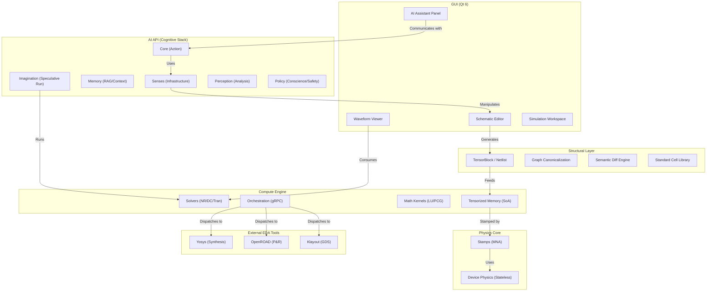

# AcuteSim/CuteApp: Architectural Blueprint & Interconnections

This document provides a high-level map of how the different modules of AcuteSim (Engine) and CuteApp (Application) interconnect to form an AI-native ASIC design platform.

## 🏗 High-Level Module Topology

---

## 🔌 Functional Interconnections

### 1. The Design-to-Simulation Loop
*   **Editor → Substrate**: `gui/editors/schematic_editor.cpp` populates the **Unified DesignDb** (`components/design_db.h`), which acts as the persistent, object-oriented source of truth for connectivity.
*   **Substrate → Snapshot**: `DesignDb` generates an immutable `TensorBlock` snapshot (SoA-ready).
*   **AoS → SoA**: `compute/tensors/physics_tensors.cpp` consumes this snapshot to initialize the `TensorizedBlock` (Structure-of-Arrays).
*   **Stamping & Solving**: `compute/solvers/circuitsim_solver.cpp` orchestrates the Newton-Raphson loop. It calls `physics/circuitsim.h` to stamp the MNA matrix using `physics/stamps.h` and pure kernels from `physics/device_physics.h`. Numerical solving is performed by `compute/math/linalg.h`.
*   **Trace → Visualization**: Results are captured in a `SimulationTrace` (`ai_api/simulation/simulation_trace.h`) and rendered by the `WaveformViewer` or standard Qt widgets in `gui/widgets/`.

### 2. The AI Cognitive Loop (The "Artificial Engineer")
*   **Perception**: `ai_api/analysis/topology_analyzer.h` examines the netlist to identify functional blocks (e.g., "Differential Pair").
*   **Memory**: `ai_api/context/rag_context.h` provides the LLM with relevant snippets from past simulations or documentation.
*   **Action**: `ai_api/system/schema_api.h` allows the AI to programmatically place components or route wires in the `SchematicEditor`.
*   **Conscience**: `ai_api/policy/ai_policy.h` enforces that every AI suggestion must be grounded in raw solver data (residuals, conservation laws).

### 3. The Orchestration Layer (RTL-to-GDS Flow)
*   **Drivers**: `compute/orchestration/drivers/` (e.g., `yosys_task.cpp`, `openroad_task.cpp`) translate high-level design goals into tool-specific TCL/Shell scripts.
*   **Client**: `compute/orchestration/grpc_worker_client.cpp` dispatches these tasks to local or remote workers using gRPC (`worker_service.proto`).
*   **GUI Bridge**: `gui/orchestration/worker_manager.cpp` manages the connection and streams real-time logs back to the user console.

### 4. PDK & Standard Cell Integration
*   **Standard Cells**: `components/standard_cells.h` defines complex gates (and Darlington pairs, OpAmps) as transistor-level subcircuits.
*   **PDK Primitives**: These subcircuits are composed of `PDK_NFET`, `PDK_PFET`, etc., which map to foundry-specific models (e.g., `nfet_01v8`).
*   **Compliance**: `components/pdk_compliance.h` audits the schematic to ensure all components and parameters align with the target process design kit.

### 5. Numerical Authority & Trust
*   **Canonicalization**: `components/graph_canonical.h` generates a unique hash based on circuit topology (BFS from ground), ensuring that identical circuits produce identical results, regardless of visual layout.
*   **Canonicalization**: `components/graph_canonical.h` generates a unique hash based on circuit topology (BFS from ground), ensuring that identical circuits produce identical results, regardless of visual layout.
*   **Trust Surface**: The UI exposes the **KCL Residual Audit** (`calculatePhysicalResiduals`), providing mathematical proof that the simulation converged to a physically valid state.
*   **Paradigm Bridge**: `gui/core/crossprobe_manager.h` maintains a bidirectional map between `DesignDb` UUIDs, GUI elements, and simulation traces, enabling features like cross-probing and Tcl-driven highlighting.

---

## 🤖 Development Rules (Flow Grounding)
1.  **Context First**: Always read the `flow.md` in a directory before modifying its files.
2.  **Stateless Physics**: Keep `device_physics.h` kernels pure and stateless to facilitate parallel/GPU execution.
3.  **Grounding**: AI suggestions must cite specific log lines or introspection data.
4.  **Evidence-First**: Never let the AI explain a failure without first showing the raw solver evidence.
