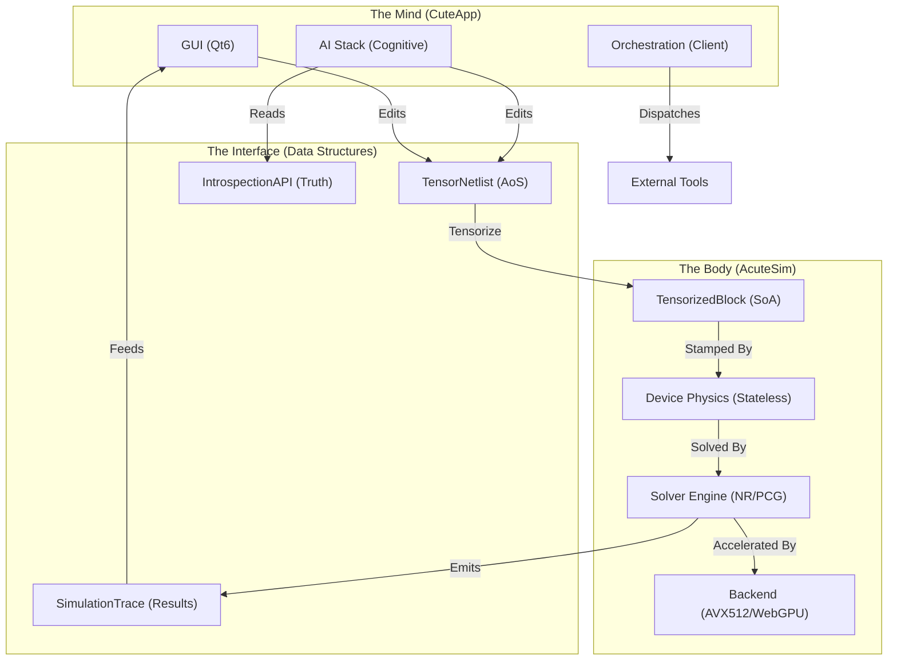

# AcuteSim/CuteApp: Architectural Context & Interconnections

This document provides a comprehensive map of the AcuteSim/CuteApp codebase, detailing how specific files and modules interconnect to form the "Cognitive Foundry."

## 🏗 System Architecture (The "Dual Kernel")

The system is split into two primary domains:
1.  **AcuteSim (The Body)**: A high-performance, stateless physical engine (C++20/Dawn).
2.  **CuteApp (The Mind)**: An AI-native IDE (Qt6) that perceives, reasons, and acts upon the Body.

---

## 🔌 Functional Interconnections (File-Level)

### 1. The Physics Core (Stateless Truth)
*   **Source of Truth**: [`physics/device_physics.h`](file:///Users/seshak/Desktop/CuteApp/physics/device_physics.h) contains the pure, stateless constitutive equations. It is templated (Dual/Double) to support autodiff.
*   **The Bridge**: [`physics/stamps.h`](file:///Users/seshak/Desktop/CuteApp/physics/stamps.h) maps these physical quantities (Current, Conductance) into the Linear Algebra domain (Matrix Stamping).
*   **The Arbiter**: [`physics/circuitsim.h`](file:///Users/seshak/Desktop/CuteApp/physics/circuitsim.h) manages the time-step evolution (`IntegratorArbiter`) and validation (`calculatePhysicalResiduals`).
*   **Key Flow**:
    *   `circuitsim_solver.cpp` (Solver Loop) calls `stampAllElements()`.
    *   `stampAllElements()` invokes `stampSoABlock()` (Batch) or `stampBlockLinear()` (Scalar).
    *   `stampSoABlock()` calls `device_physics.h` kernels via `KernelDispatcher`.

### 2. The Compute Engine (AoS → SoA Pipeline)
*   **Definition (AoS)**: [`components/circuit.h`](file:///Users/seshak/Desktop/CuteApp/components/circuit.h) defines the user-facing `TensorNetlist` (Object-Oriented, easy to edit).
*   **Transformation**: [`compute/tensors/physics_tensors.cpp`](file:///Users/seshak/Desktop/CuteApp/compute/tensors/physics_tensors.cpp) converts this into [`TensorizedBlock`](file:///Users/seshak/Desktop/CuteApp/compute/tensors/physics_tensors.h) (Structure-of-Arrays, SIMD-ready).
*   **Execution**:
    *   [`compute/math/linalg.h`](file:///Users/seshak/Desktop/CuteApp/compute/math/linalg.h): Provides the Matrix/Vector operations (`solvePCG`, `solveLU`).
    *   [`compute/solvers/webgpu_solver.h`](file:///Users/seshak/Desktop/CuteApp/compute/solvers/webgpu_solver.h): Mirrors the SoA structure to GPU buffers for Dawn/WGSL acceleration.

### 3. The GUI Ecosystem (MVC Pattern)
*   **View**: [`gui/editors/schematic_editor.cpp`](file:///Users/seshak/Desktop/CuteApp/gui/editors/schematic_editor.cpp) renders the `GridScene`.
*   **Model**: The scene drives the `TensorNetlist`.
*   **Controller**: [`gui/analysis/simulation_workspace.cpp`](file:///Users/seshak/Desktop/CuteApp/gui/analysis/simulation_workspace.cpp) manages the `SimulationProfile` and triggers the solver.
*   **AI Integration**: [`gui/panels/ai_assistant_panel.cpp`](file:///Users/seshak/Desktop/CuteApp/gui/panels/ai_assistant_panel.cpp) captures user prompts and forwards them to the `ai_api`.

### 4. The AI Cognitive Stack (6 Layers)
*   **Senses**: [`ai_api/system/schema_api.h`](file:///Users/seshak/Desktop/CuteApp/ai_api/system/schema_api.h) allows the AI to "touch" the circuit (`placeComponent`, `routeWire`).
*   **Perception**: [`ai_api/analysis/topology_analyzer.h`](file:///Users/seshak/Desktop/CuteApp/ai_api/analysis/topology_analyzer.h) labels schematics ("Differential Pair").
*   **Memory**: [`ai_api/context/rag_context.h`](file:///Users/seshak/Desktop/CuteApp/ai_api/context/rag_context.h) performs RAG lookup on the `TensorNetlist` state.
*   **Imagination**: [`ai_api/simulation/speculative_runner.h`](file:///Users/seshak/Desktop/CuteApp/ai_api/simulation/speculative_runner.h) runs "What-If" checks (`SpeculativeManager`).
*   **Policy**: [`ai_api/policy/ai_policy.h`](file:///Users/seshak/Desktop/CuteApp/ai_api/policy/ai_policy.h) enforces the "Evidence-First" rule (citations required).
*   **Introspection**: [`ai_api/introspection_api.h`](file:///Users/seshak/Desktop/CuteApp/ai_api/introspection_api.h) is the **Ultimate Truth** the AI sees (Voltages, Residuals, Errors).

### 5. The Orchestration Layer (Hybrid Cloud)
*   **Payload**: [`compute/orchestration/drivers/` (e.g., `yosys_task.cpp`)](file:///Users/seshak/Desktop/CuteApp/compute/orchestration/drivers/yosys_task.cpp) generates TCL scripts from high-level `SynthesisConfig`.
*   **Transport**: [`compute/orchestration/proto/worker_service.proto`](file:///Users/seshak/Desktop/CuteApp/compute/orchestration/proto/worker_service.proto) defines the gRPC contract.
*   **Client**: [`compute/orchestration/grpc_worker_client.cpp`](file:///Users/seshak/Desktop/CuteApp/compute/orchestration/grpc_worker_client.cpp) streams logs to the GUI Console.
*   **Worker**: `acutesim-worker` (standalone binary) executes the actual tools.

### 6. Critical Cross-Cutting Logic
*   **Graph Canonicalization**: [`components/graph_canonical.h`](file:///Users/seshak/Desktop/CuteApp/components/graph_canonical.h). Calculates `topologyHash`.
    *   *Constraint*: Must be orientation-invariant. `Hash(A-B) == Hash(B-A)`.
    *   *Usage*: Used to cache Simulation Results (`SimulationCache`) and RAG Contexts.
*   **Semantic Diffing**: [`components/netlist_diff.h`](file:///Users/seshak/Desktop/CuteApp/components/netlist_diff.h).
    *   *Usage*: Determines if a re-simulation is needed. (e.g., `ChangeType::MODIFIED_PARAMETER` vs `ChangeType::CONNECTIVITY_CHANGED`).

---

## 📜 Development Guidelines (from Flows)

1.  **DoD over OOP**: In `compute/`, always prefer `std::vector<double> R` (SoA) over `std::vector<Resistor>` (AoS) for inner loops.
2.  **Stateless Physics**: `device_physics.h` functions must never have `static` variables or side effects.
3.  **Grounding**: AI suggestions must include citations to `introspection_api` data (e.g., "Residual > 1e-9 at Node 5").
4.  **Flow-First**: Always check the `flow.md` in a directory before adding files to ensure architectural compliance.
