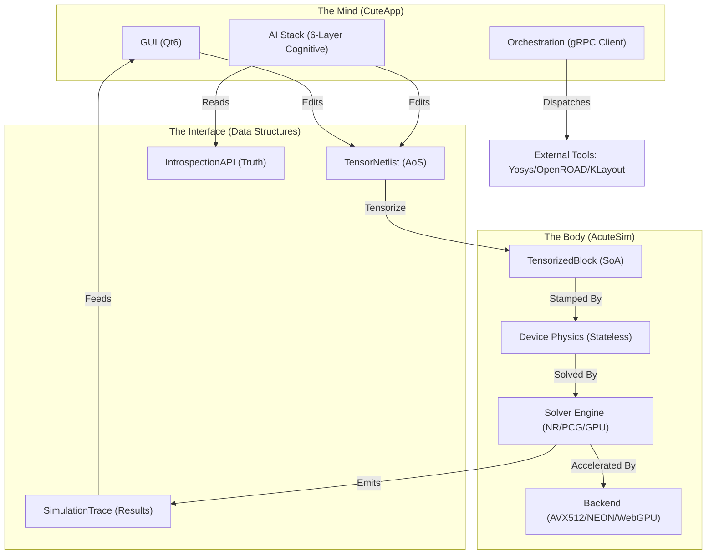

# AcuteSim/CuteApp: Architectural Context & Interconnections

This document provides a comprehensive map of the AcuteSim/CuteApp codebase, detailing how every file and module interconnects to form the "Cognitive Foundry" - an AI-agent/Co-pilot focused ASIC design environment with a Qt6 frontend, custom MNA Tensor backend, and full RTL-to-GDS flow.

**Build**: Qt6 + CMake (C++17) | **Platforms**: macOS/Windows/WASM (Emscripten) | **GPU**: Google Dawn (WebGPU)

---

## System Architecture (The "Dual Kernel")

The system is split into two primary domains:
1. **AcuteSim (The Body)**: A high-performance, stateless physics engine for circuit simulation.
2. **CuteApp (The Mind)**: An AI-native IDE (Qt6) that perceives, reasons, and acts upon the Body.



---

## Complete Directory Structure

```
/CuteApp/
├── main.cpp                          # Entry point (Qt app + CLI modes: --stress, --monte-carlo, --benchmark)
├── CMakeLists.txt                    # Master build config (C++17, FP determinism flags, Dawn, gRPC, Qt6)
├── Roadmap.md                        # 2026 development plan (Cognitive Foundry vision)
├── context.md                        # THIS FILE - architectural interconnection map
├── README.md                         # Quick start guide
│
├── physics/                          # STATELESS device models & solver orchestration
│   ├── device_physics.h              # Pure constitutive equations (Diode/BJT/MOSFET/JFET/Zener)
│   ├── stamps.h                      # MNA matrix stamping patterns (Norton equivalents)
│   ├── circuitsim.h                  # Solver orchestration (IntegratorArbiter, KCL residuals)
│   ├── simulation_profile.h          # Analysis config (DC/AC/Transient + constraints)
│   ├── simulation_intent.h           # User-facing analysis goals
│   ├── corner_config.h               # PVT (Process/Voltage/Temperature) sweep setup
│   ├── design_rules.h                # DRC/LVS rules database
│   ├── physics_constants.h           # Universal/material constants
│   ├── quick_analysis.h/cpp          # Fast pre-simulation checks
│   ├── sensitivity_analysis.h        # Gradient computation (dI/dR, etc.)
│   ├── statistical_engine.h          # Stochastic modeling
│   └── flow.md
│
├── components/                       # STRUCTURAL TRUTH - circuit definitions & serialization
│   ├── circuit.h                     # TensorBlock (immutable def) + BlockState (mutable history) + TensorNetlist
│   ├── graph_canonical.h             # Orientation-invariant topology hashing (BFS canonical relabel)
│   ├── netlist_diff.h                # Semantic diffing (ADDED/REMOVED/MODIFIED_PARAMETER/CONNECTIVITY_CHANGED)
│   ├── standard_cells.h              # Hardcoded PDK cells (Darlington, OpAmps, gates, PDK_AND2/OR2/DFF etc.)
│   ├── component_library.h           # User-defined component persistence (.comp JSON)
│   ├── pdk_manager.h/cpp             # PDK loading & caching
│   ├── pdk_parser.h                  # SPICE netlist parser
│   ├── pdk_compliance.h/cpp          # PDK rule validation
│   ├── netlist_export.h/cpp          # Export: Verilog-A, SPEF, Verilog
│   ├── design_db.h/cpp               # Project database serialization
│   ├── reference_designs.h           # Golden reference circuits
│   ├── subcircuit_validator.h        # Hierarchical correctness checks
│   └── flow.md
│
├── compute/                          # EXECUTION ENGINE - solvers, tensors, math, orchestration
│   ├── tensors/
│   │   ├── physics_tensors.h         # SoA struct defs (DiodeTensor, MosfetTensor, BJTTensor...)
│   │   ├── physics_tensors.cpp       # AoS->SoA conversion (tensorizeBlock) + batch physics wrappers
│   │   ├── kernel_dispatch.h/cpp     # CPU feature detection (AVX-512/NEON) + function pointer binding
│   │   ├── physics_kernels_avx512.cpp # Hand-optimized AVX-512 intrinsics
│   │   └── flow.md
│   ├── solvers/
│   │   ├── circuitsim_solver.cpp     # Newton-Raphson DC/Transient (seeding, GMIN stepping, convergence)
│   │   ├── webgpu_solver.h/cpp       # 6-stage GPU kernel via Google Dawn (EmulatedF64 precision)
│   │   ├── superposition.h/cpp       # Linear decomposition for educational visualization
│   │   └── flow.md
│   ├── math/
│   │   ├── linalg.h                  # CSR sparse matrix + PCG/LU solvers + lock-free TLS assembly
│   │   ├── integration_method.h      # Trapezoidal/Gear-1/Gear-2 time integration strategies
│   │   ├── emulated_f64.h            # Double-double precision for GPU verification
│   │   ├── fpu_control.h             # IEEE-754 rounding enforcement (FE_TONEAREST, no DAZ/FTZ)
│   │   ├── graph_utils.h             # Graph algorithms for connectivity
│   │   └── flow.md
│   ├── infrastructure/
│   │   ├── safe_utils.h              # Bounds checking, NaN detection (sanitize_vector)
│   │   ├── simtrace.h                # Result trace collection (SimulationTrace)
│   │   ├── tensorscheduler.h         # Batch job grouping by topologyHash
│   │   ├── monte_carlo.h             # Statistical sampling framework
│   │   └── flow.md
│   ├── orchestration/
│   │   ├── grpc_worker_client.h/cpp  # gRPC dispatcher to acutesim-worker (PIMPL pattern)
│   │   ├── simulation_context.h      # Transient execution context
│   │   ├── sim_auto_detector.h/cpp   # External tool availability checks
│   │   ├── drivers/
│   │   │   ├── yosys_task.h/cpp      # Verilog synthesis TCL generation
│   │   │   ├── openroad_task.h/cpp   # Place & Route script generation
│   │   │   ├── klayout_task.h/cpp    # Layout viewing command setup
│   │   │   └── flow.md
│   │   ├── server/
│   │   │   ├── worker_server_main.cpp # Headless acutesim-worker executable
│   │   │   ├── worker_service_impl.h  # gRPC service implementation
│   │   │   └── subprocess.h/cpp       # Process spawning & log capture
│   │   ├── proto/
│   │   │   └── worker_service.proto   # gRPC contract (stream-based API)
│   │   └── flow.md
│   ├── generated/
│   │   ├── worker_service.pb.h        # Protobuf message definitions
│   │   └── worker_service.grpc.pb.h   # gRPC service stubs
│   └── flow.md
│
├── autodiff/                         # AUTOMATIC DIFFERENTIATION - Dual numbers
│   ├── dual.h                        # Dual<T> struct (val + grad), operator overloads, std:: specializations
│   └── flow.md
│
├── ai_api/                           # AI COGNITIVE STACK - 6-layer artificial engineer
│   ├── introspection_api.h           # CircuitState (Ultimate Truth: voltages, residuals, convergence, DRC)
│   ├── system/                       # Layer 1: SENSES
│   │   ├── schema_api.h/cpp          # Geometric manipulation (placeComponent, routeWire)
│   │   ├── feedback_loop.h/cpp       # Error reporting & learning
│   │   ├── crash_report.h            # Failure diagnosis
│   │   └── flow.md
│   ├── analysis/                     # Layer 2: PERCEPTION
│   │   ├── topology_analyzer.h/cpp   # Pattern recognition ("Differential Pair", "Bootstrap")
│   │   ├── failure_classifier.h/cpp  # Categorize convergence failures
│   │   ├── failure_taxonomy.h        # Enumeration of failure modes
│   │   ├── drc_engine.h              # Rule violation detection
│   │   └── flow.md
│   ├── context/                      # Layer 3: MEMORY
│   │   ├── rag_context.h/cpp         # RAG vector store for past designs
│   │   ├── context_engine.h/cpp      # Short-term prompt context management
│   │   ├── prompt_builder.h/cpp      # Assemble AI system prompts
│   │   ├── safe_io.h                 # Secure file I/O for context
│   │   └── flow.md
│   ├── simulation/                   # Layer 4: IMAGINATION
│   │   ├── speculative_runner.h/cpp  # Fork & test hypotheses (const-safe cloning)
│   │   ├── simulation_api.h          # High-level simulation interface
│   │   ├── simulation_trace.h/cpp    # Waveform trace collection + TraceFailure modes
│   │   ├── trace_builder.h           # Incremental trace assembly
│   │   ├── trace_chunker.h           # Time-domain chunking for AI context
│   │   ├── speculative_indexing.h    # Efficient hypothesis indexing
│   │   ├── local_vector_store.h      # Embedding-based similarity search (counterfactuals)
│   │   ├── auto_harness.h/cpp        # Automated test bench generation
│   │   └── flow.md
│   ├── core/                         # Layer 5: ACTION
│   │   ├── ai_interface.h            # Action dispatcher (JSON -> Circuit change)
│   │   ├── circuit_templates.h       # Common subcircuit patterns
│   │   ├── nl_parser.h               # Netlist parsing for AI
│   │   └── flow.md
│   ├── policy/                       # Layer 6: CONSCIENCE
│   │   ├── ai_policy.h               # "Evidence-First" validation, citation enforcement
│   │   └── flow.md
│   └── flow.md
│
├── gui/                              # QT6 IDE FRONTEND - VS Code-style ASIC design environment
│   ├── core/                         # Application skeleton
│   │   ├── mainwindow.cpp/h          # App shell: mode management (Bench/Block/System), toolbar, menus
│   │   ├── docking_manager.cpp/h     # VS Code-style panel management (lazy creation, tab promotion)
│   │   ├── layout_manager.cpp/h      # Workspace preset persistence (save/restore geometry)
│   │   ├── storage_manager.cpp/h     # Project persistence (Qt 6.9.3 WASM IndexedDB compat)
│   │   ├── editor_manager.cpp/h      # Editor tab lifecycle
│   │   ├── hierarchy_path.cpp/h      # Breadcrumb-style hierarchical navigation
│   │   ├── subcircuit_resolver.cpp/h # Recursive .sch loading for ICPackage drill-down
│   │   ├── crossprobe_manager.cpp/h  # Schematic <-> Simulation bidirectional linking
│   │   ├── sim_auto_detector.cpp/h   # Auto-detection of simulation readiness
│   │   └── flow.md
│   ├── editors/                      # Content creation tools
│   │   ├── schematic_editor.cpp/h    # 2D vector canvas (GridScene, placement, routing, AI hooks)
│   │   ├── schematic_editor_api.cpp  # AI-facing placement APIs
│   │   ├── schematic_editor_sync.cpp # Bi-directional HDL synchronization
│   │   ├── schematic_view.cpp/h      # QGraphicsView subclass (rendering viewport)
│   │   ├── code_editor.cpp/h         # Verilog/VHDL syntax-highlighting text editor
│   │   ├── component_wizard.cpp/h    # Subcircuit packaging workflow
│   │   ├── component_browser.h       # Library browsing
│   │   └── flow.md
│   ├── analysis/                     # Simulation & validation
│   │   ├── simulation_workspace.cpp/h # Simulation profile management, batching, engine selection
│   │   ├── simulation_worker.cpp/h   # Multithreaded solver dispatch (background thread)
│   │   ├── simulation_explorer.cpp/h # Result waveform browsing (tree view)
│   │   ├── erc_engine.h              # Real-time Electrical Rule Check
│   │   ├── erc_autofix.h             # DRC/ERC auto-correction (A* pathfinding)
│   │   ├── logic_analyzer.cpp/h      # Digital probe waveforms (bus support)
│   │   ├── statistical_dashboard.cpp/h # Monte Carlo yield/sensitivity visualization
│   │   ├── corner_setup_widget.cpp/h # PVT corner configuration UI
│   │   ├── system_inspector.cpp/h    # Environmental variables (VDD, Temp, Noise)
│   │   └── flow.md
│   ├── components/                   # Visual primitives
│   │   ├── visual_component.cpp/h    # Base class: VisualComponent + VisualWire (QGraphicsObject)
│   │   ├── probe_tip.cpp/h           # Interactive voltage probes
│   │   ├── standard_cell_visualizer.cpp/h # PDK cell rendering
│   │   └── flow.md
│   ├── panels/                       # Conversational interfaces
│   │   ├── ai_assistant_panel.cpp/h  # Chat interface + review cards + approval flow
│   │   └── flow.md
│   ├── ai/                           # AI state management (GUI-side)
│   │   ├── ai_action_envelope.h      # Secure courier: wraps AI suggestions (Type + Confidence + Payload)
│   │   ├── ai_action_history.h/cpp   # Undo/Redo for AI actions (atomic grouping)
│   │   └── flow.md
│   ├── orchestration/                # Worker connection bridge
│   │   ├── worker_manager.cpp/h      # gRPC WorkerClient lifecycle + Qt signal bridging
│   │   ├── worker_status_panel.cpp/h # Real-time worker health UI
│   │   └── flow.md
│   ├── scripting/                    # Automation hooks
│   │   ├── tcl_bridge.cpp/h          # Tcl/Python automation interface
│   │   └── flow.md
│   ├── styling/                      # Theme engine
│   │   ├── theme_manager.cpp/h       # Dark/Light/High Contrast theme loading
│   │   └── flow.md
│   ├── widgets/                      # Reusable UI components (22 files)
│   │   ├── waveform_widget.cpp/h     # Oscilloscope-style plot (pinch-to-zoom, multi-trace)
│   │   ├── breadcrumb_widget.cpp/h   # Hierarchical navigation bar
│   │   ├── command_palette.cpp/h     # VS Code-style Ctrl+Shift+P action launcher
│   │   ├── project_explorer.cpp/h    # File tree browser
│   │   ├── project_model.cpp/h       # Virtual file system (QAbstractItemModel)
│   │   ├── output_dock_widget.cpp/h  # Console/log viewer
│   │   ├── terminal_widget.cpp/h     # Interactive shell (REPL)
│   │   ├── toast_manager.cpp/h       # Non-intrusive notification system
│   │   ├── problems_panel.cpp/h      # ERC/DRC violation list (navigable)
│   │   ├── compliance_report_dialog.cpp/h # DRC report viewer
│   │   ├── component_library.cpp/h   # Standard cell palette (mode-filtered)
│   │   ├── debug_suggestions_panel.cpp/h  # AI-driven probe recommender
│   │   ├── ghost_diff_viewer.cpp/h   # AI suggestion diff preview (accept/reject)
│   │   ├── design_flow.cpp/h         # ASIC lifecycle state machine
│   │   ├── search_dock.cpp/h         # Find & replace
│   │   ├── trust_badge_widget.cpp/h  # Proof-of-Correctness indicator (residuals, method, provenance)
│   │   ├── keybindings_dialog.cpp/h  # Shortcut editor with conflict detection
│   │   ├── activity_bar.cpp/h        # VS Code-style sidebar
│   │   ├── icon_provider.cpp/h       # SVG icon management
│   │   ├── platform_helper.cpp/h     # OS-specific helpers
│   │   ├── keybinding_manager.cpp/h  # Input routing (context-aware shortcuts)
│   │   └── flow.md
│   └── flow.md
│
├── resources/                        # Static assets
│   ├── cells/*.sch                   # Reference schematic designs (13 files)
│   ├── pdk/sky130.json               # Sky130 process kit definition
│   ├── themes/*.json                 # Dark Modern, Light Modern, High Contrast
│   └── icons/*.svg                   # GUI icons (QRC resource)
│
├── tests/                            # Verification framework (60+ test files)
│   ├── test_flow.cpp                 # Main integration test (27KB)
│   ├── test_physics_kernels.cpp      # BJT/MOSFET/Diode physics verification
│   ├── test_transient.cpp            # Time-stepping accuracy
│   ├── test_emulated_f64.cpp         # GPU precision validation
│   ├── test_dual_emulated.cpp        # Autodiff + EmulatedF64
│   ├── test_fpu_determinism.cpp      # IEEE-754 reproducibility
│   ├── test_sensitivity.cpp          # Gradient verification (AD vs finite diff)
│   ├── test_linalg_improvements.cpp  # Matrix solver correctness
│   ├── test_superposition.cpp        # Linear decomposition
│   ├── test_soa_bridge.cpp           # SoA tensor parity
│   ├── test_kernel_dispatch.cpp      # SIMD routing verification
│   ├── test_subcircuit.cpp           # Hierarchical instantiation
│   ├── test_std_cells.cpp            # Standard library validation
│   ├── test_mode_ladder.cpp          # Ladder network analysis
│   ├── test_multi_domain_power.cpp   # Multiple supply domains
│   ├── test_gui_logic.cpp            # Headless editor operations
│   ├── test_docking_interaction.cpp  # Panel management
│   ├── test_hierarchical_sim.cpp     # Subcircuit drilling
│   ├── test_verilog_export.cpp       # Netlist generation
│   ├── test_spef_export.cpp          # Parasitic extraction
│   ├── test_export_consistency.cpp   # Round-trip fidelity
│   ├── test_introspection.cpp        # CircuitState API
│   ├── test_ai_simulation_intelligence.cpp # Speculative runner
│   ├── test_copilot_validate.cpp     # End-to-end AI flow
│   ├── test_determinism.cpp          # Cross-platform parity
│   ├── test_diff.cpp                 # Semantic diffing
│   ├── test_erc_rules.cpp            # DRC/ERC enforcement
│   ├── test_pdk_compliance.cpp       # PDK rule validation
│   ├── test_pdk_manager.cpp          # Library management
│   ├── test_pdk_swap.cpp             # PDK switching
│   ├── test_worker_connectivity.cpp  # gRPC transport
│   ├── regression_suite.h            # Cross-platform golden comparison
│   ├── regression_golden.db          # Golden baseline (JSON, with OS/Compiler metadata)
│   ├── benchmark_suite.h             # Performance profiling
│   ├── stress_test.h                 # Robustness (10,000+ random circuits)
│   ├── monte_carlo.h                 # Statistical sampling
│   ├── parity_harness.py             # Python gRPC agent for cross-platform 0-bit parity
│   └── flow.md
│
└── scripts/                          # DevOps utilities
    ├── setup_dependencies.sh         # Build environment setup
    ├── kill_web.sh/ps1               # WASM dev helper
    ├── serve.py                       # Local WASM HTTP server
    └── flow.md
```

---

## Functional Interconnections (File-Level)

### 1. The Physics Core (Stateless Truth)

**Source of Truth**: `physics/device_physics.h` - Pure, stateless constitutive equations templated for `double` and `Dual<T>` (autodiff).
- Diode: `diode_current_clamped(vd, params)` - Shockley equation + linear continuation above exp(30)
- BJT: `bjt_collector_current(vbe, vbc, params)` - Gummel-Poon model with thermal effects
- MOSFET: `mosfet_ids(vgs, vds, params)` - Charge-based EKV or Level-1
- JFET, Zener: Additional device models
- PNJLIM: `pnjlim(vnew, vold, vt, vcrit)` - SPICE-style voltage limiting to dampen NR oscillations

**The Bridge**: `physics/stamps.h` maps physical quantities (Current, Conductance) into Linear Algebra (MNA matrix entries).
- Voltage sources as Norton equivalents to minimize matrix fill-in
- `stampVoltageSourceAsNorton()`, `stampResistor()`, `stampCapacitor()` (history-dependent companion model)
- Batch interface: `matrixBuilder.addBatch(...)` for SoA physics results

**The Arbiter**: `physics/circuitsim.h` manages the solver loop.
- `IntegratorArbiter`: LTE checking + Lyapunov energy validation (adaptive time-stepping)
- `calculatePhysicalResiduals()`: KCL conservation audit using EXACT physics (no clamping)
- `stampAllElements()` entry point dispatches to `stampSoABlock()` (batch) and `stampBlockLinear()` (scalar)

**Key Flow**:
```
circuitsim_solver.cpp -> stampAllElements() -> stampSoABlock() -> KernelDispatcher -> device_physics.h
                                             -> stampBlockLinear() -> stamps.h (scalar path)
```

### 2. The Compute Engine (AoS -> SoA Pipeline)

**Definition (AoS)**: `components/circuit.h` defines the user-facing `TensorNetlist`:
- `TensorBlock`: Immutable definition (vectors of Resistor, Capacitor, Diode, BJT, MOSFET, etc.)
- `BlockState`: Mutable history (capacitor voltages, inductor currents) - unique per simulation instance
- `TensorNetlist`: Root object = `globalBlock` + `globalState` + `instances[]` + `instanceStates[]`

**Transformation**: `compute/tensors/physics_tensors.cpp` converts AoS to SoA:
- `tensorizeBlock()`: Packs objects into contiguous `TensorizedBlock` (DiodeTensor, MosfetTensor, etc.)
- Safety clamping at conversion boundary (e.g., R_MIN_SAFE = 0.5 Ohm)

**Dispatch**: `compute/tensors/kernel_dispatch.h/cpp`:
- CPUID detection at startup -> binds function pointers to AVX-512, NEON, or Generic kernels
- Single dispatch (checked ONCE, not per loop)
- `physics_kernels_avx512.cpp`: 512-bit registers, 8 doubles per cycle

**Math**: `compute/math/linalg.h`:
- `MatrixConstructor`: Lock-free TLS buffers for parallel stamping (`omp_get_thread_num`)
- `createCsr()`: Parallel merge + dedup of triplets into CSR format
- `solvePCG()`: Iterative, Jacobi-preconditioned (good for large passive grids)
- `solveLU_Pivoted()`: Direct, robust (mandatory fallback for active/small circuits)
- Auto-selection: `hasActiveDevices ? LU : PCG` with PCG->LU fallback

**Time Integration**: `compute/math/integration_method.h`:
- Strategy pattern: `IIntegrationMethod` -> Trapezoidal (default), Gear-1 (max stability), Gear-2 (BDF2)
- Stamps capacitor companion models based on selected method

**GPU**: `compute/solvers/webgpu_solver.h/cpp`:
- Google Dawn backend, 6-stage persistent NR kernel (no host-device round-trips)
- EmulatedF64 (hi-lo f32 pairs) for SPICE-level precision without native f64
- SoA tensor layout mirrors CPU `TensorizedBlock` 1:1

**Safety**: `compute/infrastructure/safe_utils.h`:
- `sanitize_vector`: NaN/Inf scrubbing after each solve
- `simtrace.h`: Result trace collection for GUI visualization

**Scheduling**: `compute/infrastructure/tensorscheduler.h`:
- Groups hierarchical instances by `topologyHash` into `SolverJob` batches

**Full Pipeline**:
```
TensorNetlist (AoS, user-friendly)
  -> tensorizeBlock() -> TensorizedBlock (SoA, SIMD-ready)
  -> KernelDispatcher -> select AVX512/NEON/Generic
  -> batchDiodePhysics / batchMosfetPhysics (branchless, contiguous)
  -> MatrixConstructor (lock-free parallel stamping)
  -> createCsr() (parallel merge)
  -> solveLU_Pivoted / solvePCG (or WebGPU 6-stage kernel)
  -> sanitize_vector() + calculatePhysicalResiduals()
  -> SimulationTrace (time-series voltages)
  -> GUI WaveformWidget
```

### 3. The GUI Ecosystem (MVC + 4 Layers)

**Layer 1 - Interaction** (User <-> Agent):
- `gui/panels/ai_assistant_panel.cpp/h`: Chat interface, review cards, approval flow
  - Emits `querySubmitted(text)` -> processed by WorkerManager -> returns `SchematicChangeRequest`
- `gui/orchestration/worker_manager.cpp/h`: gRPC bridge (async callbacks -> Qt signals)
- `gui/scripting/tcl_bridge.cpp/h`: Tcl/Python automation hooks

**Layer 2 - Creative** (Design):
- `gui/editors/schematic_editor.cpp/h`: 2D vector canvas with GridScene
  - `toNetlist()`: Compiles scene -> TensorNetlist
  - `placeComponent()`, `placeWirePath()`: AI-accessible manipulation API
  - `requestOpenSubcircuit(path)`: Hierarchical drill-down
  - `schematic_editor_api.cpp`: AI-facing placement APIs
  - `schematic_editor_sync.cpp`: Bi-directional HDL synchronization
- `gui/editors/code_editor.cpp/h`: Verilog/VHDL syntax-highlighting editor
- `gui/editors/component_wizard.cpp/h`: Subcircuit packaging workflow
- `gui/ai/ai_action_envelope.h`: Wraps AI suggestions (Type + Confidence + Payload)
- `gui/ai/ai_action_history.h/cpp`: Undo/Redo stack for AI actions (atomic grouping)

**Layer 3 - Scientific** (Analysis):
- `gui/analysis/simulation_workspace.cpp/h`: Profile management, engine selection (Legacy/SoA/SIMD/GPU)
- `gui/analysis/simulation_worker.cpp/h`: Background thread solver dispatch
- `gui/analysis/simulation_explorer.cpp/h`: Run history tree view
- `gui/analysis/erc_engine.h`: Real-time ERC (Floating nodes, shorts, mode violations)
- `gui/analysis/erc_autofix.h`: A* pathfinding fix suggestions
- `gui/analysis/logic_analyzer.cpp/h`: Digital logic waveform viewer
- `gui/analysis/statistical_dashboard.cpp/h`: Monte Carlo yield/sensitivity charts
- `gui/analysis/corner_setup_widget.cpp/h`: PVT corner configuration
- `gui/analysis/system_inspector.cpp/h`: Environmental controls (VDD, Temp, Noise)

**Layer 4 - Foundation** (Building blocks):
- `gui/core/mainwindow.cpp/h`: App skeleton, mode management (Bench/Block/System)
- `gui/core/docking_manager.cpp/h`: VS Code-style panel management (singleton access to all docks)
- `gui/core/layout_manager.cpp/h`: Workspace presets (save/restore from QSettings)
- `gui/core/storage_manager.cpp/h`: WASM IndexedDB persistence layer
- `gui/core/editor_manager.cpp/h`: Editor tab lifecycle
- `gui/core/hierarchy_path.cpp/h`: Breadcrumb navigation state
- `gui/core/subcircuit_resolver.cpp/h`: Recursive .sch loading for ICPackage components
- `gui/core/crossprobe_manager.cpp/h`: Schematic <-> Simulation linking
- `gui/components/visual_component.cpp/h`: `VisualComponent` + `VisualWire` (QGraphicsObject)
  - `ComponentType` enum: Resistor, Capacitor, ..., PDK_NFET, PDK_AND2, ..., ICPackage
  - `GhostState`: None/Preview/Focused/Accepted/Rejected (for AI suggestions)
  - Terminals must align to GRID_STEP (20px)
- `gui/styling/theme_manager.cpp/h`: Dark/Light/High Contrast JSON themes

**Key Widgets** (`gui/widgets/`):
- `waveform_widget.cpp/h`: Oscilloscope plot (pinch-to-zoom, multi-trace, DesignDb net renaming)
- `command_palette.cpp/h`: VS Code-style Ctrl+Shift+P fuzzy action launcher
- `project_explorer.cpp/h` + `project_model.cpp/h`: File tree browser + virtual file system
- `ghost_diff_viewer.cpp/h`: AI suggestion diff preview (accept/reject signals)
- `trust_badge_widget.cpp/h`: Proof-of-Correctness (method, iterations, max residual, provenance)
- `toast_manager.cpp/h`: Non-modal notifications
- `problems_panel.cpp/h`: ERC/DRC violation list with click-to-navigate
- `design_flow.cpp/h`: ASIC lifecycle state machine (RTL -> Synthesis -> Physical -> Verification)
- `debug_suggestions_panel.cpp/h`: AI probe recommender

**GUI Data Flow (AI Interaction)**:
```
1. User types "Add a 10k resistor" in AiAssistantPanel
2. querySubmitted() -> WorkerManager ships to external worker
3. Worker uses ai_api logic to determine action
4. JSON SchematicChangeRequest returns
5. gui/ai wraps in AiActionEnvelope (confidence score)
6. gui/panels renders "Ghost" preview via gui/editors
7. User clicks "Approve" -> AiActionHistory.push() -> SchematicEditor commits to GridScene
```

### 4. The AI Cognitive Stack (6 Layers)

**Introspection Layer** (Center): `ai_api/introspection_api.h`
```cpp
struct CircuitState {
    string name; uint64_t topologyHash; string precision;
    vector<double> nodeVoltages; double residual; bool converged; int drcErrors;
    string toJSON() const;
};
```

**Layer 1 - Senses** (`ai_api/system/`):
- `schema_api.h/cpp`: `placeComponent(type, position)`, `routeWire(path)` - geometric manipulation
- `feedback_loop.h/cpp`: Error reporting and learning from failures
- `crash_report.h`: Captures diagnostic info on simulation failures

**Layer 2 - Perception** (`ai_api/analysis/`):
- `topology_analyzer.h/cpp`: Labels schematics ("Differential Pair", "Darlington", "Floating Node")
- `failure_classifier.h/cpp`: Categorizes failures ("Singular Jacobian", "Non-convergence")
- `failure_taxonomy.h`: Complete enumeration of failure modes

**Layer 3 - Memory** (`ai_api/context/`):
- `rag_context.h/cpp`: RAG vector store for past designs (keyed by topologyHash)
- `context_engine.h/cpp`: Assembles short-term prompt context from circuit state
- `prompt_builder.h/cpp`: Constructs system prompts for external LLM

**Layer 4 - Imagination** (`ai_api/simulation/`):
- `speculative_runner.h/cpp`: Forks netlist, applies hypothesis (e.g., GMIN resistor), verifies convergence
  - CONST-safe: never modifies original TensorNetlist
  - Resource bounded: default 1e-6s duration
  - Can target GPU (Dawn) for batch speculative analysis
- `simulation_trace.h/cpp`: Trace schema + `TraceFailure` modes + RAG chunks
- `local_vector_store.h`: Counterfactual lookup ("same topology, different config")
- `auto_harness.h/cpp`: Automated stimulus injection + output verification

**Layer 5 - Action** (`ai_api/core/`):
- `ai_interface.h`: JSON -> structured action dispatch
- `circuit_templates.h`: Common subcircuit patterns for quick generation
- `nl_parser.h`: Netlist parsing utilities

**Layer 6 - Conscience** (`ai_api/policy/`):
- `ai_policy.h`: Evidence-First enforcement - every suggestion must cite specific data
  - Citations point to: log lines, introspection data, or design rules
  - Prevents hallucination by grounding in `CircuitState`

**Cognitive Loop Example ("Fix the crash")**:
```
1. Sensing:  introspection_api captures CircuitState + CrashReport
2. Perception: failure_classifier labels "Singular Jacobian" at Darlington topology
3. Memory:  rag_context retrieves similar past crashes
4. Imagination: speculative_runner forks netlist, adds GMIN resistor, verifies convergence
5. Action:  ai_interface generates placeComponent command
6. Conscience: ai_policy ensures explanation cites GMIN log lines + residual data
7. Output:  "Fixed singularity by adding 1G Ohm resistor. Sim converged [Residual: 1e-13]"
```

### 5. The Orchestration Layer (Hybrid Cloud/Local)

**Architecture**: 4-layer stack with separation of concerns:

| Layer | Directory | Responsibility | Key File |
|-------|-----------|---------------|----------|
| Semantic | `drivers/` | Payload generation (Intent -> TCL/Shell) | `yosys_task.h`, `openroad_task.h`, `klayout_task.h` |
| Transport | `proto/` | gRPC wire format (stream API) | `worker_service.proto` |
| Client | `orchestration/` | Dispatch + log streaming | `grpc_worker_client.h/cpp` |
| Worker | `server/` | Headless execution (`acutesim-worker`) | `worker_server_main.cpp`, `subprocess.h` |

**Execution Pipeline**:
```
User clicks "Synthesize"
  -> YosysTask::generateTcl(config) generates TCL script
  -> WorkerClient::runSynthesis() bundles request
  -> gRPC stream to acutesim-worker
  -> WorkerServiceImpl spawns Subprocess (yosys/openroad/klayout)
  -> Logs streamed back via gRPC
  -> GUI Console displays results
```

**Guards**:
- `#ifdef ACUTESIM_ENABLE_ORCHESTRATION`: All gRPC code guarded for WASM builds
- PIMPL pattern in `WorkerClient` hides gRPC headers from rest of codebase
- `parity_harness.py`: Python agent for cross-platform 0-bit numerical parity verification

### 6. The Autodiff Subsystem

`autodiff/dual.h`: Forward-mode AD via Dual Numbers.
- `Dual<T>` struct carries value (`.val`) and gradient (`.grad`)
- Operator overloads enforce Chain Rule automatically
- `std::exp/sin/cos` specialized in `namespace std` for ADL compatibility
- Control flow (`<`, `>`) depends ONLY on `.val` (NASA Principle)
- Used by `physics/device_physics.h` via template parameter: `T = Dual<double>` for Jacobian assembly
- Also supports `Dual<EmulatedF64>` for GPU precision verification

### 7. Critical Cross-Cutting Logic

**Graph Canonicalization**: `components/graph_canonical.h`
- Calculates `topologyHash` via BFS canonical relabeling from Ground (Node 0)
- Orientation-invariant: `Hash(A-B) == Hash(B-A)`
- Used to cache simulation results and RAG contexts
- CONSTRAINT: Must stay in sync with `TensorBlock` changes

**Semantic Diffing**: `components/netlist_diff.h`
- Categories: ADDED, REMOVED, MODIFIED_PARAMETER, CONNECTIVITY_CHANGED
- Returns `SimImpact` score: NONE (label change) -> LOW -> MEDIUM (value change) -> HIGH (connectivity/full re-solve)
- AI speculative runner uses this to decide: re-simulate or skip

**Floating-Point Determinism**: Enforced across the entire stack
- `compute/math/fpu_control.h`: `FPUControl::enforceDeterminism()` locks FE_TONEAREST, no DAZ/FTZ
- CMake flags: `-fno-fast-math`, `-frounding-math`, `-ffloat-store` (GCC), `/fp:strict` (MSVC)
- Tests: `test_fpu_determinism.cpp`, `test_determinism.cpp`
- WASM validated to 0-bit deviation vs desktop

**State Hygiene**:
- `TensorBlock`: Immutable definition (R values, model params) - reused across instances
- `BlockState`: Mutable history (capacitor voltage, inductor current) - unique per sim instance
- RULE: History buffers NEVER stored in TensorBlock; only in BlockState

**Thread Safety**:
- Matrix assembly: TLS buffers in `MatrixConstructor`, not mutexes
- `#pragma omp parallel for` on disjoint data with reductions for shared accumulation
- GUI: Heavy compute in background threads; Qt signals bridge to main thread

---

## Entry Point & Application Startup

`main.cpp`:
1. CLI modes: `--stress` (StressHarness), `--monte-carlo` (MonteCarloRunner), `--benchmark` (GoldBench)
2. `Q_INIT_RESOURCE(icons)` - initialize Qt resources
3. Platform-specific Qt plugin path setup (macOS homebrew / WASM screen sizing)
4. `QApplication` + Fusion style + `ThemeManager::loadTheme("Dark")`
5. `MainWindow w` -> `w.showMaximized()` (desktop) or `w.show()` (WASM, browser-sized)

WASM-specific: `statx` shim for Emscripten 3.1.56+ vs Qt 6.9.3 compatibility; `dumpStorageFile` debug helper.

---

## Build System (CMakeLists.txt)

- **Project**: AcuteSim VERSION 1.0, C++17
- **FP Determinism**: `-fno-fast-math`, `-ffloat-store` (GCC), `/fp:strict` (MSVC) - MANDATORY
- **Qt6 Discovery**: Platform-aware (macOS homebrew, Windows C:/Qt auto-detect, Emscripten)
- **Google Dawn**: FetchContent integration for WebGPU backend
- **gRPC/Protobuf**: Required for orchestration (guarded by `ACUTESIM_ENABLE_ORCHESTRATION`)
- **OpenMP**: Optional parallelism for matrix assembly
- **Targets**:
  - `AcuteSim`: Main executable (~200 source files)
  - `acutesim-worker`: Standalone gRPC server
  - 50+ test executables via CTest
- **Presets**: `macos-clang`, `windows-msvc`, `emscripten`

---

## Key Data Structures

### Circuit Representation (`components/circuit.h`)
```cpp
struct TensorBlock {                    // IMMUTABLE definition
    vector<Resistor> resistors;         // {name, node1, node2, R, tc1, tc2}
    vector<Capacitor> capacitors;       // {name, plate1, plate2, C}
    vector<Inductor> inductors;         // {name, node1, node2, L}
    vector<Diode> diodes;              // {name, anode, cathode, Is, N}
    vector<BJT> bjts;                  // {name, B, C, E, Is, Bf, Br}
    vector<MOSFET> mosfets;            // {name, D, G, S, W, L, Vth}
    vector<VoltageSource> sources;     // {name, pos, neg, V}
    vector<ICPackage> instances;       // Hierarchical subcircuits (sourceFile -> .sch)
};

struct BlockState {                     // MUTABLE simulation state
    vector<double> capacitorVoltageHistory;
    vector<double> inductorCurrentHistory;
};

struct TensorNetlist {                  // ROOT object
    TensorBlock globalBlock; BlockState globalState;
    vector<ICPackage> instances; vector<BlockState> instanceStates;
};
```

### SoA Tensors (`compute/tensors/physics_tensors.h`)
```cpp
struct DiodeTensor { vector<int> anodes, cathodes; vector<double> Is, v_d, i_d, g_d; };
struct MosfetTensor { vector<int> drains, gates, sources; vector<double> W, L, vgs, ids; };
struct TensorizedBlock { DiodeTensor diodes; MosfetTensor mosfets; BJTTensor bjts; ... };
```

### AI Introspection (`ai_api/introspection_api.h`)
```cpp
struct CircuitState {
    string name; uint64_t topologyHash; string precision;
    vector<double> nodeVoltages; double residual; bool converged; int drcErrors;
};
```

---

## Subsystem Dependency Graph

```
                    ┌──────────────┐
                    │   main.cpp   │
                    └──────┬───────┘
                           │
              ┌────────────┼────────────┐
              v            v            v
      ┌──────────┐  ┌───────────┐  ┌──────────┐
      │  gui/    │  │  tests/   │  │ scripts/ │
      │ (Qt6 UI)│  │(CTest)    │  │(DevOps)  │
      └────┬─────┘  └─────┬─────┘  └──────────┘
           │               │
    ┌──────┴──────┐   ┌───┴───┐
    v             v   v       v
┌────────┐  ┌─────────┐  ┌──────────┐
│ ai_api │  │compute/ │  │components│
│(Cognit)│  │(Engine) │  │(Struct)  │
└───┬────┘  └────┬────┘  └────┬─────┘
    │            │             │
    └──────┬─────┘       ┌────┘
           v             v
      ┌─────────┐  ┌──────────┐
      │physics/ │  │autodiff/ │
      │(Models) │  │(Dual<T>) │
      └─────────┘  └──────────┘
```

**Dependency rules** (flow DOWNWARD only):
- `gui/` -> `ai_api/`, `compute/`, `components/`, `physics/`
- `ai_api/` -> `compute/`, `components/`, `physics/`
- `compute/` -> `components/`, `physics/`, `autodiff/`, `compute/math/`
- `physics/` -> `autodiff/`, `components/` (for TensorBlock types)
- `autodiff/` -> (no dependencies - foundational)
- `components/` -> (no dependencies - structural truth)

---

## Development Guidelines (from flow.md files)

1. **DoD over OOP**: In `compute/`, prefer `vector<double> R` (SoA) over `vector<Resistor>` (AoS) for inner loops.
2. **Stateless Physics**: `device_physics.h` functions must never have `static` variables or side effects.
3. **Grounding**: AI suggestions must include citations to `introspection_api` data.
4. **Flow-First**: Always check the `flow.md` in a directory before adding files.
5. **Branchless Math**: Within batch functions, use `std::max(0.0, v)` not `if(v > 0)`.
6. **GPU Mirror**: Any field added to `TensorizedBlock` must be mirrored in `webgpu_solver.h` buffers.
7. **Topology Sync**: Changes to `TensorBlock` must update `graph_canonical.h` hash.
8. **Semantic Diff**: Changes to `TensorBlock` must update `netlist_diff.h` detection.
9. **Thread Safety**: Use TLS buffers in hot paths, Qt signals for GUI bridging.
10. **No Direct Physics in Widgets**: Widgets are dumb renderers; logic in `core/` or `analysis/`.
11. **AI Via Envelope**: AI never touches QGraphicsScene directly; always through `AiActionEnvelope`.
12. **ADL for Generics**: Use unqualified `exp()` not `std::exp` in templated physics (supports `Dual<T>`).
13. **WASM Guards**: gRPC code under `#ifdef ACUTESIM_ENABLE_ORCHESTRATION`.

---

## Roadmap Summary (2026 Vision)

| Phase | Quarter | Focus |
|-------|---------|-------|
| 0-2 | Q1 | Physics Core, Tensor Foundations, WASM Parity, Numerical Authority |
| 3-5 | Q2 | Hierarchical Drill-Down, PDK Compliance, Standard IR Exports (SPEF/Verilog) |
| 6-8 | Q3 | GDSII Layout Editor, Harmonic Balance Solver, Simulation Orchestration |
| 9-14 | Q4 | Unified Project Mgmt, Mixed-Signal (AMS) Engine, GPU Solvers |

**Cognitive Milestones**: Neuro-Symbolic AI (Q2), Generative Analog RL (Q3), STCO 3D + Thermal GNNs + Secure Enclaves (Q4).

**Phase Gates**: DC/Transient regression >99% (Phase 1) -> AC+Noise+Corners (Phase 2) -> Tapeout-Adjacent (Phase 3).

---

## Current State (Git)

**Modified**: CMakeLists.txt, simulation_workspace.cpp/h, mainwindow.cpp, schematic_editor.cpp, visual_component.cpp/h, theme_manager.cpp/h
**New (Untracked)**: simulation_worker.cpp/h (multithreaded solver dispatch)

**Recent Commits**:
1. `0f06bea` - Editor management, HDL editor, hierarchy path, subcircuit resolution, PDK cells
2. `aa4f4c8` - gRPC worker orchestration with determinism tests
3. `090f9c3` - WebGPU integration with solver updates
4. `6e44596` - WebGPU Newton-Raphson solver with GPU connectivity tests
5. `073ddfd` - Netlist export (Verilog-A, SPEF)
